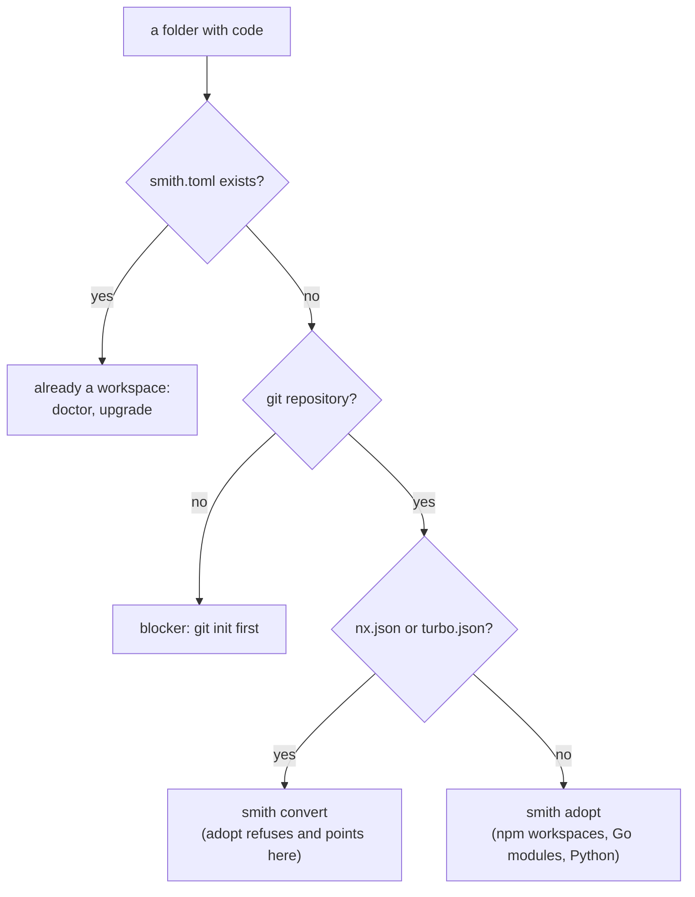
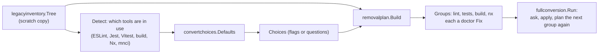
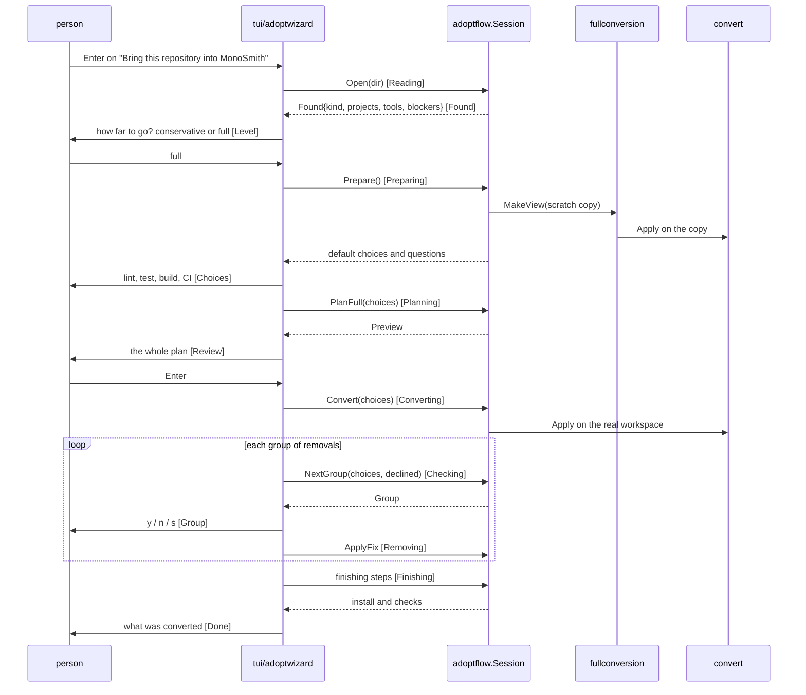

# How adopt and convert work

`smith adopt` and `smith convert` bring an existing repository under smith. They share a rule: read
first, change nothing until the plan has been shown, and make every change through a clean git
tree so git can undo it. This page explains how each reads a repository (the inventory), how a plan
is built, how the depth levels decide how much of the old tooling is removed, and how the terminal
wizard and the command-line flags drive the same code.

Audience: contributors working on `adoption`, `convert*`, `legacyinventory`, `removalplan`,
`fullconversion`, `adoptflow` and `tui/adoptwizard`. For the user view see
[Adopting an existing repository](../getting-started/adopting.md) and
[Converting from Nx (and from the old mnci)](../getting-started/converting.md).

## Two commands, one decision about the repository

The same decision is made in two places that must agree. `adoptflow.Open` (the wizard's side,
`apps/smith/adoptflow/open_repository_use_case.go`) classifies the folder as already a smith
workspace, not a repository, Nx or Turborepo, or plain. `convert.readPlan` (`convert/convert_handler.go`)
picks the reader: `turbo.json` or `turbo.jsonc` gives Turborepo, `nx.json` gives Nx, both is an
error ("convert one tool at a time"), neither is an error.

| Command | Is for | Reads with | Plans with | Package |
|---|---|---|---|---|
| `smith adopt` | a repository with no monorepo tool | `adoption.Inspect` | the report itself; `Init` applies it | `apps/smith/adoption` |
| `smith convert` (Nx, old mnci) | an Nx workspace | `nxworkspace.Read` (runs the workspace's own Nx) | `convertplan.MakePlan` | `nxworkspace`, `convertplan`, `convert` |
| `smith convert` (Turborepo) | a Turborepo workspace | `turboworkspace.Read` (files only) | `turboplan.MakePlan` | `turboworkspace`, `turboplan`, `convert` |

For Nx the project graph, with every target resolved, comes from the workspace's own Nx
(`nx graph --file`, in `nxworkspace.describe`), so its dependencies must be installed (`npm ci`
first); `nxworkspace` adds `nx.json`, `project.json` files and the `nx` fields of `package.json`.
(The package comment of `nxworkspace` still says it reads the workspace "without running Nx"; the
code runs it.) A Turborepo workspace is read from its files and needs nothing installed. Both readers produce a model, and both planners
return a `convertplan.Plan` made of `Finding`s with a severity (`mapped`, `dropped`, `changed`,
`manual`, `unsupported`, `blocker`). Nothing is written while planning: the plan can be printed
(`--dry-run`), refused (`--strict` fails on `manual` and `unsupported`), or applied by
`convert.Apply`.

## Adopt: report, then two small steps

`adoption.Inspect(dir, version, log)` builds a `Report`: the projects smith would see (it opens a
session with a preview configuration, since no `smith.toml` exists), blockers, and warnings, each
with the step that clears it. Warnings are mostly predicted `smith doctor` failures
(`predictedFailure`): the check names that doctor will report once the workspace exists. It changes
nothing.

Two steps can follow, both of which need a clean tree:

| Step | Function | What it does |
|---|---|---|
| `--tags` | `adoption.CreateBaselines` | tags, locally, the commits that lineage checks found under another naming, so the next release continues instead of starting from scratch |
| `--init` | `adoption.Init` | writes `smith.toml` and the pipelines, keeps a team pipeline as `<file>.pre-smith`, adds `.smith/` to `.gitignore`, runs `go work init` and `go work use`, adds Node projects to the root `workspaces`, commits `chore: adopt smith`, and ends with a doctor run |

`--install` and `--eslint` extend `--init` (`complete_workspace_use_case.go`,
`add_eslint_config_use_case.go`).

## Convert: from a plan to a workspace

`convert.Apply(plan, options)` writes `smith.toml`, edits manifests, removes the old tool's files,
carries release tags over, regenerates the pipelines (unless the choice is to keep them), runs one
`npm install` and checks that `npm ci` accepts the lockfile. Everything goes through git, so a
clean tree is required (`--allow-dirty` relaxes that for the conservative level only).

The mapping rules (what an Nx target, an executor or a Turborepo task becomes) are tabulated in the
user guide and live in `convertplan/*_mapper.go` and `turboplan/*_mapper.go`. The plan reports what
it cannot map instead of dropping it silently; that was the stated design rule of the first
version, and no decision record exists for it.

## Depth levels

The conservative level maps what can be mapped and keeps the old tooling that still runs, listing
it under "things to check". The full level then removes tooling that nothing uses any more
([ADR 0034](decisions/0034-adopt-and-convert-depth-levels.md), issues
[#548](https://github.com/monosmith-app/monosmith/issues/548) and
[#553](https://github.com/monosmith-app/monosmith/issues/553)).

| Level | `convert` | `adopt` |
|---|---|---|
| `conservative` (default) | maps and lists the leftovers | reports; `--init` keeps the repository's own build and lint setup |
| `full` | after the conversion, removes unused lint, test-runner, build and Nx/mnci tooling after asking | not built for plain repositories; `adopt --level full` stops and names issue 553 |

The full level has four choices (`convertchoices`): `lint` (`smith` or `keep`), `test` (`jest`,
`vitest` or `keep`), `build` (`smith` or `keep`) and `ci` (`smith` or `keep`). `Defaults` derives
them from what the workspace uses: lint is `smith` only when the root ESLint config imports a known
shared config (so the rules the team wrote beside it survive), the test runner is the one in use,
build and CI are `smith`. Flags override; in a terminal the unanswered ones are asked as numbered
questions; without a terminal the plan is printed and the command stops, naming the flags that apply it.

### The scratch copy

Deciding what is removable needs the converted workspace, but nothing may change before the user
agrees. `fullconversion.MakeView` copies the workspace's files to a temporary folder, initialises an
empty git repository there (the conversion works through git), and has `convert.Apply` run on the
copy with the install skipped. The result is a `legacyinventory.Tree`: the files as the conversion
would leave them, with installed packages described from the real `node_modules`. The tree is
removed when the view closes. A fix in 1.62.0 ("a conversion on a scratch copy never touches the real
workspace", commit `11ea406`) keeps the scratch run away from the real files.

### Inventory and removal plan

`legacyinventory` finds the old tooling's files and the `devDependencies` only they needed. It
reports a file or package as removable only when no file that stays imports or runs it: it reads
every script, CI file, config and source file left, ignoring comment lines, and keeps a package
that a staying package needs as a peer dependency. When it cannot show a file is unused it keeps it
and says why (`kept rollup: used by ...`).

`removalplan.Build(tree, choices, declined)` makes one group of deletions per retired tool, in this
order: lint (when the choice is `smith`), tests (the runner not chosen), build, and Nx/mnci. Each
group is a `doctorfix` fix: files as edits, so the same plan can be shown as diffs, asked about,
applied and read as JSON. Each group is computed on the tree as the groups before it leave it
(`v.Apply(group.Fix.Fix)`). After the groups, a final scan reports files that still mention Nx or
mnci for hand checking.

`fullconversion.Run` loops: plan, take the first group, walk it with `doctorfix.Walk` (a question,
a review, apply), and plan again from the files as they are. A declined group is remembered in
`declined`, so the groups after it see that its files stay. It ends with one install and the checks
(build, test, lint, doctor) unless `--skip-install` and `--skip-verify` say otherwise. The
failure message tells how to undo: `git restore --staged --worktree . && git clean -fd`.

## One flow, two drivers

The wizard (`apps/smith/tui/adoptwizard`) is a state machine whose stages are `Reading`, `Found`,
`Level`, `Preparing`, `Choices`, `Planning`, `Review`, `Converting`, `Checking`, `Group`, `Removing`,
`Finishing` and `Done` (`wizard_contract.go`). Every screen is a `fixwizard.Wizard`, so keys, mouse
and drawing match the Doctor fix dialog. It touches nothing: a step that takes time comes out as a
`Job` the shell runs off the UI goroutine, and `adoptflow.Session` does the reading and writing.
`adoptflow` holds no screen and asks no question, which is why the same functions could drive a
different front end. The CLI drives the same packages directly: `convert.runFull` calls
`MakeView`, `Defaults`, `Ask`, `MakeReport`, `Apply` and `fullconversion.Run`. Flags take the place of
questions, `--dry-run` takes the place of the review, and `--yes` accepts every group.

For a plain repository `adoptflow` offers only the conservative level and tells why the full level is
missing (`NoFullForPlain`, `IssueFullForPlain`).

## Where in the code

| Concern | Path |
|---|---|
| `smith adopt` | `apps/smith/adoption` |
| `smith convert` command and full level | `apps/smith/convert` (`convert_handler.go`, `full_level_use_case.go`) |
| Nx model and plan | `apps/smith/nxworkspace`, `apps/smith/convertplan` |
| Turborepo model and plan | `apps/smith/turboworkspace`, `apps/smith/turboplan` |
| Choices | `apps/smith/convertchoices` |
| Inventory of old tooling | `apps/smith/legacyinventory` |
| Removal groups | `apps/smith/removalplan` |
| Scratch copy, the removal loop, report | `apps/smith/fullconversion` |
| Fix questions, review, apply | `apps/smith/doctorfix` |
| Wizard data and calls | `apps/smith/adoptflow` |
| Wizard screens | `apps/smith/tui/adoptwizard`, `apps/smith/tui/fixwizard` |

## Decisions

| Decision | Record |
|---|---|
| `--level conservative` and `full`; plain repositories proposed | [ADR 0034](decisions/0034-adopt-and-convert-depth-levels.md) |
| pnpm and yarn workspaces become npm workspaces on conversion | [ADR 0007](decisions/0007-npm-only-for-node.md) |
| Doctor fixes with steps and choices (the removal groups are fixes) | [ADR 0033](decisions/0033-doctor-fixes-with-steps-and-choices.md) |
| The convert end-to-end test runs on demand | [ADR 0014](decisions/0014-convert-end-to-end-test-on-demand.md) |

Why adopt and convert are two commands and not one is not recorded in the decision log. The
code and issue 548 show the split (adopt reports and makes small steps; convert rewrites). The
person sees one way in: the wizard is one entry, "Bring this repository into MonoSmith", and
`smith adopt` hands an Nx or Turborepo workspace to `smith convert`.
