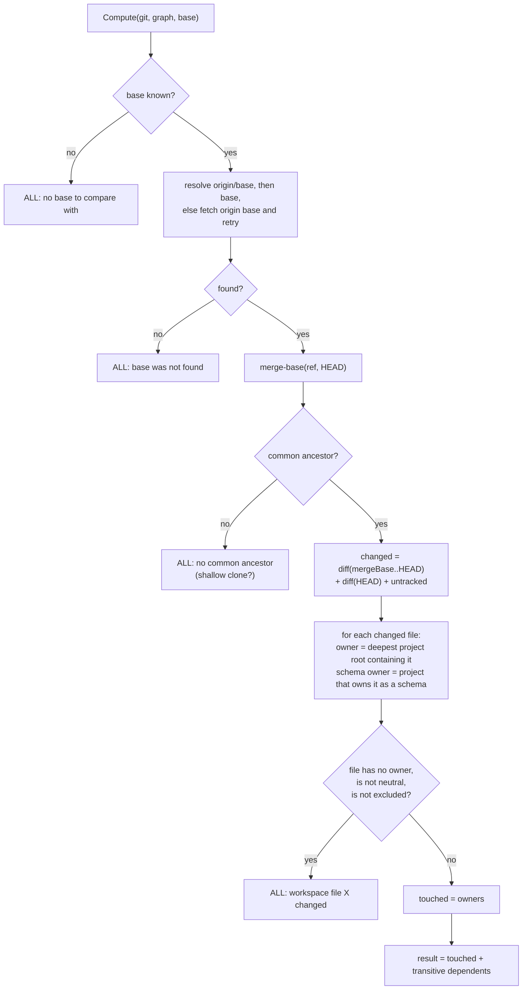

# How affected projects are computed

"Affected" answers one question cheaply and conservatively: given what changed, which
projects could now behave differently? Pull-request CI uses the answer to lint, test and build
only those projects. This page describes the algorithm step by step: how the base is chosen,
which files count as changed, how a file is attributed to a project, which files are
workspace-wide triggers, and the many places where smith gives up and says "everything".

**Audience:** engineers who wonder why a project was or was not selected, who configure CI,
or who deploy apps from a platform that rebuilds on a path filter. The commands are
[`smith affected`](../manual/affected.md), `--affected` on [`smith run`](../manual/run.md)
and [`smith graph`](../manual/graph.md), and [`smith ci verify`](../manual/ci.md).

## The rule

A change is **safe to ignore for a project** only if the project cannot import anything that
changed. smith therefore selects:

1. every project that **owns** a changed file, and
2. every project that **depends on** one of those, transitively
   ([The project graph](project-graph.md)).

Whenever smith cannot establish the changed set with confidence it selects **every** project
and says why. The cost of selecting too much is minutes; the cost of selecting too little is a
green build for code nothing checked. No decision record covers this trade-off; the
rationale is in the code comments of `affected` and in
[How tasks run, and how the cache decides](execution-and-cache.md#7-affected).



The code is `apps/smith/affected/affected_projects_use_case.go` (`Compute`) and
`apps/smith/gitclient/git_client.go` (`ChangedSince`, `MergeBase`, `RevParse`).

## Step 1: the base

The caller passes a base branch name; the callers resolve an empty one the same way:

1. an explicit `--base`;
2. else the pull-request target branch the CI provider exports, read by
   `affected.BaseFromEnv` in this order: `SMITH_BASE`, `GITHUB_BASE_REF`,
   `SYSTEM_PULLREQUEST_TARGETBRANCH`, `CI_MERGE_REQUEST_TARGET_BRANCH_NAME` (a `refs/heads/`
   prefix is removed);
3. else `[release] branch` (default `main`).

`ci verify` is the exception: it passes only what `BaseFromEnv` finds, so it narrows to
affected projects only when the environment names a pull-request target. With none (a push
to the release branch, or a local run) it verifies every project.

`Compute` tries `origin/<base>` before `<base>` because CI checkouts rarely have the local
branch. If neither resolves it runs `git fetch --no-tags origin <base>` once and tries again.
Failing that, the result is everything: `base <name> was not found`.

## Step 2: the changed files

`git merge-base <ref> HEAD` gives the point where the branch left the base. `ChangedSince`
then unions three lists, as paths relative to the workspace:

| List | Command | Catches |
|---|---|---|
| committed on the branch | `git diff --name-only --no-renames --relative <mergeBase> HEAD` | the pull request itself |
| uncommitted tracked changes | `git diff --name-only --no-renames --relative HEAD` | edits and staged changes |
| untracked, not ignored | `git ls-files --others --exclude-standard` | new files |

`--no-renames` makes a rename count as a removal plus an addition, so both directories are
affected. Because uncommitted and untracked files are included, a local `smith test
--affected` reflects the working tree, not only what is committed.

If git cannot compute the merge base (`no common ancestor with origin/main (shallow
clone?)`) or cannot list changes, the result is everything. Generated pipelines check out with
full history for this reason (`fetch-depth: 0` on GitHub and Azure, `GIT_DEPTH: "0"` on
GitLab), and `smith doctor` warns about a shallow clone (`the clone has full history`).

## Step 3: from files to projects

For every changed file:

- `Graph.Owner(file)` is the project whose root contains it; when roots nest, the deepest
  wins. That project is **touched**.
- `Graph.SchemaOwner(file)` is the project that owns the file as a shared schema. It is touched
  too, wherever the file lives. A schema outside every project directory (a `contracts/`
  folder at the root, owned through a `schemas` glob) is therefore not a workspace-level
  change ([ADR 0028](decisions/0028-graph-edges-from-shared-schemas.md)).
- A file with an owner is attributed to it even if it is documentation: a `README.md` inside
  `libs/ui` touches `ui`.
- A file with **no** owner is a **workspace-level** change, unless it is *neutral* or
  *excluded*, in which case it is ignored.

Neutral files (`neutralFiles`): `*.md` at the workspace level, `docs/**`, `LICENSE`,
`.github/ISSUE_TEMPLATE/**`, `.vscode/**` and `*.code-workspace`. Excluded files are those
under a directory matched by `[workspace] exclude`.

Anything else without an owner (`smith.toml`, a lockfile, `package.json` at the root,
`.github/workflows/ci.yml`, `.devcontainer/devcontainer.json`, `go.work`) makes **every**
project affected, with the reason `workspace file <path> changed`. This is the most common
reason a fresh scratch workspace says "all": its generated files are not yet committed.

```json
{
  "projects": ["api", "core", "sdk", "ui", "web"],
  "all": true,
  "reason": "workspace file .devcontainer/devcontainer.json changed",
  "base": "main",
  "changed": [".devcontainer/devcontainer.json", ".github/workflows/ci.yml"]
}
```

(`smith affected --json`, abridged; `changed` lists every changed file considered.)

## Step 4: the dependents

For each touched project, add `Graph.TransitiveDependents(name)`: everything that imports it
directly or indirectly, including through shared schemas. The result is sorted. Its `reason`
is `changes since <ref>`, or `no project changed since <ref>` when the set is empty; `base`
in the JSON is the merge-base commit, and `all` is false.

The edges are only as complete as discovery: a dependency that exists at run time but not in
an import (a runtime plugin loaded by name) is invisible, and a change to the dependency does
not select the dependent. That is the one place where "affected" can be too narrow. Make the
relationship visible to smith: an import the scanner sees, or a shared schema declared with
`schemas` and `consumes_schemas`.

## Who uses the result

| Caller | Use |
|---|---|
| `smith affected` | prints the names; with `--json` the whole result plus `watch`; with `--paths` only the watch paths |
| `smith run`, `build`, `test`, `lint`, `typecheck` with `--affected` | `RunInWorkspace` intersects the selected projects with the result and prints `affected: <reason> → N project(s)` |
| `smith graph --affected` | keeps the affected projects and marks the ones that own a changed file |
| `smith ci verify` | on a pull request (the base comes from the environment), runs the verify tasks only on affected projects; also for tasks that plugins mark for verification, such as an app's container image |
| the terminal shell | the Home view's "N projects affected: press w" and the `w` key (`smith run lint test --affected`) |
| `smith serve` and `smith mcp` | the `affected` method and the `smith_affected` tool |

An affected run that selects nothing prints `nothing to run` and succeeds.

## Deployment watch paths

`affected.WatchPaths` (`watch_paths_algorithm.go`) answers a related question for platforms
that rebuild on a push (Railway, Render, a GitOps path filter): which directories can change
what an app deploys? For each **app** it returns the app's own root plus the root of every
project it depends on, transitively, plus the directory of any consumed schema that lies
outside every project. Every app is listed whether or not it is affected.

```text
$ smith affected --paths
api	apps/api libs/core
web	apps/web libs/ui
```

(One app per line, a tab, then the directories; the example is from the getting-started
tour, where `api` imports `core` and `web` imports `ui`.)

## Decisions

| Decision | Record |
|---|---|
| shared schemas are graph edges, and owners of a changed schema are affected | [ADR 0028](decisions/0028-graph-edges-from-shared-schemas.md) |
| CI phases are thin calls to smith, so `verify` can narrow to affected | [ADR 0005](decisions/0005-generated-ci-pipelines.md) |
| conventional commits and tag-only releases (the release branch builds everything) | [ADR 0006](decisions/0006-conventional-commits-tag-only-releases.md) |

The choice to fall back to "everything" has no record of its own (see above).

## Where in the code

| Concern | Path |
|---|---|
| the algorithm | `apps/smith/affected/affected_projects_use_case.go` |
| watch paths | `apps/smith/affected/watch_paths_algorithm.go` |
| git queries | `apps/smith/gitclient/git_client.go` |
| `--affected` in runs | `apps/smith/taskrun/run_in_workspace_use_case.go` |
| `--affected` in graphs, `smith affected` | `apps/smith/graphview/graph_handler.go` |
| verify phase | `apps/smith/cipipeline/run_phase_use_case.go` |
