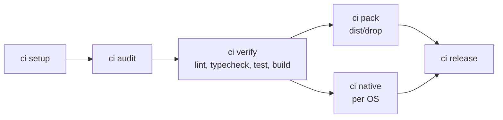

# Architecture

How smith is built today. The decisions behind it are in
[decisions.md](decisions.md); the plugin protocol in detail is in
[plugins.md](../reference/plugins.md).

This page is the overview. The deep dives:

| Page | Answers |
|---|---|
| [The plugin system](plugin-system.md) | what a plugin is, the handshake, roles and levels, who speaks in what order when a project is assembled, how plugins interact (and why they never call each other), failure modes |
| [How tasks run, and how the cache decides](execution-and-cache.md) | task graph, scheduler, process-tree cancellation, serving an app, the exact cache key, the store, the signed remote cache, affected, why-miss |
| [Releases and CI](release-and-ci-internals.md) | the release plan, lineage and preflight, one project's release step by step, assets and distribution, the provider-neutral pipeline model, slots, the phases |
| [Technology](technology.md) | why Go and a single binary, libraries, process boundaries, cross-platform handling, the security model, the test layers |
| [Recipes and CI](recipes-and-ci.md), [TUI and IDE](tui-and-ide.md) | the design notes for those features |

## The repository

One Go workspace (`go.work`), one module per project. smith builds, tests and
releases this repository itself.

| Path | What it is |
|---|---|
| `apps/smith` | the `smith` command: the core, the CLI, the TUI, and every built-in plugin linked in |
| `libs/plugin-<name>` | one built-in plugin each: `node`, `node-toolchains` (typescript, eslint, jest, vitest, vite, angular, astro, vscode), `python`, `go`, `dart`, `dotnet`, `rust`, `ruby`, `php`, `jvm`, `cpp`, `bicep`, `docker`, `vertical-slices` |
| `packages/plugin-sdk` | the protocol types (`protocol`), a server loop for plugins (`serve`), a client for hosts (`host`), framing (`transport`), the conformance suite (`conformance`), and helpers for templates and tool runs. Published as its own Go module (`packages/plugin-sdk/vX.Y.Z` tags) |
| `docs/` | the user documentation, these notes, and the research the project started from (`docs/design/research/`) |
| `install.sh`, `install.ps1` | install the newest `smith@` GitHub Release |

## The core

`apps/smith` is organised by vertical slices: one Go package per outcome, its
exported identifiers as its API. `commandline` assembles the commands from
each slice's handler; most commands start by opening a `session`.

| Slice | Owns |
|---|---|
| `workspace` | finding the root and loading `smith.toml` (TOML, every setting optional); task overrides, each recorded with its source for `smith explain` |
| `session` | opening a workspace for a command: root, config, plugins started, project graph built; plugins shut down at the end |
| `pluginhost` | starting plugins and routing requests to them; built-in plugins, the plugin search path, stacks and their validation |
| `projectgraph` | the project graph: projects from the language plugins' `discover`, edges from what each project imports matched to what others export, stacks and conventions applied, `smith.toml` overrides on top; cycle detection and project selection |
| `taskgraph` | expanding the requested tasks into every task they depend on (`build` in the same project, `^build` in every project imported) |
| `taskrun` | running a task graph: dependencies first, cache replay on a hit, otherwise a child process whose whole tree is killed on cancel (Windows included); a failure skips its dependents |
| `taskcache` | the cache key (SHA-256 over a versioned, canonical encoding of command, env, inputs, upstream sources, dependency keys, OS/arch and plugin versions), the local store (`ac/` entries and `cas/` blobs) behind a `Storage` interface, pruning, and what `smith why-miss` compares |
| `remotecache` | a remote tier behind the local store (HTTP object store, S3, Azure Blob); every object signed with HMAC-SHA256; a failed check or an unreachable store is a miss |
| `affected` | which projects a change can break: owners of changed files, their dependents, everything when a workspace file changed |
| `release` | conventional commits to versions, in dependency order: stamp manifests, publish through the language plugin, distribute an app's binaries to registries, tag, push, GitHub Release; resumable and previewable (`--dry-run` is the same path) |
| `releaselineage`, `releasepreview` | refusing tags that would give wrong versions; posting the release preview on a pull request |
| `npmbinaries`, `pypiwheels`, `nugettool`, `rubygems` | re-packing an app's release archives as npm packages, PyPI wheels, a .NET tool and platform gems, and uploading them |
| `packagemanifests` | Homebrew, Scoop and winget manifests attached to a GitHub Release |
| `githubrelease`, `gitclient` | the only doors to the GitHub Releases API and to git |
| `cipipeline` | generating pipelines and running their phases (`smith ci <phase>`) |
| `nativebuild` | `smith ci native`: projects built on their own OS runner |
| `doctor` | the workspace's health: smith's invariants plus each plugin's checks, with remedies and safe fixes |
| `tui` | the interactive front end of a bare `smith` |
| `scaffold`, `upgrade` | `smith new` and `smith add`; bringing a workspace up to a newer smith |
| `convert`, `convertplan`, `nxworkspace`, `adoption` | converting an Nx (or old-mnci) workspace, and adopting a repository that has no tool yet |
| `convertchoices`, `legacyinventory`, `removalplan`, `fullconversion` | the full level of `smith convert`: the choices (lint, test runner, build, CI), the scan for old tooling nothing uses any more, the removals as doctor fixes asked one group at a time, and the run that applies them |
| `dependencies`, `devservers`, `explain`, `whymiss`, `graphview`, `stackview`, `configedit`, `clicontract`, `mcpserver`, `slicecheck` | the remaining commands: install/uninstall, `smith dev`, explain, why-miss, graph, stacks, config edits, the `--json` contracts for editors, `smith mcp`, slice checks |
| `goldenpath` | the end-to-end tests: new workspace, every kind in every language, build, test, release |

## Plugins

Everything language-specific is a plugin: discovery, tasks, scaffolding,
version writing, publishing, CI needs, health checks. The core knows no
language.

A plugin is a separate process speaking JSON-RPC 2.0 over stdio, framed like
the Language Server Protocol. Built-in plugins ship inside the `smith` binary
but still run out of process: smith starts itself as
`smith plugin serve <name>`, so they speak exactly the protocol an external
plugin does. A plugin declares its roles in `initialize`, and the host only
calls the methods it advertised.

```mermaid
flowchart LR
  cli["smith command"] --> session
  session --> ws["workspace<br/>smith.toml"]
  session --> host["pluginhost"]
  host -- "JSON-RPC over stdio" --> lang["language plugins<br/>node, go, python, …"]
  host -- "JSON-RPC over stdio" --> tool["toolchain / structure / deploy plugins<br/>eslint, jest, vertical-slices, docker, …"]
  lang -- "discover" --> graph["projectgraph"]
  tool -- "contribute" --> graph
  ws -- "overrides" --> graph
  graph --> tasks["taskgraph"] --> run["taskrun"]
  run <--> cache["taskcache<br/>.smith/cache/v1"]
  cache <--> remote["remotecache"]
```

The methods, roles and stacks are described in [plugins.md](../reference/plugins.md) and
[stacks.md](../reference/stacks.md). How plugins are distributed, installed by name and
where they live is not decided yet, see #164.

## Data flow

### `smith run lint test -p api`

1. `session` loads `smith.toml`, starts the plugins, and asks each language
   plugin to `discover` its projects; toolchain and structure plugins
   `contribute` tasks for the projects whose stack or conventions include
   them; `smith.toml` overrides apply last.
2. `projectgraph` turns imports and exports into edges; `--affected` narrows
   the selection with `affected`.
3. `taskgraph` expands `lint` and `test` into the tasks they depend on.
4. `taskrun` runs them in dependency order, in parallel where it can. For each
   task `taskcache` computes the key: on a hit the outputs are restored and
   the log replayed, on a miss the task runs and a success is stored.

### `smith release`

1. `release` reads the conventional commits since each project's last tag and
   plans the versions (a `version(<project>)[x.y.z]` commit forces one); a
   released dependency gives its dependents a patch.
2. In dependency order, for each project: preflight (credentials, clean tree),
   stamp the version into the manifests through the language plugin's
   `version/write`, build, `publish`. For an app with release assets, the
   plugin builds the per-platform archives into `dist/release/<app>`, and the
   app is distributed from them to npm, PyPI, NuGet and RubyGems.
3. Manifests are restored, the tag is created and pushed, and the GitHub
   Release is created with the archives, `checksums.txt` and the package
   manager manifests attached.

Nothing is committed back: the tag is the record of the release. A re-run
after a failure resumes, since what is tagged is done and a version a registry
already has is skipped.

### `smith ci <phase>`

`smith ci generate` collects each plugin's `ci` contribution (toolchains,
setup and audit steps, credentials), builds one provider-neutral model, and
renders it as GitHub Actions, Azure Pipelines or GitLab CI. The YAML stays
thin: each job calls a phase, so a laptop runs what CI runs.



`pack` and `release` run on a push to the release branch only. Steps a team
adds between `smith:slot` markers survive regeneration.

## Where things go

| Path | Holds |
|---|---|
| `dist/<project dir>/` | every project's build; nothing is written into a source tree |
| `dist/drop/` | what `smith ci pack` keeps |
| `dist/release/<app>/` | an app's release archives and the packages made from them |
| `.smith/cache/v1/` | the local cache: `ac/`, `cas/`, `last/` |
| `.smith/plugins/` | plugins installed for this workspace (with `SMITH_PLUGIN_PATH` and `$SMITH_HOME/plugins`) |

## How smith builds and releases itself

The repository was bootstrapped by the old, Nx-based mnci, then converted to
smith. Since then smith runs its own CI: `.github/workflows/ci.yml` is generated
by `smith ci generate`, and `golden-path.yml` (written by hand) runs the unit
tests on every pull request and the end-to-end suites once a day, on Linux,
macOS and Windows. A merge to `main`
releases: the `smith` app as `smith@<version>` (archives for six platforms,
npm, PyPI, NuGet, RubyGems, the GitHub Release) and the plugin SDK as
`packages/plugin-sdk/v<version>`.
