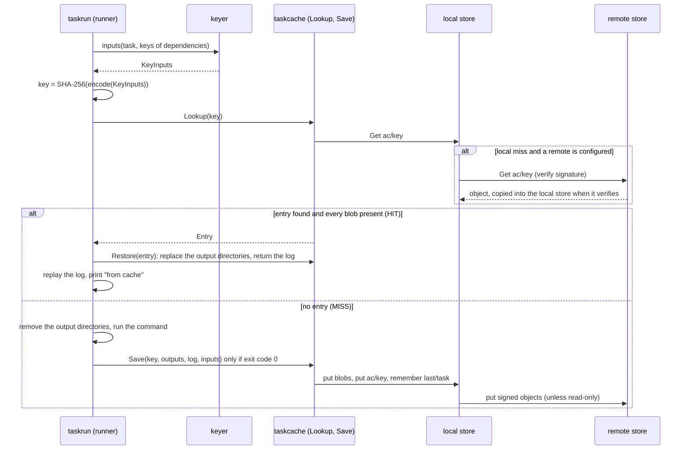
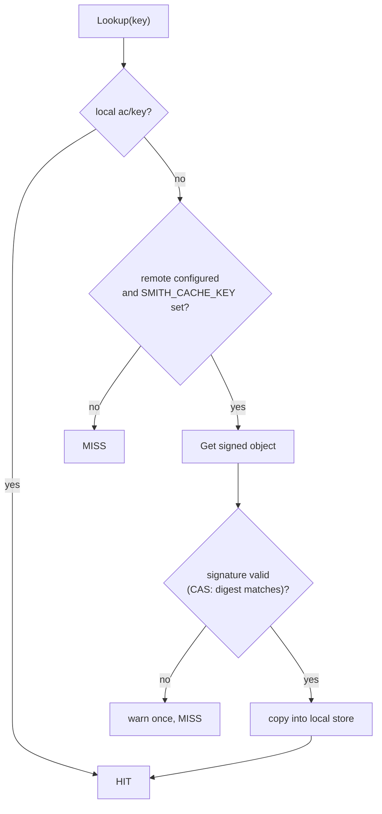

# The cache key, hits and misses

smith runs a task again only when something that could change its result has changed. This
page defines "something": the exact ingredients of a task's cache key, how the key is
encoded, how a hit restores a result and how a miss stores one, how the local store is laid
out on disk, how the remote tier is trusted, and how `smith why-miss` explains a miss
without running anything.

**Audience:** engineers who debug a surprising miss or a surprising hit, who declare `inputs`
and `outputs` in `smith.toml`, or who change the cache. The commands are
[`smith why-miss`](../manual/why-miss.md), [`smith explain`](../manual/explain.md) and the
`--no-cache` flag of [`smith run`](../manual/run.md). The longer narrative of a run, with the
scheduler, is in [How tasks run, and how the cache decides](execution-and-cache.md).

## What a hit and a miss are

A task is cacheable when its definition says `cache = true`. For such a task, before running
it, the runner computes a **key** from everything that can change the result, and looks the
key up:



A **hit** requires an `ac/<key>` entry of the current schema whose log blob and every output
blob are present; a corrupt entry or a missing blob is simply a miss (`taskcache.Lookup`). A
**miss** runs the task; only a run that exits with code 0 is stored, so failures are never
cached. `--no-cache` skips the lookup but still stores the result. A task with `cache =
false` is neither looked up nor stored.

## The key

`taskcache.Key` (`cache_key_algorithm.go`) hashes a `KeyInputs` value. Each field is written
as an 8-byte big-endian length followed by its bytes, so no two different inputs can produce
the same byte stream by concatenation. Every collection is sorted, so the same inputs give the
same key on any machine.

| Order | Part | Value | Why it is there |
|---|---|---|---|
| 1 | schema | `smith-task-key-v1` (`KeySchema`) | changing the encoding or what goes in requires a new schema, so old entries are never mistaken for new ones |
| 2 | task | `core:test` | |
| 3 | platform | `windows/amd64` | a binary built on one OS is not another's |
| 4 | tool | `1.62.0/go@1.62.0+vertical-slices@1.62.0`: smith's version, then the project's language plugin and the other plugins that shape it, each with its version | upgrading smith or a plugin invalidates the project's results |
| 5 | toolchain, only if reported | `go 1.27.0` (the language plugin probes the compiler or runtime at discovery) | a build cached on one Node is a miss on another |
| 6 | serve, only if set | `web:start http://127.0.0.1:5173` | the app under test |
| 7 | command | the argv **before** `{workspaceRoot}` and friends are expanded | the key does not depend on where the repository is checked out |
| 8 | env | the task's declared `env`, sorted | |
| 9 | files | path and SHA-256 of **each input file**, sorted by path | the heart of the key |
| 10 | upstream | for every project the task's project depends on, transitively, one digest of that project's source files | a library change invalidates its dependents even if the dependent's own files did not change |
| 11 | deps | the **keys** of the tasks this one depends on | an upstream task that produced different results propagates |

A real entry, abridged from a scratch workspace (`.smith/cache/v1/ac/0f/0f55...`):

```json
{"schema":1,"task":"core:test","created":"2026-10-25T09:41:26Z","outputs":null,
 "log":"5a17...dfb99","duration":3096948100,
 "inputs":{"task":"core:test","command":["go","test","./..."],
   "files":[{"path":"go.work","digest":"49fb..."},{"path":"libs/core/doc.go","digest":"4446..."}],
   "platform":"windows/amd64","tool":"1.62.0/go@1.62.0+vertical-slices@1.62.0","toolchain":"go 1.27.0"}}
```

The `inputs` object stored in every entry is the same `KeyInputs` the key was computed from.
That is what makes a miss explainable later.

**Optional parts join the key only when set.** `toolchain` and `serve` are written only when
non-empty, so adding a feature to the key does not invalidate the cache of a project that does
not use it.

### Which files are inputs

`SelectInputs` (`select_inputs_algorithm.go`) chooses the files:

- The universe is the workspace's file list from git (tracked, or untracked and not ignored),
  so `.gitignore` is respected.
- With no `inputs`, every file under the project's root. Otherwise the globs of `inputs`:
  relative to the project root, `{workspaceRoot}/x` for a root file such as a lockfile, and a
  leading `!` to exclude. Matching uses `**` (`doublestar`).
- Files under the task's declared `outputs` are never inputs, so a build cannot invalidate
  itself.
- A file that has vanished since the list was made digests to the string `missing`, which
  still changes the key.

File digests are memoised for one invocation (`FileDigests`), and the memo is dropped after a
task runs because the task may have changed files. A project's "sources" digest for the
`upstream` part is a digest over all its files (`taskcache.Combine`).

Two properties follow, and both are on purpose. The key includes everything that is declared
and nothing that is not: if you declare too few `inputs`, smith can replay a stale result
(smith does not sandbox tasks); if you declare too many, it misses more than needed.
[`smith doctor`](../manual/doctor.md) checks that outputs are declared and do not overlap, and
`smith why-miss` shows what changed.

### Keys for a graph

`taskrun.KeyOf` (`task_key_use_case.go`) computes a task's key recursively: it walks the task's
`Deps`, computes their keys first, and passes them in as `deps`. During a run the runner does the
same with the keys of the tasks that just finished. `smith why-miss` calls `KeyOf` to compute
the key "as a run would now".

## What is stored

On a successful run `taskcache.Save` stores:

- every file under the task's **output directories** as a content-addressed blob, with its
  path and mode (outputs must be directories; a bare file path is rejected so a restore can
  replace the directory wholesale);
- the task's combined log as a blob;
- an `Entry` (`schema`, `task`, `created`, `outputs`, `log`, `duration`, `inputs`) under
  `ac/<key>`;
- the key as the task's **last** run under `last/<sha256 of the task id>`.

`taskcache.Restore` first deletes the output directories, then writes the cached files back
with their modes, and returns the log. This is why two tasks must not declare the same output
directory: restoring one deletes what the other wrote.

### The local store

`LocalStorage` (`local_storage_repository.go`) keeps the cache under `[cache] dir` (default
`.smith/cache`; `SMITH_CACHE_DIR` overrides it), in a `v1` directory:

```text
.smith/cache/v1/
  ac/<aa>/<key>          action cache: one JSON Entry per key
  cas/<aa>/<sha256>      content-addressed blobs: output files and logs
  last/<aa>/<sha256 of task id>   the key of the task's most recent cached run
  tmp/                   writes land here first, then are renamed into place
  prune-state.json       when the store was last measured, its size then, and what runs added since
  prune.lock             exists while one smith process prunes
```

`<aa>` is the first two characters of the name. Entries point at blobs by digest, so an
identical file produced by a hundred tasks is stored once. A `Put` of a CAS blob verifies the
content against its digest, and writes go through `tmp/` and a rename (retried on Windows when
an antivirus scanner holds the file), so an interrupted run never leaves a half-written entry.

`Storage` is an interface (`Has`, `Get`, `Put`, `Delete`, `Walk`, `Touch`) so that other
backends can be added; the remote tier is one (below).

### Pruning

`[cache] max_size_mb` (default 2048; `0` or less means no limit) is the size the **local** store
is kept under. `taskcache.PruneWith` does the work: it ranks the entries by last use (the
modification time that `Touch` refreshes on every hit), keeps the most recent ones until the next
no longer fits, removes the rest, then sweeps the blobs no kept entry names. The size counts
entries, blobs and the `last/` pointers. `taskrun.RunInWorkspace` calls it, through
`cachemaintenance.AfterRun`, after a run that stored something; the remote tier is never pruned.

```mermaid
sequenceDiagram
  participant R as taskrun (RunInWorkspace)
  participant M as WriteMeter
  participant A as cachemaintenance.AfterRun
  participant S as prune-state.json
  participant P as taskcache.PruneWith
  participant L as local store
  R->>M: run the tasks with the meter as the Storage
  M->>L: Put entries and blobs (counts bytes, not last/ pointers)
  R->>A: stored something? AfterRun(dir, limit, bytes added)
  A->>S: read
  alt no limit, or the store is not due
    A->>S: add the bytes to the running total (one small write)
  else never measured, an hour old, or a big run over the limit
    A->>L: take prune.lock (skip if another smith holds it)
    A->>P: PruneWith(limit, grace 5 min)
    P->>L: Walk ac, cas, last; delete old entries, then unused blobs
    A->>S: write size after, time, added = 0
  end
  A-->>R: error becomes a warning, never a failed run
```

It is cheap because most runs never walk the store. The state file holds the size at the last
walk and the bytes added since; a walk happens only when the store was never measured, when
`CheckInterval` (an hour) has passed (which also corrects the total for what other processes
stored), or when this run stored `BigRunBytes` (4 MB) or more and the total says the store is
over its limit. On a store of 4 000 entries a walk takes about 0.2 s and a run that does not walk
adds about 4 ms (`BenchmarkAfterRunOnALargeStore`).

It is safe beside other smith processes, which can be reading, storing or pruning the same
directory:

- **Grace.** An entry used, and a blob written or used, within `InUseGrace` (five minutes) is
  neither removed nor swept, so what the run just stored and what another process is restoring
  survive. A blob no entry names yet is kept for a minute even in a manual prune, because a task
  writes its blobs before the entry that names them. A prune that leaves the store over the
  limit because of this looks again after six minutes rather than an hour.
- **Touch on store.** Storing a blob that is already there refreshes it, so the new entry that
  is about to name it is not left with a blob an older prune is about to sweep.
- **Vanishing and held files.** `Walk` ignores a directory that disappears; a file a prune cannot
  delete (a reader holds it open on Windows) is skipped and counted, not an error. Deleting an
  entry or blob under a reader at worst makes that task a miss: `Restore` fails and the runner
  runs the task.
- **One pruner.** `prune.lock` (created exclusively, taken over when ten minutes old) keeps two
  automatic prunes from walking the store together.

`smith cache` is the command line for this: [`status`](../manual/cache-status.md) measures the
store, [`prune`](../manual/cache-prune.md) runs `PruneWith` now (with a dry run),
[`clear`](../manual/cache-clear.md) deletes the `v1` folder and
[`verify`](../manual/cache-verify.md) hashes every blob and checks every entry. All of it works
on a cache directory and never on the remote tier. [`smith doctor`](../manual/doctor.md) warns
when the store is over its limit or holds entries that can never hit, from a look that hashes nothing.

## The remote tier

`[cache] remote` (or `SMITH_CACHE_REMOTE`) puts a shared store behind the local one
(`session.Session.Storage`):

- With no `SMITH_CACHE_KEY` set the remote is switched off with a warning: nothing is shared
  unsigned.
- `remotecache.Open` selects the backend by scheme: `https://` or `http://` (an HTTP object
  store with an optional bearer token, `SMITH_CACHE_TOKEN`), `s3://bucket/prefix` (AWS
  Signature V4 written in this repository, so there is no SDK; `AWS_ACCESS_KEY_ID`,
  `AWS_SECRET_ACCESS_KEY`, optional `AWS_REGION`, `AWS_ENDPOINT_URL_S3`), and
  `azblob://account/container/prefix` (`AZURE_STORAGE_SAS_TOKEN`).
- `remotecache.Tiered` reads local first and, on a local miss, asks the remote; a fetched
  object is verified before it is copied into the local store. It writes to both, unless the
  session is **read-only**: `[cache] remote_read_only`, `SMITH_CACHE_READ_ONLY`, or a CI
  environment that says the run is for a pull request (`GITHUB_EVENT_NAME` is `pull_request`
  or `pull_request_target`, `BUILD_REASON` is `PullRequest`, `CI_PIPELINE_SOURCE` is
  `merge_request_event`).
- `last/` never leaves the machine: it exists to explain misses on this one.

**Trust.** A remote store is somewhere anyone with write access to the bucket could poison. So
every object is `signature || content`, where the signature is HMAC-SHA256 over
`kind + "/" + key + "\n" + content` with the team's secret (`SMITH_CACHE_KEY`). Because the
name is in the signed message, an object cannot be replayed under another key; a CAS blob is
also checked against its own digest. An object that fails verification, an unreachable store
or a timeout are all a **miss**, reported once as a warning. A remote cache can make a run
slower; it cannot make it wrong ([ADR 0003](decisions/0003-content-addressed-cache.md)).



## Explaining a miss: `smith why-miss`

`whymiss.ExplainMiss` (`apps/smith/whymiss/explain_miss_use_case.go`) takes `project:task` and:

1. refuses a task that is not cacheable (`not-cached`);
2. builds the task graph for that task and computes its key with `KeyOf`;
3. if `Lookup(key)` succeeds, the answer is `hit`;
4. otherwise loads the task's last cached run from `last/` (`no-earlier-run` if there is none
   or it was pruned) and its stored `inputs` (`no-record` for entries written before inputs
   were recorded);
5. otherwise `taskcache.Diff` compares the stored inputs with the current ones and reports
   `changed` with the list.

`Diff` reports, in this stable order: `tool`, `toolchain`, `serve`, `platform`, `command`,
`env`, then `file`, `upstream` and `dependency` entries, each as added, removed or changed by
name. Run in a workspace after adding a file to a project:

```text
$ smith why-miss web:test
web:test would run: 1 change(s) since its last cached run (2026-10-25 09:41)
  file       apps/web/src/index.ts added
```

The explanation follows the chain one step at a time: a changed `dependency` entry names a
task, and `smith why-miss` on that task explains it in turn. `smith explain` is the
companion: it shows how the task resolved (command, inputs, outputs, `dependsOn`, `cache`)
and where each value came from.

## Things the cache deliberately does not do

- **No sandbox.** A task may read files it did not declare; smith trusts `inputs`. That is what
  lets it run `npm`, `dotnet` and `cargo` unmodified.
- **No distributed execution.** Tasks run on one machine; only results are shared.
- **No file watching.** The key is recomputed from git on each run.

## Decisions

| Decision | Record |
|---|---|
| content-addressed cache behind a `Storage` interface | [ADR 0003](decisions/0003-content-addressed-cache.md) |
| toolchain versions are checked, not downloaded | [ADR 0020](decisions/0020-toolchain-pins-checked-not-downloaded.md) |
| signed remote objects (part of the cache decision) | [ADR 0003](decisions/0003-content-addressed-cache.md) |

## Where in the code

| Concern | Path |
|---|---|
| key encoding | `apps/smith/taskcache/cache_key_algorithm.go` |
| input selection and digests | `select_inputs_algorithm.go`, `file_digest_store.go` |
| computing a task's key | `apps/smith/taskrun/task_key_use_case.go` |
| lookup, store, restore | `apps/smith/taskcache/store_result_use_case.go` |
| local store | `local_storage_repository.go`, `storage_contract.go` |
| last run and diff | `last_run_repository.go`, `diff_key_inputs_algorithm.go` |
| pruning | `prune_cache_use_case.go`; wired by `apps/smith/cachemaintenance` (`prune_local_cache_use_case.go`, `prune_throttle_policy.go`, `prune_state_store.go`, `write_meter_store.go`) |
| `smith cache` | `apps/smith/cachecommand` over `cachemaintenance` (`inspect_`, `verify_`, `clear_local_cache_use_case.go`) |
| remote tier | `apps/smith/remotecache` |
| choosing local or tiered storage | `apps/smith/session/open_session_use_case.go` |
| the explanation | `apps/smith/whymiss` |
