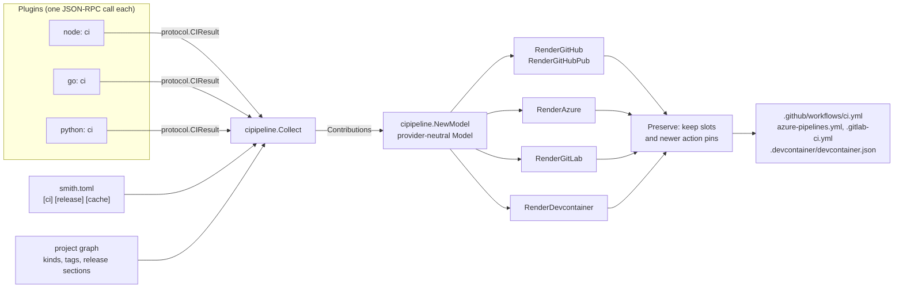
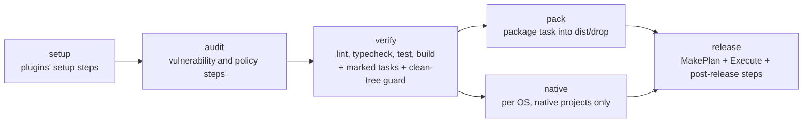

# How CI pipelines are generated

smith writes the CI pipeline of a workspace from what is in the repository, and the pipeline does
almost nothing but call `smith ci <phase>`. This page explains how the pipeline is derived
(plugins describe what they need, smith merges it into one model, a renderer spells it for one
provider), what each phase runs, how a team's own steps survive regeneration, and the guard that
stops a pull request from leaving tracked files dirty.

Audience: contributors working on `apps/smith/cipipeline`, and operators who want to know why a
generated file looks the way it does. For the user view see [CI pipelines](../reference/ci.md); for
the release half see [How a release is decided and published](release-design.md).

## The idea

A pipeline that spells out every build step per language goes stale the moment a project is added.
smith inverts that: the YAML is thin and generated, and the logic lives in the `smith` binary. A
developer who runs `smith ci verify` on a laptop runs what the pipeline runs
([ADR 0005](decisions/0005-generated-ci-pipelines.md); its rationale is not recorded in the decision
log, so the reasons above are the design's, not a quotation).

## Step 1: plugins say what they need

`cipipeline.Collect` (`apps/smith/cipipeline/generate_pipelines_use_case.go`) walks the plugins the
session started. A plugin that advertises the `ci` capability in its `initialize` answer is asked,
once, with the projects it serves (`p.ServedBy(plugin)`), through the protocol method `ci`
(`protocol.MethodCI`, one minute timeout). It answers a `protocol.CIResult`:

| `CIResult` field | What the core does with it |
|---|---|
| `toolchains` | a setup step per provider (an action, a task, or an install command) |
| `authenticate` | provider-native sign-in steps for private registries, placed after the toolchains |
| `setup` | steps that `smith ci setup` runs (`npm ci`, `go mod download`, the Python venv) |
| `audit` | steps that `smith ci audit` runs |
| `postRelease` | steps that `smith ci release` runs after the release |
| `credentials` | secrets the pipeline needs, with where each is needed |
| `permissions` | GitHub token permissions (`packages: write`) |
| `stores` | package download stores to cache (npm, pip, Go modules, cargo, NuGet, Composer, pub) |

`Contributions.Add` merges the answers: toolchains and stores by name (the first wins), a
credential once, steps appended in plugin order.

The core then adds what is not a plugin's business, by reading the project graph and
`smith.toml` (still in `Collect`):

| Fact | Becomes | Why it is the core's |
|---|---|---|
| any project has a `package` task | `Pack = true`: a pack step and the `drop` artifact | `dist/drop` is workspace-wide |
| a project is tagged `native` (`release.Native`) | `Native = true`: a job per OS | the matrix is workspace-wide |
| an app is published to npm | `Provenance = true`: the job may request an OIDC token | npm provenance needs `id-token: write` |
| a release attaches archives to a GitHub Release (`[release] github_releases`) | `Attest = true`: build provenance attestation | needs `id-token` and `attestations: write` |
| an app has `pub` set | `Pub = true`: the release dispatches a second workflow, `pub.yml` | pub.dev publishing is accepted from a tag-triggered workflow |
| `[release] rubygems_trusted_publishing` | `RubyGemsTrusted`; the `GEM_HOST_API_KEY` secret is dropped | gems are signed in with the workflow's token |
| `[release] vsce_entra` | `VSCEEntra`; the `VSCE_PAT` secret is dropped | see [ADR 0031](decisions/0031-marketplace-publishing-with-entra-id.md) |
| `[cache] remote` | credentials for the remote cache (`cachecredentials.For`) | every step that runs tasks reads it |
| `[release] github_releases` | a required `GITHUB_TOKEN` | Releases need it |

`NewModel` then sorts everything. Output is deterministic: regenerating an unchanged workspace
changes no byte, which is what lets `smith ci generate --check` and `smith doctor` act as gates.

## Step 2: the model and the renderers

`cipipeline.Model` (`pipeline_model.go`) holds the release branch, `Branches`, toolchains, sign-in
steps, credentials, package stores, the flags above, `NativeRunners`, `NativeLinuxPackages`,
`AzurePool`, `AzureVariableGroups` and `Permissions`. It names no provider.

`Rendered` (same file as `Collect`) walks `[ci] providers` and calls pure functions of the model:

| Provider | Function | Output path |
|---|---|---|
| `github` | `RenderGitHub`; `RenderGitHubPub` when `Pub` | `.github/workflows/ci.yml`, `.github/workflows/pub.yml` |
| `azure` | `RenderAzure` | `azure-pipelines.yml` |
| `gitlab` | `RenderGitLab` | `.gitlab-ci.yml` |
| `[ci] devcontainer = true` | `RenderDevcontainer` | `.devcontainer/devcontainer.json` |

The renderers decide nothing about what to run. They spell it. All of them produce the same order:
checkout, toolchains, sign-in, package-store caches, install smith (pinned to the version that
generated the file), the `before-setup` slot, `smith ci setup`, `smith ci audit`,
`smith ci verify`, the `after-verify` slot, a release preview on pull requests, `smith ci pack`,
and `smith ci release` (GitHub mapper: `github_actions_mapper.go`).

Two settings shape the triggers. `[ci] branches` adds branches the GitHub and Azure pipelines run
on for pushes and pull requests (the release branch is always included and is still the only one a
release runs from; [ADR 0035](decisions/0035-ci-branches-setting.md)). GitLab is not covered by it:
`Branches` is read only by the GitHub and Azure mappers. `[ci] providers` chooses which files exist;
a provider dropped from the list has its generated file deleted, but only when the file still starts
with smith's `Generated by smith` header (`Stale`, `OwnedPaths`). A file without the header is the
team's and is kept.

## The phases

`smith ci <phase>` is `cipipeline.RunPhase` (`run_phase_use_case.go`). `Phases` is
`setup, audit, verify, pack, native, release`.

| Phase | What it runs | Notes from the code |
|---|---|---|
| `setup` | `Contributions.Setup` steps | prints `nothing to setup` when empty |
| `audit` | `Contributions.Audit` steps | passing verdicts are remembered (`audit_verdict_store.go`) |
| `verify` | tasks `lint`, `typecheck`, `test`, `build` (`VerifyTasks`) | on a pull request only the affected projects (`affected.BaseFromEnv`); projects tagged `native` are excluded (`!tag:native`); then tasks a plugin marked `Verify` (an app's image build), skipped with a warning when their program is missing; then the tracked-changes guard |
| `pack` | the `package` task into `dist/drop` | the directory is always created so the artifact upload has a path; `nothing to pack` when no project has the task |
| `native` | `nativebuild.Run` | lints, tests, builds and packages native projects on this OS |
| `release` | `release.MakePlan`, `release.Execute` with `Push: true`, then `PostRelease` steps | see [release design](release-design.md) |

In the generated GitHub file `pack` and `release` run only for a push to the release branch
(`github.event_name == 'push' && github.ref_name == '<branch>'`); the release preview step runs on
pull requests. On GitHub Actions each phase also appends a line to the job summary
(`GITHUB_STEP_SUMMARY`).

### The tracked-changes guard

A release refuses a working tree with uncommitted changes, because it stamps version numbers into
manifests and restores them afterwards (`release.Preflight`). A pull request that makes a task
rewrite a tracked file would pass review and then break the release on the release branch. The guard
moves that failure to the pull request.

`runPhase` for `verify` records the changed tracked files before the tasks
(`git status --porcelain --untracked-files=no`, through `release.Uncommitted`), runs them, and
`verifyClean` compares. If tracked files are changed afterwards, `TrackedChanges`
(`tracked_changes_policy.go`) attributes each file to the deepest project whose root holds it and to
the tasks verify ran in that project, and marks it `Before` when it was already changed before
verify started (for example an install rewriting a lockfile). `ExplainTrackedChanges` builds the
error: which files, who probably changed them, and what to do (ignore and untrack generated state;
commit files a task updates on purpose).

A file that was already changed before verify fails the phase only when `CI` is set, because in CI
the checkout starts clean; on a laptop it is the developer's own edit. `smith doctor` carries a
related check, `tracked files are not generated files` (`doctor/tracked_outputs_policy.go`), with a
fix (`corefixes/untrack_generated_fix_mapper.go`).

## Slots: team steps survive regeneration

`smith:slot <name>` and `smith:slot-end <name>` comment pairs mark regions of the generated YAML
that regeneration keeps. The slot names are `before-setup` and `after-verify` in the GitHub, Azure
and GitLab files, and `before-publish` in `pub.yml`. `Write` reads the old file, and `Preserve` (which calls `KeepSlots` in
`slot_mapper.go`) lifts the text of each slot, re-indents it if the slot moved (an Azure
pipeline gaining a native job nests its steps), and puts it into the new rendering. A slot the new
file no longer has is returned in `lost` and printed as a warning, so a step is never dropped
silently. `Preserve` also keeps an action pin (`uses: actions/cache@v6`) that the old file has at a
higher version than the template, because dependency bots bump pins and cannot see smith's
templates (`keep_action_pins_mapper.go`).

## Drift

`Drift` renders the model and compares it with the committed file after `Preserve`. It reports a
file that is missing, out of date or no longer configured. Three commands use it:

| Caller | Behaviour |
|---|---|
| `smith ci generate --check` | fails with `pipelines are out of date: ... run smith ci generate` |
| `smith doctor` | the check `CI pipelines match the workspace`; its fix regenerates, and is marked safe only when no slot would be lost (`Planned` returns `lost`) |
| `smith upgrade` | lists drifted files in its plan and regenerates them |

## Supply-chain steps

Two steps are model flags rather than plugin contributions. `Attest` adds an
`actions/attest-build-provenance` step (SLSA provenance for the archives in `dist/release`) and the
`attestations: write` and `id-token` permissions. `Provenance` gives the job `id-token: write` so
npm can sign provenance. The SBOM is not a pipeline step: `release.publishGitHubRelease` writes a
CycloneDX file with `sbom.Write` and attaches it to the GitHub Release ([ADR 0011](decisions/0011-no-paid-code-signing.md)).

## Where in the code

| Concern | Path |
|---|---|
| Collect, Rendered, Write, Drift, Stale | `apps/smith/cipipeline/generate_pipelines_use_case.go` |
| The model and Contributions | `apps/smith/cipipeline/pipeline_model.go` |
| Renderers | `github_actions_mapper.go`, `azure_pipelines_mapper.go`, `gitlab_ci_mapper.go`, `devcontainer_mapper.go` |
| Toolchain and setup spelling | `toolchain_setup_mapper.go`, `setup_steps_mapper.go`, `package_stores_mapper.go` |
| Slots and pins | `slot_mapper.go`, `keep_action_pins_mapper.go` |
| Phases and the guard | `run_phase_use_case.go`, `tracked_changes_policy.go` |
| Hand-set-up instructions | `manual_steps_mapper.go` (`smith ci check`) |
| The `smith ci` commands | `ci_handler.go` |
| Native job | `apps/smith/nativebuild` |

## Decisions

| Decision | Record |
|---|---|
| Generate pipelines from one provider-neutral model that calls `smith ci <phase>` | [ADR 0005](decisions/0005-generated-ci-pipelines.md) |
| Plugins contribute toolchains, steps and credentials through the protocol | [ADR 0002](decisions/0002-out-of-process-plugins.md) |
| `[ci] branches` | [ADR 0035](decisions/0035-ci-branches-setting.md) |
| Attestations and SBOM instead of paid code signing | [ADR 0011](decisions/0011-no-paid-code-signing.md) |
| Marketplace sign-in with Entra ID in the release job | [ADR 0031](decisions/0031-marketplace-publishing-with-entra-id.md) |

The tracked-changes guard and the pin-keeping rule have no decision record; the code comments give
the reason (a release refuses a dirty tree; bots bump pins) and no issue is cited.
