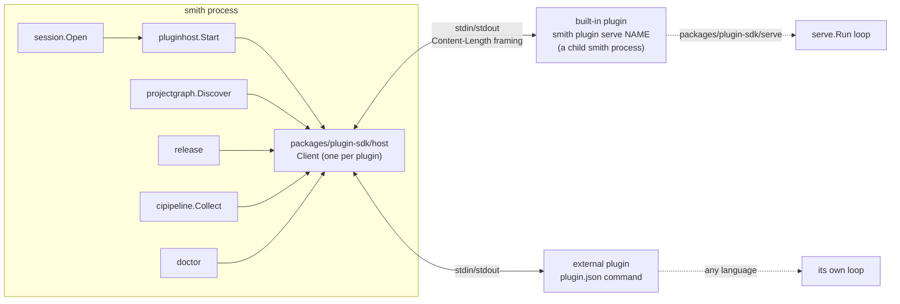
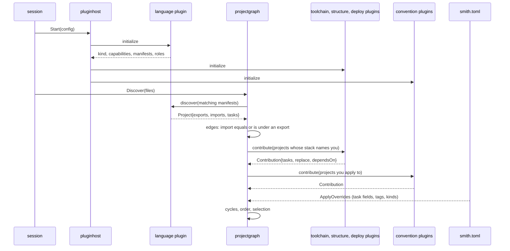

# The plugin protocol: roles, handshake, capabilities and contributions

Everything that depends on a language, a tool or a registry in smith is a plugin: a separate process
that answers JSON-RPC requests on its standard input and output. This page is the architecture of
that protocol: how a plugin is started and identified, what it declares in the handshake, which
methods exist and who calls them, how several plugins are merged into one project, and what
happens when something goes wrong. It is a map of `packages/plugin-sdk/protocol` and
`apps/smith/pluginhost`, not a guide to writing a plugin.

Audience: contributors to smith and authors who want to understand why the protocol looks as it
does. To write a plugin, start with [Writing a plugin](../guides/writing-a-plugin.md); for the field
by field reference see [Plugins](../reference/plugins.md). [The plugin system](plugin-system.md)
is the longer, discursive version of the same design.

## Context

The decision to use out-of-process plugins over a pipe is [ADR 0002](decisions/0002-out-of-process-plugins.md);
the Why-not list at the end of [the plugin system](plugin-system.md#why-not-) records the alternatives
that were considered (shared libraries, WASM, gRPC). Where the decision log is silent the reasons
given there are the design notes' own.

## Transport and framing

| Aspect | Value | Source |
|---|---|---|
| Messages | JSON-RPC 2.0 requests, responses and notifications | `protocol/message_contract.go` |
| Framing | `Content-Length: N`, a blank line, N bytes of JSON, as the Language Server Protocol frames | `transport/stream_client.go` |
| Largest message | 64 MiB (`MaxMessageSize = 64 << 20`); a larger header closes the stream | `transport` |
| Channel | the child's stdin and stdout; stderr is forwarded to the user's terminal, so a plugin logs there | `host.Options.Stderr` |
| Error codes | the JSON-RPC ones, plus `-32000` (`CodePluginFailure`) for a failure the user must act on and `-32800` (`CodeRequestCancelled`) for a request stopped by `cancel` | `protocol` |
| Requests in flight | at most the `concurrency` the plugin declared in `initialize` (absent: 1, one request at a time); responses may come in any order, matched by `id` | `protocol/initialize_contract.go`, `protocol/concurrency_policy.go` |
| Cancel | the notification `cancel` `{id}`, sent only to a plugin that advertised the `cancel` capability ([ADR 0037](decisions/0037-cancel-and-concurrency-in-the-plugin-protocol.md)) | `protocol/cancel_contract.go` |
| Version | one integer, `protocol.Version = 1`; additive changes use capabilities, a breaking change raises it | `protocol/message_contract.go` |

The client never has more calls in flight to one plugin than the plugin declared, so a plugin that
declares nothing is called one request at a time and the next call waits for the answer to the previous
one; calls to different plugins run in parallel. The default call timeout is two minutes (`host.DefaultTimeout`); `initialize` is given 30 seconds;
the core passes its own timeout on some calls (`ci` and `version/write` one minute), and longer ones
for `generate` and `publish`, which run toolchains. When a call runs out of time, or its context ends
(Ctrl+C, a cancelled command), the host stops waiting: a plugin that advertised `cancel` is sent the
notification and has five seconds to answer, with its result or `-32800`; one that cannot be asked is
killed at once on a timeout and after the same five seconds on a cancel. A plugin that does not answer
in time is killed, because its stream can no longer be trusted, and so are the other calls in flight to
it. At the end of a command `shutdown` is sent and the process is killed if it does not exit within five
seconds. [Cancel and concurrency](#cancel-and-concurrency) has the whole rule.

## The schema is the contract

The Go types in `packages/plugin-sdk/protocol` are the source of truth of the protocol, and a JSON
Schema (draft 2020-12) generated from them,
[`packages/plugin-sdk/schema/protocol.schema.json`](../../packages/plugin-sdk/schema/protocol.schema.json),
is the contract for every other language. It has one definition per message (a member is required
when its Go field has no `omitempty`; the doc comments are the descriptions), and next to the
definitions `x-methods` (each of the 19 methods with its params, its result and the capability it needs,
`null` for `initialize` and `shutdown`, and `notification: true` with no result for `cancel`), `x-errorCodes`, `x-roles` (with each role's cardinality and the
kinds that default to it), `x-protocolVersion` and `x-transport` (the framing and the largest message).

| Step | Where | Fails when |
|---|---|---|
| reflect over the types and read the package's source for comments and enumerations | `packages/plugin-sdk/protocolschema`, run by `go run ./schemagen` (`smith run schema -p plugin-sdk`) | the protocol has a method, an error code or a capability that `protocolschema`'s tables do not describe |
| compare the committed file with what the generator writes | the Go test `TestCommittedSchemaIsCurrent` | someone changed `protocol` and not the schema |
| generate each SDK's types from the schema | the TypeScript SDK: `tools/generate-protocol` (`smith run generate -p plugin-sdk-ts`); the Python SDK: `tools/generate_protocol` (`smith run generate -p plugin-sdk-py`); the C# SDK: `Generator` (`smith run generate -p plugin-sdk-dotnet`) | its test finds the generated files stale; another test finds a method the SDK cannot serve |
| check that the SDKs agree on the wire | `packages/plugin-sdk-ts/integration` (a TypeScript and a Go plugin) `packages/plugin-sdk-py/tests/integration` (a Go, a TypeScript and a Python plugin) and `packages/plugin-sdk-dotnet/tests/Integration` (those and a C# plugin): the same logic answers the same requests with the same bytes, compared by response id where requests run together | an SDK writes members in another order, leaves out different zero values, or escapes differently |

Three things about the wire that the schema cannot say, and that a new SDK must do (the Go SDK does
them and the host relies on them):

- A required array or object that is empty in Go is written as `null` when the Go value is nil, so a
  receiver treats `null` as empty.
- Optional members follow `omitempty`: a zero value (`""`, `0`, `false`, an empty array or map) and a
  nil pointer are left out, a struct is not, and a required member is always written, `false` included.
- Maps are written with their keys sorted, and Go escapes `<`, `>` and `&` in strings; both are only
  needed to make the bytes of two SDKs equal.

## Who is started, and how

`pluginhost.Start` (`apps/smith/pluginhost/start_plugins_use_case.go`) builds a list of launches
and starts them in parallel, each with `SMITH_PLUGIN=1` in its environment and the workspace root
in `initialize`:

| Plugin | Command | Notes |
|---|---|---|
| a built-in language plugin in `Builtins` (`node`, `go`, `python`, `rust`, `dotnet`, `ruby`, `php`, `cpp`, `dart`, `jvm`, `bicep`, `lua`, `applescript`, `vba`, `swift`, `objc`, `recipe`) | `smith plugin serve <name>`, i.e. the running binary again | all of them unless `[plugins] enabled` lists some; skipped when `[plugins.external.<name>]` replaces it |
| a built-in addon in `BuiltinAddons` (`vertical-slices`, `eslint`, `jest`, `vitest`, `playwright`, `typescript`, `vite`, `angular`, `astro`, `vscode`, `go-smith-plugin`, `docker`) | the same | always started unless replaced |
| an external plugin, `[plugins.external.<name>]` | the `command` of the `plugin.json` found on the search path, or the command in `smith.toml` | the name it answers to and its version are checked (`checkExternal`) |

The search path (`pluginhost.SearchPath`) is the workspace's `.smith/plugins`, each directory of
`SMITH_PLUGIN_PATH`, then `$SMITH_HOME/plugins` (`SMITH_HOME` defaults to `~/.smith`); the first
directory holding `<name>/plugin.json` wins. `plugin.json` has `name`, `version`, `description` and
`command`; `./` paths are relative to the plugin directory and `{os}`, `{arch}`, `{exe}` are
filled in (`plugin_manifest_contract.go`). A plugin that fails to start stops the command, naming it.

Built-in plugins use the same protocol on purpose: they are its first users, and an external plugin
can replace one by name without the core noticing. How plugins are published, found and installed
by name is not decided; see the open list in the [decision records](decisions/README.md#open-not-decided-yet).

## The handshake

The host sends `initialize` first (`InitializeParams`): the protocol versions it speaks, its name
and version, and the absolute workspace root. The plugin answers `InitializeResult`:

| Field | Meaning |
|---|---|
| `protocolVersion` | the version the plugin picked from the host's list; one the host does not speak ends the connection |
| `plugin` | name and version; the version enters every cache key of the projects it shapes |
| `kind` | `language` or `convention`. It only sets the default roles |
| `capabilities` | the optional methods the plugin implements (below) |
| `languages` | values of `--lang` that reach this plugin |
| `manifests` | file names or patterns (`package.json`, `*.csproj`) that may make a directory a project of this plugin |
| `roles` | the levels the plugin can be chosen for; empty means `DefaultRoles(kind)` |
| `provides` | slots: task names the plugin owns (`test`, `lint`) |
| `requires`, `conflicts` | plugins that must or must not share a project |
| `stacks` | ready-made stacks the plugin publishes |
| `kinds` | the project kinds `generate` can scaffold (`app`, `lib`, `package`); absent or empty means all three ([ADR 0039](decisions/0039-a-plugin-declares-the-project-kinds-it-scaffolds.md)) |
| `follows` | the project shape keys `generate` applies when it is given `shape`; `discover` reports `shape`, the dialect of each project ([ADR 0041](decisions/0041-smith-add-follows-the-dialect-of-sibling-projects.md)) |
| `concurrency` | how many requests the plugin can work on at once: absent or `0` is 1, `N` is N, `-1` leaves the number to the host (which keeps 32 in flight) |

### Capabilities

The host calls a method only if the plugin advertised it; an unadvertised method means "nothing to
say here", not an error. The Go SDK derives the flags from the interfaces a plugin implements
(`packages/plugin-sdk/serve/plugin_contract.go`), and the TypeScript and Python SDKs from the members of the plugin
object, and the C# SDK from the interfaces the class implements. A plugin without an SDK sets the booleans by hand. The schema's methods table (below) says
which capability each method needs.

| Capability flag | Methods | Go interface | Called by |
|---|---|---|---|
| `discover` | `discover` | `Discoverer` | `projectgraph.Discover`, every session |
| `contribute` | `contribute` | `Contributor` | `projectgraph`, for stacks and conventions |
| `generate` | `generate` | `Generator` | `smith new`, `smith add` |
| `remove` | `remove` | `Remover` | `smith remove` |
| `changeKind` | `project/kind` | `KindChanger` | `smith kind` |
| `components` | `sbom/components` | `ComponentLister` | `release`, for the SBOM it attaches |
| `version` | `version/write` | `Versioner` | `release` |
| `publish` | `publish` | `Publisher` | `release` (registry or release archives; deploy plugins too) |
| `published` | `published` | `RegistryReader` | release lineage checks, doctor |
| `ci` | `ci` | `CIContributor` | `cipipeline.Collect`, release preflight |
| `doctor` | `doctor` | `DoctorContributor` | `smith doctor` |
| `dependencies` | `dependencies/install`, `dependencies/uninstall` | `DependencyManager` | `smith install`, `uninstall` |
| `declarations` | `dependencies/declared`, `dependencies/rewrite` | `DeclarationEditor` | `smith sync`, `smith up --align` |
| `latest` | `dependencies/latest` | `LatestReader` | `smith up` |
| `cancel` | `cancel` (a notification) | `Cancellable` | the host, when a call's context ends or its time runs out |

`initialize` and `shutdown` are always available.

## Roles, levels and slots

A role is a level at which a plugin can take part in a project (`protocol/plugin_role_enum.go`):

| Role | Question it answers | Cardinality in a project |
|---|---|---|
| `language` | what is here, what does it import, how is it versioned and published | exactly one |
| `scaffold` | what files does a new project start with | at most one |
| `toolchain` | how are lint, test, build and typecheck run | one plugin per slot (task name) |
| `structure` | how must the source be laid out | any number, additive |
| `deploy` | what is built and shipped from it | any number, additive |

`pluginhost.ValidateMembers` (`stack_validator.go`) checks every stack and recipe: each plugin plays
only a role it declared and applies to the project's language, two toolchains may not provide the
same slot, every `requires` is met, no two plugins `conflict`. A stack is a named list of plugins a
project uses; a recipe is data that chooses stacks by answers ([ADR 0021](decisions/0021-plugin-roles-and-per-project-stacks.md),
[ADR 0023](decisions/0023-recipes-with-levels-and-slots.md)).

## The methods at a glance

All payload types live in `packages/plugin-sdk/protocol`.

| Method | Request | Response | Contribution to the whole |
|---|---|---|---|
| `discover` | `DiscoverParams{manifests}` (paths whose base name matches) | `DiscoverResult{projects}` | one `Project` per manifest the plugin owns: name, root, language, kind, exports, imports, version, tasks, tags, stack, settings |
| `contribute` | `ContributeParams{projects}` | `ContributeResult{projects: name -> Contribution}` | `Contribution{tasks, replace, dependsOn, release}`: add tasks, replace tasks, append dependencies, default the project's release-from-a-command settings (`build`, `assets`, `platforms`, `assetName`, `checksums`) that its `[projects.<name>.release]` table leaves out |
| `generate` | `GenerateParams{kind, name, directory, workspace, stack, settings}` | `GenerateResult{files, notes}` | writes a new project's files |
| `remove` | `RemoveParams` | `RemoveResult` | cleans traces outside the project directory |
| `project/kind` | `ChangeKindParams` | `ChangeKindResult` | the edits that make a project another kind: its manifest and the references to its directory |
| `sbom/components` | `ComponentsParams{project}` | `ComponentsResult{components, source, purl}` (`components` are `Component{name, version, purl}`) | the dependencies the project ships, read from its lockfile where the ecosystem has one and from its manifest otherwise, as package URLs; `purl` is the project's own, without a version. An empty list is an answer |
| `version/write` | `VersionParams{project, version, dependencies, dryRun}` | `VersionResult{files}` | stamps the manifests; the release restores them. Asked of the project's language plugin and of every other plugin that serves the project and advertises `version` (a convention such as `tauri`, for the files it keeps a version in) |
| `publish` | `PublishParams{project, version, dryRun, assets}` | `PublishResult{published, skipped, registry, assets, assetPlatforms, binary, images}` | uploads; for an app builds release archives (`AssetSpec`); for a deploy plugin reports pushed images |
| `published` | `PublishedParams{project}` | `PublishedResult{version, registry, unreachable, detail}` | what the registry already has |
| `ci` | `CIParams{projects, audit}` | `CIResult{toolchains, authenticate, setup, audit, postRelease, credentials, permissions, stores}` | see [CI generation](ci-generation.md) |
| `doctor` | `DoctorParams{projects}` | `DoctorResult{findings}` | `Finding{check, ok, detail, remedy, warning, fix}`; a `Fix` has `files`, `steps`, `choices`, `safe` |
| `dependencies/install`, `uninstall` | `InstallParams`, `UninstallParams` | `DependencyResult` | adds or removes packages in one project |
| `dependencies/declared`, `rewrite` | `DeclaredParams`, `RewriteParams` | `DeclaredResult`, `DependencyResult` | reads and edits declared specs |
| `dependencies/latest` | `LatestParams` | `LatestResult{latest, unreachable, tools}` (`tools` are `ToolPin`s) | newest releases and pinned tools |
| `cancel` | `CancelParams{id}`, a notification | none | stops the in-flight request with that id |

### Tasks

A `Task` (`project_contract.go`) is a command plus what the cache needs: `command` (argv, no shell),
`cwd`, `env`, `inputs`, `outputs`, `dependsOn`, `cache`, `description`, and two flags for the
runner: `verify` (run it in `smith ci verify` besides lint, typecheck, test and build) and `serve`,
`serveUrl`, `serveTimeout` (start an app for an end-to-end task). Plugins never talk to the cache;
they have to be honest and deterministic in what they put in a task. The key is described in
[the cache page](cache.md).

### Doctor fixes

A fix is data, not code: whole new file contents (`FileEdit`, so the host can show a diff), ordered
`steps` (argv, no shell) and `choices` (questions whose options are fixes). The host applies it, which
is why a plugin in any language only describes the change
([ADR 0033](decisions/0033-doctor-fixes-with-steps-and-choices.md)).

## Assembling a project

The merge rule for a task field is: language plugin, then the stack's plugins in order, then
conventions, then `[tasks.<name>]`, then `[projects.
.tasks.<name>]`; later wins, and each merge
records its source for `smith explain`. The code is `projectgraph.Discover` and
`projectgraph.ApplyOverrides` (`task_overrides_mapper.go`). Plugins never call or read each other:
what they share goes through the project (`exports`, `imports`, `tags`, `settings`) and through task
names. The result therefore depends on the set of plugins and the stack's order, not on timing.
How the edges are found is the subject of [the project graph page](project-graph.md).

## Cancel and concurrency

Two features of the handshake, both additive: the protocol version stays 1, and a plugin that knows
neither is called as it always was ([ADR 0037](decisions/0037-cancel-and-concurrency-in-the-plugin-protocol.md)).

**Concurrency.** The `concurrency` member of the `initialize` result says how many requests the plugin can
work on at once. Absent or `0` is 1: every plugin that says nothing is sent the next request after
the previous is answered, which is what they all did. `N` above 1 allows N; `-1` leaves the number to the
host, which keeps 32 in flight. Any other negative value is invalid, is read as 1, and is reported by
the conformance suite. The host waits for a free place before it sends, so it never exceeds the
declaration; `shutdown` does not wait. Responses may come in any order and are matched by `id`; a
plugin starts requests in the order they arrive. The Go `serve.Serve` runs them on a bounded pool
of that many workers, keeps up to 1024 more waiting, and refuses with `-32600` an id that is already
in flight and a host that sends more than the queue holds.

**Cancel.** The host sends the notification `cancel` with the id of an in-flight request to a plugin that
advertised the `cancel` capability, and only to one. The plugin stops that request's work and answers
the request with its result, if it had finished, or with the error `-32800`. An unknown or answered
id is ignored, and a request that had not started is answered `-32800` without running. When a
cancelled request fails with any error, the SDKs answer `-32800` rather than `-32000`. In the Go SDK
the capability comes from implementing `serve.Cancellable` (`WithContext(ctx)`, the plugin as it serves
one request); in the TypeScript SDK from `cancellable: true`, with an `AbortSignal` as the second argument
of every method; in the Python SDK from `cancellable = True`, with a `CancelToken` as the optional second parameter
of a method (the SDK runs requests on a bounded pool of worker threads); in the C# SDK from `Cancellable => true`, with the
`CancellationToken` of every method (requests run on a bounded pool of tasks). `shutdown` is answered after everything read before it, running or waiting, has been answered with its result (only a `cancel` stops a request); the end of the input, the host being gone, cancels what is in flight.

What the host does when it gives up on a call (`host.Client.CallContext`, `PluginSet.CallContext`):

| Event | The plugin advertised `cancel` | The plugin did not |
|---|---|---|
| the context ends (Ctrl+C, a cancelled command) | send `cancel`; wait 5 seconds for the answer; kill the process only if none comes | wait 5 seconds for the answer; then kill the process |
| the call's timeout runs out | the same | kill the process at once |
| the answer comes in time | a result is the call's result; an error is returned, and `errors.Is` sees the context error and the plugin's `-32800` | the same |

Killing the process fails every other call in flight to that plugin. `smith release` and the native
builds pass their context to the plugin calls; the other commands call without one, and a cancelled
command ends them with the process, as before. `taskrun` does not call plugins at all: tasks are
processes smith starts and kills itself.

## Failure modes

| What goes wrong | What the host does |
|---|---|
| plugin missing or failing to start | the command stops, naming the plugin and its command |
| a protocol version the host does not speak | the connection is refused |
| a call exceeds its timeout | a plugin that advertised `cancel` is asked to stop and has five seconds; any other plugin, or one that does not answer, is killed. The call fails; other plugins are unaffected |
| the command is cancelled (Ctrl+C) during a call | the same, with the five seconds for every plugin: it is sent `cancel` if it can be, and killed if it has not answered by then |
| the plugin returns an error | the command stops with the plugin's name and message (`-32000` means act on it) |
| two plugins provide one slot, or conflict | the stack or recipe is refused, naming both |
| an external plugin's name or version differs from `smith.toml` | refused at start-up, with both versions |
| stray output on stdout | the stream is corrupt and the call fails; log to stderr |

## The conformance suite

`packages/plugin-sdk/conformance.Check` starts a plugin as the host would and verifies that it
identifies itself, that its roles match what it implements, that its stacks are complete, that
every advertised method answers a well-formed request, that requests sent together are answered
(one at a time unless it declared a concurrency, and that many at once if it did), that a plugin which
advertised `cancel` stops a cancelled request within a bound and ignores a cancel for a request it
does not know, and, with generation enabled, that the
projects it generates are found again by its own `discover`. Authors call it from their tests;
`smith plugin check <name|path>` runs it against any plugin ([`smith plugin check`](../manual/plugin-check.md)).
The checks and their output are shown in that page.

## Where in the code

| Concern | Path |
|---|---|
| Message types, methods, roles, contracts | `packages/plugin-sdk/protocol` |
| Framing | `packages/plugin-sdk/transport` |
| Host client (spawn, call, timeout, kill) | `packages/plugin-sdk/host` |
| Plugin-side loop and interfaces | `packages/plugin-sdk/serve` |
| Conformance | `packages/plugin-sdk/conformance` |
| The JSON Schema, and what writes it | `packages/plugin-sdk/schema`, `protocolschema`, `schemagen` |
| The TypeScript SDK | `packages/plugin-sdk-ts` |
| The Python SDK | `packages/plugin-sdk-py` |
| The C# SDK | `packages/plugin-sdk-dotnet` |
| Starting, search path, `plugin.json`, stacks | `apps/smith/pluginhost` |
| Built-in list | `apps/smith/pluginhost/builtin_plugins_config.go`; plugins in `libs/plugin-*` |
| Assembling projects | `apps/smith/projectgraph` |

## Decisions

| Decision | Record |
|---|---|
| Plugins are processes speaking JSON-RPC over stdio | [ADR 0002](decisions/0002-out-of-process-plugins.md) |
| Roles and per-project stacks | [ADR 0021](decisions/0021-plugin-roles-and-per-project-stacks.md) |
| Recipes with levels and slots | [ADR 0023](decisions/0023-recipes-with-levels-and-slots.md) |
| Doctor fixes with steps and choices | [ADR 0033](decisions/0033-doctor-fixes-with-steps-and-choices.md) |
| Graph edges from shared schemas | [ADR 0028](decisions/0028-graph-edges-from-shared-schemas.md) |

No record explains the choice of Content-Length framing over newline-delimited JSON; the design
note gives its reasons (no escaping, large payloads) and the decision log does not cite them.
