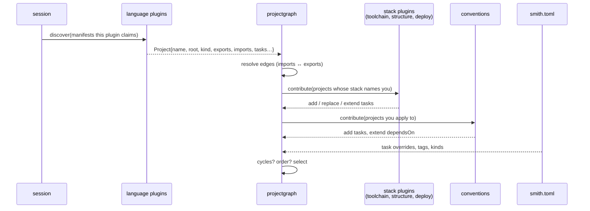

# The plugin system

This is the long version of how plugins work in smith: what a plugin is, how the
core starts and talks to it, which plugin gets to say what about a project, and
what happens when two of them disagree. The short version is in
[architecture.md](architecture.md); the method-by-method reference is in
[plugins.md](../reference/plugins.md).

If you want to *write* a plugin, start with the guide
([writing-a-plugin.md](../guides/writing-a-plugin.md)). This page explains why
the protocol looks the way it does.

## The one rule

**The core knows no language.** Everything that depends on Node, Go, Python,
Rust, a test runner, a registry or a cloud is a plugin. The core owns only what
is the same for every project: the graph, the cache, the scheduler, the
release plan, the pipeline model, `smith.toml`.

That rule has a consequence you can see in the code: `apps/smith` has no
`package.json`, no `go.mod`, no `pyproject.toml` parsing. It asks a plugin what
a manifest means and gets back a `Project`.

## What a plugin is

A plugin is a program that speaks **JSON-RPC 2.0 over its standard input and
output**, with each message framed the way the Language Server Protocol frames
them:

```
Content-Length: 87\r\n
\r\n
{"jsonrpc":"2.0","id":1,"method":"initialize","params":{...}}
```

Three decisions are packed in that sentence.

- *A separate process.* A buggy or slow plugin cannot corrupt the core's memory,
  a plugin can be written in any language, and the core can kill one that hangs.
  The cost is a start-up of a few milliseconds per plugin and JSON on a pipe.
- *Standard input and output.* Nothing to configure, nothing to listen on, no
  port to clash with; it works the same on Windows, macOS and Linux and inside
  containers. Because stdout carries the protocol, a plugin writes its logs and
  the output of the tools it runs to **stderr**; the host forwards stderr to the
  user's terminal.
- *LSP framing.* A length-prefixed message needs no escaping and lets either
  side send large payloads (a project list for a thousand-package repository).
  The reader refuses a message above 64 MiB so a corrupt header cannot make it
  allocate without limit (`packages/plugin-sdk/transport`).

The wire protocol is versioned by one integer (`protocol.Version`, currently 1)
independent of smith's own version. The host offers the versions it speaks in
`initialize`; the plugin picks one; if it picks one the host does not speak, the
connection is dropped. Adding a method or an optional field does not change the
version; changing the meaning of an existing one does.

### Built-in plugins use the same protocol

The plugins that ship inside the `smith` binary (the language plugins `node`,
`go`, `python`, …, and the toolchain, convention and structure plugins
`eslint`, `jest`, `vitest`, `docker`, `vertical-slices`, …) are not a special
case. The host
starts **itself** as `smith plugin serve <name>` and talks to the child over
pipes, exactly as it would to `smith-plugin-kiwi`. This keeps the protocol
honest (the built-ins are its first and best-tested users) and means a
built-in can be replaced by an external plugin of the same name in `smith.toml`
(`[plugins.external.<name>]`) without the core noticing.

## Lifecycle of a command

Almost every command begins with `session.Open` (`apps/smith/session`):

1. **Find and load** the workspace: walk up from the current directory (or
   `SMITH_WORKSPACE_ROOT`) to the directory with `smith.toml`, parse it, and
   reject unknown keys. (`smith adopt` and `smith new` run before a
   `smith.toml` exists and open the directory with a preview configuration
   instead.)
2. **List the files**: `git ls-files` plus untracked files that are not ignored.
   Everything that follows works on this list, so `.gitignore` is respected
   everywhere without each plugin parsing it.
3. **Start the plugins** (`pluginhost.Start`), all in parallel:
   - the built-ins named in `[plugins] enabled` (all of them by default),
   - each `[plugins.external.<name>]`, located on the plugin search path (the
     workspace's `.smith/plugins`, then each directory of `SMITH_PLUGIN_PATH`,
     then `$SMITH_HOME/plugins`; the first `<dir>/<name>/plugin.json` wins),
   - the built-in *conventions* (docker, playwright, …), unless an external
     plugin of the same name replaced them.
   Each child gets `SMITH_PLUGIN=1` in its environment and the workspace root in
   `initialize`.
4. **Handshake.** `initialize` returns what the plugin *is* (see below). The
   host checks that an external plugin answers to the name it is declared under
   and that its version satisfies the constraint in `smith.toml`.
5. **Build the catalog of stacks** the plugins publish plus the ones
   `smith.toml` defines, and validate them.
6. **Discover projects** and build the graph (next section).
7. At the end of the command, **shutdown**: the plugins are closed. A call that
   exceeds its timeout kills the plugin process, because after a timeout its
   stream can no longer be trusted.

A plugin is never given more calls at once than it declared (`concurrency` in the
`initialize` result; absent is one, so such a plugin is called one request at a
time and the next call waits for the answer), and `host.Client` waits for a
free place before it sends; calls to different plugins can run at the same time.
A call whose context ends or whose time runs out is cancelled (see
[the plugin protocol](plugin-protocol.md#cancel-and-concurrency)). Default timeout is two minutes;
`generate` and `publish` pass much longer ones because they run real
toolchains.

## The handshake: what a plugin says it is

`initialize` returns an `InitializeResult`. This is the plugin's whole
self-description, and it is the only thing the host trusts:

| Field | Meaning |
|---|---|
| `plugin` | name and version. The version goes into cache keys. |
| `kind` | `language` or `convention` (`protocol.PluginKind`). It sets the *default* roles: a language plugin is language, toolchain and scaffold; a convention plugin is a structure rule |
| `roles` | the levels the plugin can be chosen for in a project. Empty means the default for its kind. One plugin can play several (a scaffold that is also a toolchain). |
| `languages` | values of `--lang` that reach this plugin |
| `manifests` | file names or patterns (`package.json`, `*.csproj`) whose presence may make a directory a project of this plugin |
| `provides` | slots: the task names a toolchain owns (`test`, `lint`). A slot is exclusive. |
| `requires`, `conflicts` | other plugins that must / must not be in the same project |
| `stacks` | ready-made stacks the plugin publishes |
| `capabilities` | which methods it implements |

The **capabilities** matter most. The host calls a method only if the plugin
advertised it, and the Go SDK derives the list from the Go interfaces a plugin
implements (`Discoverer`, `Generator`, `Versioner`, `Publisher`,
`CIContributor`, `DoctorContributor`, `Contributor`, `Remover`,
`PublishedLooker`, and the `dependencies/*` family). A plugin in another
language sets the booleans by hand. A method the plugin did not advertise is
not an error; the host treats it as "this plugin has nothing to say here".

## Roles and levels

A project is made from plugins at **levels**:

| Level | Question it answers | Example |
|---|---|---|
| language | what is in this directory, who does it import, how is it versioned and published? | `node`, `go`, `python` |
| scaffold | what files does a new project of this kind start with? | the language plugin itself, or `vite-react` |
| toolchain | how are its lint, test, build and typecheck tasks run? | `eslint`, `jest`, `vitest`, `typescript` |
| structure | how must its source be laid out? | `vertical-slices` |
| deploy | what is built and shipped from it? | `docker`, `deploy-azure-function` |

Exactly one language plugin and at most one scaffold per project; every other
level can have several plugins. The rest of the make-up is checked by
`ValidateMembers` (`apps/smith/pluginhost/stack_validator.go`) whenever a stack
or a recipe is built:

- every plugin plays only a level it declared in `roles`, and applies to the
  project's language;
- each **slot** has one plugin: two toolchains that both `provide` `test` are an
  error naming both;
- every `requires` is met (a Node toolchain requires the `node` language
  plugin); no two plugins `conflict`.

A *convention* is a plugin that applies to a whole workspace rather than being
chosen per project (`docker`, `playwright`): it is switched on by a
`[conventions.<name>]` table in `smith.toml` and applies to the projects whose
language it supports, minus any it `exclude`s.

## From files to a project: who speaks, and in what order

This ordering is the heart of how plugins interact, so it is spelled out. The
code is `projectgraph.Discover`.



1. **Discovery.** For each plugin that can `discover`, the host gives it the
   files whose base name matches its `manifests`, minus `[workspace] exclude`.
   The plugin returns one `Project` per manifest it owns (it may ignore a
   manifest, for instance a root `package.json` that only declares workspaces).
   A `Project` carries: a name (unique in the workspace), a root, a language, a
   *kind* (`app`, `lib` or `package`), the identifiers it **exports** (an npm
   package name, a Go module path), the identifiers it **imports**, its version,
   its tasks as the language plugin infers them, tags, and the stack its
   manifest records. Paths are normalised to workspace-relative POSIX paths.
2. **Edges.** The core, not the plugins, builds the dependency graph: project A
   depends on B when something A imports equals, or is a sub-path of, something
   B exports (`@acme/ui/button` imports `@acme/ui`). This is why plugins only
   report strings and the graph is the same across languages — a Python
   package, a Go module and an npm workspace can sit in one graph (and a
   `bicep` or recipe project can depend on an app).
3. **Stacks.** Each project gets a stack: `smith.toml`
   `[projects.<name>] stack`, else the one its manifest records, else the
   workspace default for its language. The stack names toolchain, structure and
   deploy plugins. Each of those plugins is asked **once**, with *all* the
   projects whose stack names it, and answers with a `Contribution` per project.
   Contributions merge in the stack's order:
   - **`tasks`** are added if the project has no task by that name;
   - **`replace`** overwrites a task (a toolchain's `test` replaces the
     language plugin's inferred one);
   - **`dependsOn`** appends dependencies to an existing task.
   Every merge records *where each field came from* ("plugin eslint (stack
   node-vitest)"), which is what `smith explain` prints.
4. **Conventions.** Same merge, for the conventions that apply, after the
   stack's plugins. Convention settings (`registry`, `short_description`, …) are handed to the
   plugin as `project.settings.<plugin>`, layered
   `[conventions.x]` → `[projects.p.x]`.
5. **`smith.toml` overrides** apply last, field by field: command, cwd, inputs,
   outputs, env, cache, dependsOn, verify, serve. The rule for a task is
   therefore **plugin → stack → convention → `[tasks.x]` →
   `[projects.p.tasks.x]`**, later wins, and `smith explain` shows the winner of
   each field. A `depends_on` override replaces the list, with one exception:
   dependencies a plugin attached to a task that exists only because of that
   plugin are kept (otherwise overriding `e2e` would drop the `e2e-browsers`
   task it cannot run without).
6. **Validation.** Cycles between projects are reported (with the path); a
   topological order is computed; the selection language (`name`, glob,
   `tag:x`, `kind:x`, `lang:x`, `!pattern`) is bound to the graph.

Two details worth knowing:

- Plugins never see each other. They cannot call one another and they cannot
  read what another contributed. Everything they share goes through the project
  (`exports`, `imports`, `tags`, `settings`) and through task names. This keeps
  composition predictable: the result depends only on the *set* of plugins and
  the stack's order, not on timing.
- A project's **toolset** — "node@1.28.1+eslint@1.28.1+jest@1.28.1" — is
  computed here and becomes part of every task's cache key, so upgrading any
  plugin that shaped a project invalidates that project's cached results.

## The methods, grouped by what they are for

| Group | Methods | Called when | Who calls |
|---|---|---|---|
| Lifecycle | `initialize`, `shutdown` | every session | host |
| Shape of the workspace | `discover`, `contribute` | every session | projectgraph |
| Creating things | `generate`, `remove` | `smith add`, `smith remove`, `smith new` | scaffold, remove slices |
| Releasing | `version/write`, `publish`, `published` | `smith release`, lineage checks, `smith ci release` | release |
| Dependencies | `dependencies/install`, `uninstall`, `declared`, `rewrite`, `latest` | `smith install`, `sync`, `up` | dependencies slice |
| CI | `ci` | `smith ci generate`, every `smith ci <phase>` | cipipeline |
| Health | `doctor` | `smith doctor` | doctor |

### `generate`

The host asks a scaffold or language plugin for a project: kind, name, root,
stack, answers. The plugin writes files itself (using the SDK's template
helper, which never overwrites a file) and reports the files it wrote. The host
then reruns discovery so the new project is a first-class member, runs the
project's first lint/typecheck/test/build, and regenerates the CI pipelines.

### `version/write` and `publish`

Versioning and publishing are separate steps on purpose. `version/write` stamps
a version into a manifest and returns the files it touched; the release restores
those files afterwards, so **nothing is committed back** — the tag is the record
of the release. `publish` uploads. Both are idempotent: a registry that already
has the version answers "skipped", which is why a failed release can simply be
re-run.

For an *app*, the language plugin's `publish` is asked for **assets** instead of
a registry upload: it cross-compiles the per-platform archives into
`dist/release/<app>`, and the core distributes those to npm, PyPI, NuGet,
RubyGems, pub.dev, Homebrew/Scoop/winget manifests and the GitHub Release. That
is why `publish` takes an `AssetSpec` and returns `assets`, `assetPlatforms`
and `binary`.

A *deploy* plugin (docker) is called by the same `publish` method after the
language plugin has published, and reports `images`: the registries and tags it
pushed and the digest each registry holds.

### `ci`

Each plugin returns what its projects need in a pipeline: toolchains (with a
GitHub action, an Azure task and a plain install command, so every provider can
install them), setup steps, audit steps, post-release steps, credentials,
permissions, package stores to cache. The core merges the contributions
(duplicates by name keep the first), sorts them so the YAML is deterministic,
and renders GitHub Actions, Azure Pipelines or GitLab CI from one
provider-neutral model.

### `doctor`

A plugin returns *findings*: a check, whether it is OK, the detail, the remedy,
and optionally a fix. A fix is files (whole new contents, so the host can show
a diff), then ordered command *steps* (argv, no shell, run from the workspace
root), and *choices*: questions whose options are fixes themselves, which turn a
remedy like "install the tool or remove the script" into a wizard. The core adds
its own invariants (builds go to `dist/`, no two tasks write the same directory,
no cycles, a full clone…) and prints one report, with the fixes folded: the same
fix on many projects is one that says which it applies to. A fix is applied
unasked only when it is marked safe, restores something smith or a plugin owns,
and has no choices; every other fix is asked about, in a terminal as numbered
prompts, and elsewhere named with the command that applies it. The host owns
applying (writing, running steps, stopping at the first failure), so a plugin in
any language only describes the change. See
[Creating a language plugin](../plugins/creating/language-plugin.md#doctor-fixes-files-steps-and-choices).

## How plugins affect the cache

The cache key of a task contains the plugin versions of its project's toolset,
the toolchain version a language plugin reported for the project
(`node 20.11.0`), and everything the plugin put into the task — command, env,
declared inputs and outputs. Plugins therefore never talk to the cache; they
only have to be *honest and deterministic* in what they put into a task. The
guidance for plugin authors:

- declare `inputs` narrowly enough to be useful and broadly enough to be right;
- declare `outputs` as directories under `dist/`;
- never put a timestamp, a random value or an absolute path into a command;
- set `cache` only for tasks whose result depends on their inputs alone.

## Schema-driven code generation

A generated client is a task whose input is a file outside the consumer. The
design keeps that in smith core, not in a plugin method, because the pieces
already exist: a project consumes a schema (the schema edge, so the consumer
depends on its owner), a task can read `{workspaceRoot}/` inputs, and the cache
key covers command, environment and input contents.

`[projects.<name>.generate]` therefore expands, in `ApplyOverrides`, into an
ordinary `generate` task: input the schema, output the `out` directory, `cache`
on, and `generate` prepended to the `dependsOn` of the project's `lint`,
`typecheck`, `test` and `build`. The generator is named by settings (`generator`
for the default OpenAPI and protoc commands, or a full `command`) and must be
pinned with `version`, which is in the command and in `SMITH_GENERATOR_VERSION`,
so upgrading it invalidates the cache. The graph knows the outputs through the
task's `outputs`. Not yet: several schemas per project, a plugin contributing
the generate task from a recipe's settings, and gRPC/AsyncAPI/GraphQL defaults.

## Failure modes

| What goes wrong | What the host does |
|---|---|
| plugin binary missing or fails to start | the command stops, naming the plugin and the command it tried |
| plugin answers `initialize` with another protocol version | the connection is refused |
| a method times out | a plugin that advertised `cancel` is asked to stop and has five seconds to answer; any other plugin, or one that does not answer, is killed. The call fails; other plugins are unaffected |
| a plugin returns an error | the command stops and shows the error with the plugin's name |
| two plugins provide one slot, or conflict | the stack or recipe is refused with both names |
| an external plugin is older or newer than `smith.toml` allows | refused at start-up, with both versions |
| a plugin writes to stdout other than protocol messages | the stream is corrupt; the call fails. Log to stderr. |

## Testing a plugin: the conformance suite

`smith plugin check <name | path>` runs the same suite `conformance.Check`
exposes to plugin authors' own tests. It starts the plugin as the host would
and verifies that it names itself, that its roles match what it implements,
that its stacks are complete, and that every method it advertises answers a
well-formed request. With `--generate` it also creates an app, a lib and a
package in a temporary directory and requires that its own `discover` finds
them. A plugin that passes behaves under smith.

## Why not …

- *… a plugin API in the host's language (shared libraries, WASM)?* Shared
  libraries are not portable across Windows, macOS and Linux without a build
  matrix per plugin; WASM cannot run `npm`, `dotnet` or `cargo`. A process can.
- *… gRPC?* It needs a port or a socket and code generation in every language;
  length-prefixed JSON needs a standard library and a loop.
- *… plugins that call each other?* It would make the result depend on call
  order and let one plugin's bug appear as another's. Composition through the
  project and task names is less powerful and far easier to reason about.
- *… scripts in `smith.toml` instead of plugins?* A task's command is already
  free-form there. A plugin is for what needs *knowledge*: how to read a
  manifest, what a language's imports are, how to publish.
