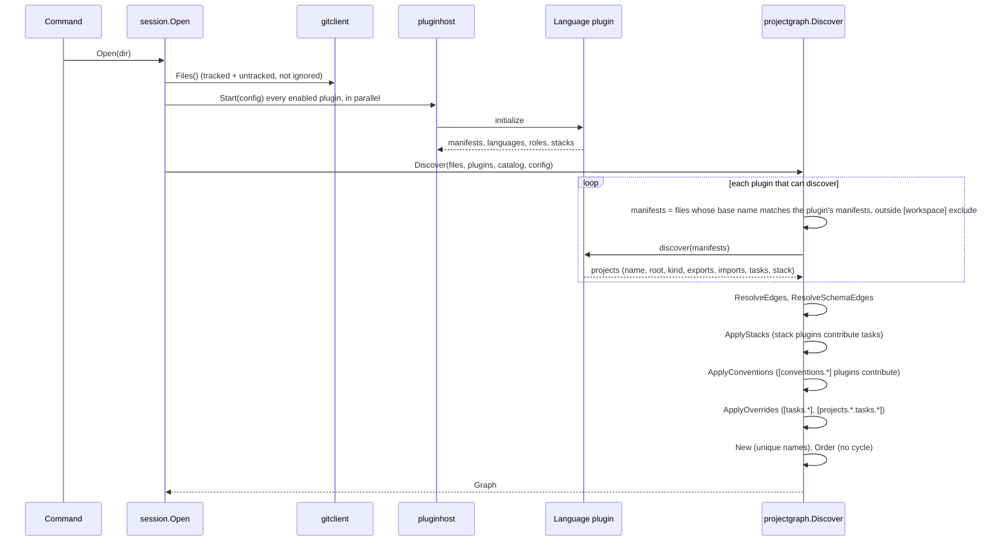

# How a project is discovered and classified

smith does not ask you to list your projects. It finds them from the manifests already in
the repository, asks the plugin that owns each manifest to describe the project behind it,
and then decides three things about every project: its kind (app, lib or package), its
stack (which plugins shape its tasks) and its tasks. This page follows that decision chain
and says where each setting in `smith.toml` takes part.

**Audience:** engineers who want to know why smith did or did not see a project, why it
called it an app, or where a task came from. The commands that show the result are
[`smith projects`](../manual/projects.md), [`smith kinds`](../manual/kinds.md),
[`smith stacks`](../manual/stacks.md) and [`smith explain`](../manual/explain.md).

## The chain in one picture

The code is in `apps/smith/session/open_session_use_case.go` (`Open`) and
`apps/smith/projectgraph/discover_projects_use_case.go` (`Discover`). The order of the
steps matters: edges are resolved before stacks, and smith.toml overrides are applied last
so they win.

## Step 1: which files are candidates

`session.Open` takes the file list from git: tracked files plus untracked files that are not
ignored. A workspace that is not a git repository is refused
(`the workspace is not a git repository; run git init`). So an ignored `node_modules/` or
`dist/` is never scanned for manifests, and a new file counts as soon as it exists.

`Discover` then gives each plugin the files whose **base name** matches one of the
manifest names the plugin declared in `initialize`. A manifest may be a plain name or a
pattern (`protocol.IsManifest`), and a file inside a directory matched by `[workspace]
exclude` is left out (`workspace.Config.Excluded`: the glob may match the file's directory
or any parent).

| Plugin (language) | Manifest it claims | When it is a project |
|---|---|---|
| `node` | `package.json` | any below the root; the root manifest holds tooling only |
| `go` | `go.mod` | any below the root; a root `go.mod` is a single-module repository |
| `python` | `pyproject.toml` | below the root, and only with a `[project]` table with a name |
| `rust` | `Cargo.toml` | below the root, with a `[package]` (a virtual workspace manifest is not a crate) |
| `dotnet` | `*.csproj`, `*.fsproj` | below the root; a test project belongs to the project it references and is not a project itself |
| `ruby` | `*.gemspec` | one per directory, below the root |
| `php` | `composer.json` | below the root |
| `cpp` | `CMakeLists.txt` | when it calls `project()`; one without is a subdirectory of a project |
| `dart` | `pubspec.yaml` | below the root |
| `jvm` | `pom.xml`, `build.gradle.kts`, `build.gradle` | modules; the root pom or build script, other pom-packaged modules and `buildSrc` only organise the build |
| `bicep` | `main.bicep` | each one |
| `lua` | `*.rockspec` | each directory with one (the first rockspec counts); the root one is skipped |
| `applescript` | `*.applescript` | each directory with one; its main script is `main.applescript`, else the first by name; the root is skipped |
| `recipe` | `*.recipe.toml` in a folder of its own | a recipe file is a project, versioned like a package |

The row for each plugin comes from its `Manifests` field in `libs/plugin-<name>/plugin`
and the doc comment of its `Discover` function in `libs/plugin-<name>/discovery`.

A plugin answers for a manifest by returning a project, or by leaving it out ("a manifest
the plugin does not own is simply left out"). The host takes the answer at face value, then
normalises every path (`projectgraph.CleanRelative`): forward slashes, no `..`, no absolute
paths. A plugin that reports an absolute root or one that climbs out of the workspace fails
the command.

Names must be unique. A project is named after the last segment of its directory (node, go,
python and rust do this), and two projects with one name stop every command with
`two projects are named "x" (a and b); project names must be unique - rename one
directory` (`projectgraph.New`).

## Step 2: what the plugin reports

The `discover` result is a `protocol.Project`
(`packages/plugin-sdk/protocol/project_contract.go`). The fields that matter here:

| Field | Meaning |
|---|---|
| `name`, `root` | the name users type; the workspace-relative directory |
| `language`, `kind` | `node`, `go`, ...; and `app`, `lib` or `package` |
| `exports` | identifiers other projects import this one by: an npm package name, a Go module path, a Python import name |
| `imports` | identifiers the sources import; used for edges ([The project graph](project-graph.md)) |
| `tasks` | the tasks the plugin infers, as argv commands with inputs, outputs, `dependsOn` and `cache` |
| `stack` | the stack recorded in the manifest, if any |
| `tags` | for example the native tag that moves a project to the per-OS native job |
| `toolchain` | the compiler or runtime version the plugin probed; it goes into every cache key |
| `tagPrefix`, `version`, `description` | release inputs |

The plugin, not the core, knows how to read its manifests. That is the point of the
protocol: the core never parses `package.json` ([ADR 0002](decisions/0002-out-of-process-plugins.md)).

## Step 3: the kind (app, lib or package)

The kind tells release and CI what to do with a project: an **app** is never published
(a deploy plugin or a `[projects.<name>.release]` table may still ship it), a **lib** is
never published, a **package** is published to its registry when it has releasable commits.

Every language plugin resolves the kind the same way, through
`packages/plugin-sdk/projectkind` (`Resolve`):

1. the kind **declared in the manifest**, if it is `app`, `lib` or `package`;
2. else the **top-level directory**: `apps/` gives app, `libs/` lib, `packages/` package;
3. else the plugin's **fallback**.

smith.toml has no setting for the kind. To change it, write the marker where the plugin
looks:

| Language | Kind and stack marker |
|---|---|
| node | `"smith": {"kind": "app", "stack": "react"}` in `package.json` (also `"native": true`) |
| go | `// smith:kind app` and `// smith:stack <name>` comments in `go.mod` (also `// smith:native`) |
| python | `[tool.smith] kind = "app"` in `pyproject.toml` |
| rust | `[package.metadata.smith] kind` and `stack` in `Cargo.toml` |
| dotnet | `SmithKind` and `SmithStack` MSBuild properties |
| ruby | `spec.metadata['smith_kind']` and `smith_stack` in the gemspec |
| php | `extra.smith.kind` and `stack` in `composer.json` |
| cpp | `set(SMITH_KIND ...)` and `set(SMITH_STACK ...)` in `CMakeLists.txt` |
| dart | a `smith:` section in `pubspec.yaml` |
| jvm | `smith.kind` and `smith.stack` properties in the pom or the Gradle build |
| bicep | `metadata smithKind = '...'` and `metadata smithStack = '...'` |
| lua | `-- smithKind: ...` and `-- smithStack: ...` comments in the rockspec |
| applescript | `-- smithKind: ...`, `-- smithStack: ...` and `-- smithVersion: ...` comments in the main script |

The fallbacks differ because the languages do: a private npm package is a lib and a public
one a package; a Go module whose top directory holds a `package main` file is an app and
any other a lib; a Rust crate with `src/main.rs` and a .NET project with output type `Exe`
or `WinExe` are apps; Python, Ruby, PHP, C++, Dart and JVM modules are libs; a Bicep
deployment is an app. When the fallback is wrong for a repository, `smith adopt` prints the
marker to add ("To change one: ...").

## Step 4: the stack

A **stack** names the plugins that shape a project besides its language plugin: a toolchain
(`jest`, `eslint`), a structure plugin (`vertical-slices`), a scaffold, a deploy target
(`docker`). `smith stacks` lists them and who uses each. The stack of a project is the first
of these that is set (`projectgraph.StackOf`):

1. `[projects.<name>] stack` in `smith.toml`;
2. the stack recorded in the manifest (the markers above);
3. `[default_stacks]` for the project's plugin or language (`node = "node-jest"`);
4. none: the language plugin alone.

The value `none` (`protocol.NoStack`) is a stack of no extra plugins. A stack must belong to
the project's plugin (`project api is discovered by the go plugin, but stack node-jest is
for node projects`), and an unknown stack fails with the list of known ones
(`no stack named "x"; known stacks: ...`). Stacks come from two sources, merged in
`pluginhost.NewCatalog`: those plugins publish in `initialize`, and those declared under
`[stacks.<name>]` in `smith.toml`, which win over a published one of the same name.
Stack members are checked for fit: roles, `provides` slots (two plugins may not provide the
same task), `requires` and `conflicts` (`pluginhost.ValidateStack`).

`ApplyStacks` then asks each stack plugin once, for all the projects that use it, to
`contribute`. The result is merged into each project with `merge`: a contributed task is
added unless the project already has one by that name, a `replace` entry replaces, and
`dependsOn` entries are appended to existing tasks. Every merged field remembers its source
(`plugin eslint (stack node-jest)`), which is what `smith explain` prints.
[Stacks](../reference/stacks.md) lists the built-in ones.

## Step 5: conventions

A convention is a plugin that smith.toml switches on for projects, as opposed to one a
stack names. `[conventions.vertical-slices]` is the example in this repository's own
`smith.toml`. `ApplyConventions` visits every plugin that has a `[conventions.<name>]` table,
refuses one that is not a convention plugin, selects its target projects
(`projectgraph.ConventionTargets`: the languages the convention supports, or the subset
`languages` names, minus the projects in `exclude`), passes it the
settings, and merges its contribution the same way. A convention that only matters when
projects are generated adds no tasks.

## Step 6: smith.toml wins

`ApplyOverrides` layers, in this order and for every task field (`command`, `cwd`,
`inputs`, `outputs`, `dependsOn`, `env`, `cache`) with its source recorded:

1. what the plugin inferred ("plugin node");
2. what a stack or convention contributed;
3. `[tasks.<task>]` for every project that has the task;
4. `[projects.<name>.tasks.<task>]`, which may also add a task if it gives a `command`.

The same pass copies the per-project release settings (`tag_prefix`, `bare_tags`,
`[projects.<name>.release]`, `split_repo`, registries) onto the project and marks an app's
`package` task to run in `smith ci verify`. See [The task graph](task-graph.md) for what
happens to the tasks afterwards.

## Step 7: the checks that end discovery

After overrides, `projectgraph.New` rejects duplicate names. `Discover` then calls
`Graph.Order`, which rejects an import cycle, naming it
(`projects import each other in a cycle: ui → web → ui`), so `session.Open` fails and every
command that needs an order stops with it. `smith graph` and `smith doctor` open the session
with `AllowCycles` (`projectgraph.DiscoverAllowingCycles`): they skip the `Order` check,
list the cycles with `Graph.Cycles` and name the import to remove (`projectgraph.CycleRemedy`).
Before the fix for issue 558 (up to 1.65.0) the error ended `session.Open` for them too.

## What `plugins.enabled` and external plugins change

`[plugins] enabled` lists the built-in language plugins to load; empty means all of them
(`pluginhost.BuiltinNames`). An unknown name is an error. The add-on plugins (toolchains,
structure, scaffold, deploy) are always loaded so their stacks exist, but they act only on
projects whose stack names them or that a convention selects. An entry under
`[plugins.external.<name>]` replaces the built-in of that name or adds a new plugin, started
from its declared command or found on the search path. `smith plugin list` shows what loaded.

## What smith does not do

- It does not discover projects from a workspace file (`pnpm-workspace.yaml`, `go.work`,
  `package.json` `workspaces`); those are consequences of the projects, which plugins keep
  in step, not inputs. `smith doctor` checks that they agree.
- It does not follow symbolic links or scan ignored directories, because the file list comes
  from git.
- It does not guess a kind from the code beyond the fallbacks above.

## Decisions

| Decision | Record |
|---|---|
| a language-agnostic core with out-of-process plugins | [ADR 0002](decisions/0002-out-of-process-plugins.md) |
| plugin roles and per-project stacks | [ADR 0021](decisions/0021-plugin-roles-and-per-project-stacks.md) |
| recipes with levels and slots | [ADR 0023](decisions/0023-recipes-with-levels-and-slots.md) |
| minimal TOML configuration | [ADR 0004](decisions/0004-minimal-toml-configuration.md) |
| vertical slices named in each language's own spelling | [ADR 0013](decisions/0013-vertical-slices-in-each-languages-naming.md) |

## Where in the code

| Concern | Path |
|---|---|
| opening a workspace | `apps/smith/session/open_session_use_case.go` |
| discovery driver | `apps/smith/projectgraph/discover_projects_use_case.go` |
| stacks and the catalogue | `apps/smith/projectgraph/apply_stacks_use_case.go`, `apps/smith/pluginhost/stack_catalog_model.go`, `stack_validator.go` |
| conventions | `apps/smith/projectgraph/apply_conventions_use_case.go`, `convention_targets_policy.go` |
| overrides and sources | `apps/smith/projectgraph/task_overrides_mapper.go` |
| exclusion | `apps/smith/workspace/excluded_paths_policy.go` |
| kind resolution | `packages/plugin-sdk/projectkind/kind_policy.go` |
| per-language discovery | `libs/plugin-<name>/discovery` |
| the contract | `packages/plugin-sdk/protocol/project_contract.go`, `initialize_contract.go` |
