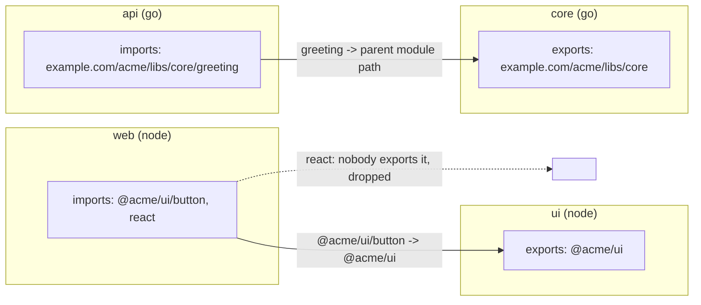

# The project graph and how edges are found

The project graph is the set of discovered projects and the "depends on" edges between them.
Everything that has to know what a change reaches is built on it: task order, `^build`,
`--affected`, release order, the graph views. smith finds edges from what each project
**imports** and what each project **exports**, and from the **shared schemas** projects own
and consume. It never asks you to write a dependency list.

**Audience:** engineers who want to know why an edge exists or is missing, and contributors
who change how edges are found. The user-facing commands are [`smith graph`](../manual/graph.md)
and [`smith affected`](../manual/affected.md).

## The model

`projectgraph.Graph` (`apps/smith/projectgraph/project_graph_model.go`) holds
`[]*Project`, indexed by unique name. A `Project` is the plugin's `protocol.Project` plus
what smith adds:

| Field | Set by | Meaning |
|---|---|---|
| `Deps` | `ResolveEdges`, then `ResolveSchemaEdges` | names of the projects this one depends on, sorted |
| `SchemaDeps` | `ResolveSchemaEdges` | the part of `Deps` that comes from schemas, not imports |
| `Schemas`, `Consumes` | `ResolveSchemaEdges` | schema files the project owns / consumes |
| `Sources` | `ApplyOverrides` | where each task field's value came from, for `smith explain` |
| `Conventions`, `Deployers` | conventions, deploy plugins | extra plugins that shape or ship the project |

The queries the rest of smith uses are methods on `Graph`: `Dependents` (who imports
this), `TransitiveDeps`, `TransitiveDependents`, `Owner` (the project whose root contains
a path; the deepest wins when roots nest), `SchemaOwner`, `Order` (a topological order),
`Cycles` and `Select`.

## Edges from imports and exports

Each language plugin fills two lists per project in its `discover` answer:

- **exports**: the identifiers other projects import this one by;
- **imports**: the identifiers its sources import.

The core then matches them (`ResolveEdges`, `resolve_edges_algorithm.go`). It builds a map
from every exported identifier to its project, and for each import tries the identifier and
then its parents, cutting at the last `/`: an import of `@acme/ui/button` is looked up as
`@acme/ui/button`, then `@acme/ui`. The first hit is the owner; an import that resolves to
the project itself is ignored; an import that nothing exports (a third-party package) is
dropped. Two projects exporting the same identifier is not diagnosed: the later one wins.

What each plugin reports:

| Plugin | Exports | Imports |
|---|---|---|
| node | the `name` of `package.json` | bare package names found by scanning `.ts .tsx .mts .cts .js .jsx .mjs .cjs` files (skipping `node_modules`, `dist`, `coverage`, `build` and hidden folders), plus every dependency, devDependency, peer and optional dependency the manifest declares, so a package used only by a config file still forms an edge |
| go | the module path from `go.mod` | the import paths of the `.go` files, parsed with `go/parser` (imports only); nested modules, `vendor`, `testdata` and hidden folders are not entered |
| python | the import name derived from the project name | top-level module names from `import` and `from ... import` lines in `.py` files, plus the import names of the `[project] dependencies` |
| cpp | the project's directory | the workspace directories it adds with `add_subdirectory` |
| bicep | the project's directory | the workspace directories its modules come from |
| lua | the rock's `package` name | the rocks in the rockspec's `dependencies`, `lua` excluded |
| applescript | the project's directory | none |
| vba | the project's directory | none |
| dotnet | the package id of the project file | the references of the project file; a tests project's references count as its owner's |
| rust | the crate name | the crate's path dependencies |
| dart | the package name | the dependencies in `pubspec.yaml` |

The other plugins (ruby, php, jvm) follow the same contract with their own manifests; their
`discovery` packages say which fields they read.

Two consequences follow from scanning instead of declaring:

- An edge exists when the source mentions the identifier, in code or in a manifest. It does
  not know whether the import is used at run time, so a dev-only import still makes the
  importer a dependent.
- A language boundary is crossed only through a schema (below). A Go service and the Node
  client for it are separate until a schema links them.

## Edges from shared schemas

Imports cannot see that a generated client depends on the OpenAPI document a server owns.
`ResolveSchemaEdges` (`resolve_schema_edges_algorithm.go`) adds those edges after the import
edges:

1. A file is a **schema** by its name (`SchemaKind`): `openapi` or `swagger` with `.yaml`,
   `.yml` or `.json`; `asyncapi` likewise; `*.proto`; `*.graphql` or `*.gql`.
2. A project **owns** the schema files inside its root, plus the files its
   `[projects.<name>] schemas` globs match, wherever they are.
3. A project **consumes** the files its `consumes_schemas` globs match (and the
   `schema` of its `[projects.<name>.generate]` table).
4. A consumer depends on the owner of each file it consumes. A file nobody owns by that
   name falls back to the project whose root holds it.

These edges are marked in `SchemaDeps`, so `smith graph --blast-radius` can say whether an
edge is an `import` or a `schema` ([ADR 0028](decisions/0028-graph-edges-from-shared-schemas.md)).
Affected computation also treats a changed schema file as a change to its owner
([How affected projects are computed](affected.md)).

## Cycles

`Graph.Order` is a depth-first topological sort that fails on a cycle and names it
(`ui → web → ui`). `projectgraph.Discover` calls it as its last step, so a cycle ends
`session.Open` and therefore every command. `Graph.Cycles` (Tarjan's strongly connected
components) lists every cycle for the commands that want to report them; its callers in
`smith graph` and `smith doctor` are not reached in 1.62.0 for that reason. Cycles are not
tolerated because both task ordering (`^build`) and release order need a DAG.

## Selecting projects

`Graph.Select` turns the patterns of `-p/--project` into names
(`select_projects_algorithm.go`). A pattern is, comma-separated or repeated:

| Pattern | Matches |
|---|---|
| `web`, `apps/web` | the name or the root |
| `lib-*`, `apps/*` | a glob (`path.Match`) over names or roots |
| `kind:app`, `lang:go`, `tag:native` | kind, language or plugin, tag |
| `!pattern` | removes what matches; only exclusions means everything except |

A pattern that matches nothing is an error that lists the project names. `smith run -p web`
runs `web` and, through `^build`-style task dependencies, what it needs; it does not select
dependencies itself.

## Views of the graph

`smith graph` (`apps/smith/graphview`) renders the same `Node` list five ways:

| Format | Renderer | Notes |
|---|---|---|
| `text` (default) | `Text` | one project per line, its dependencies as a tree beneath; a changed project is starred |
| `json` | `JSON` | `{"projects": [...]}` with `deps`, `tasks`, `kind`, `language`, `plugin`, `stack` |
| `dot` | `DOT` | Graphviz, drawn bottom to top, a changed project in bold |
| `html` | `HTML` | a self-contained page: projects in layers, arrows to what they depend on |
| `tui` | `NewBrowser` | an interactive browser (bubbletea): what a project uses, what uses it |

Options that narrow the graph before rendering:

- `--focus a,b` keeps the named projects and everything that depends on or is depended on
  by them, transitively (`graphview.Around`, then `Subgraph`, which drops edges leaving the
  kept set).
- `--affected [--base b]` keeps the projects `affected.Compute` returns and marks the ones
  that own a changed file.
- `--diff <rev>` compares with the graph at a revision. `NodesAt` creates a temporary git
  worktree at the commit, opens it as a workspace with the same plugins, discovers its
  graph, removes the worktree, and `Diff` reports added and removed projects and edges and
  changed kind, stack, plugin or directory. The working tree is not touched.
- `--blast-radius <project or file>` walks `Dependents` breadth-first from the owner of the
  target (a project name, or a file's owning project and schema owner) and lists what it
  reaches, nearest first, with `via` import or schema (`graphview.BlastRadius`).

## Decisions

| Decision | Record |
|---|---|
| edges are found by reading imports, not declared | rationale not recorded in the decision log; the behaviour is `ResolveEdges` above |
| shared schemas link projects across languages, with a blast radius | [ADR 0028](decisions/0028-graph-edges-from-shared-schemas.md) |
| one version per production dependency across the graph | [ADR 0027](decisions/0027-one-version-per-production-dependency.md) |
| language-specific knowledge stays in plugins | [ADR 0002](decisions/0002-out-of-process-plugins.md) |

## Where in the code

| Concern | Path |
|---|---|
| graph model and queries | `apps/smith/projectgraph/project_graph_model.go` |
| import edges | `apps/smith/projectgraph/resolve_edges_algorithm.go` |
| schema edges | `resolve_schema_edges_algorithm.go`, `schema_kind_policy.go` |
| cycles | `find_cycles_algorithm.go`, `Graph.Order` |
| selection | `select_projects_algorithm.go` |
| rendering, focus, diff, blast radius | `apps/smith/graphview` |
| scanning imports | `libs/plugin-<name>/discovery/import_scan_algorithm.go` |
