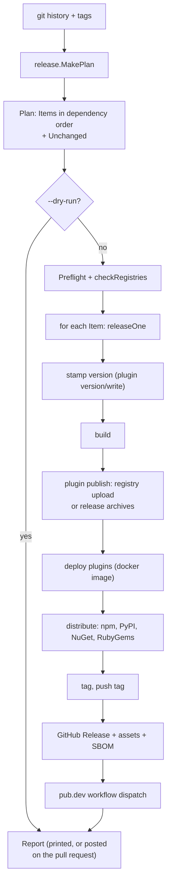

# How a release is decided and published

smith releases from the commit history. It reads conventional commits since each project's last
tag, decides which projects release and at which version, then stamps, builds, publishes and tags
each one in dependency order. Nothing is committed back: the tag is the record. This page follows
that path through `apps/smith/release` and its neighbours, and says where each decision is
recorded.

Audience: contributors changing the release, and anyone debugging why smith proposed (or refused)
a version. For the user view see [Releasing](../reference/releasing.md); for the pipeline that calls
it see [How CI pipelines are generated](ci-generation.md). An older, longer walk-through is
[Releases and CI: how they are built](release-and-ci-internals.md).

## The shape

`--dry-run` is not a separate code path. `release.Execute` takes `Options{DryRun: true}`, skips
preflight and the publishing calls, and each step reports what it would do. The preview posted on
a pull request (`releasepreview`) and the real release therefore print the same plan
([ADR 0006](decisions/0006-conventional-commits-tag-only-releases.md)).

## Deciding the plan

`release.MakePlan(git, graph)` (`plan_release_use_case.go`) visits the projects in dependency order
(`graph.Order()`; it fails on a cycle). A project is a candidate when `p.Releases()` is true: a
`package`, or an app with a release section.

1. **Last release.** `LatestTag` finds the highest version among tags with the project's prefix.
   `TagPrefix` is empty for `bare_tags`, otherwise `tag_prefix` when set, otherwise the prefix a plugin reports, otherwise `[release] tag_format`
   expanded for the project (`{name}`, `{scope}`; default `<name>@`; `ApplyOverrides` sets it). A Go
   module's plugin sets `<dir>/v` itself (`libs/plugin-go/discovery`). No tag means a first
   release, which starts from the manifest's version.
2. **Commits.** `git.Log(tag, SourceRoots...)` lists the commits since that tag that touched the
   project's directory or that of an internal project it bundles: every transitive dependency that
   does not release on its own (`SourceRoots`). A fix in a lib releases the app using it.
3. **Level.** `LevelOf` (`bump_policy.go`): a breaking change is `major`; `feat` is `minor`; `fix`
   and `perf` are `patch`; every other type, and a release commit, asks for nothing. The level of
   the project is the highest of its commits. `Version.Bump` applies it; below 1.0 a breaking change
   moves the minor (`semver_model.go`).
4. **Dependents.** If a project's own commits ask for nothing but a dependency of it is already in
   this plan, it gets a `patch` (`reason: dependency <name> <its new version>`), so its declared range stays
   correct.
5. **Override.** A commit anywhere in the repository since the tag whose message contains
   `version(<project>)[x.y.z]` forces that version (`directiveFor`). The plan refuses a next
   version that is not above the released one.

The result is `Plan{Items, Unchanged}`. Each `Item` carries the project, plugin, current and next
version, tag, level, the reason and the commits behind it.

### Release channels

A `[[release.channels]]` entry gives a branch its own line of prerelease versions
([ADR 0051](decisions/0051-a-release-channel-gives-a-branch-its-own-line-of-prerelease-versions.md)).
`release.PlanFor(session)` chooses the plan: `ChannelOf(cfg, PlanBranch(s))` returns the `Channel` of
the branch (`release_channel_model.go`), or nil for a stable plan, and `MakeChannelPlan` then counts
the channel instead of the stable line. `PlanBranch` is the branch checked out or, in a pull request
build with a detached merge commit, the branch the pull request targets.

- The first release of a project is `<major>.0.0-<prerelease>.1`, whatever stable versions exist.
  Each later one raises the counter and keeps the numbers before it, so a breaking change inside a
  channel does not start a new major.
- The channel's last release is the highest tag of that line that the checked out branch contains
  (`git tag --merged HEAD`). The stable plan ignores prerelease tags.
- `Plan.Channel` carries the publish name, and `--dry-run`, the report and the pull request comment
  print `ChannelNotice`.
- `Preflight` accepts a channel branch as a release branch. It refuses a channel release when a
  package's plugin lacks the `channels` capability, when a project has a deploy plugin, or when an
  app sends binaries to package managers (`channelProblems`), because each would move a stable
  pointer. An app's binaries sent to npm (under the channel's tag), PyPI, NuGet, RubyGems and pub.dev
  are allowed. `[projects.<name>.release] channels = false` keeps a project out of the channel: on a
  channel branch it is neither planned nor published.
- `publish` receives the publish name as `PublishParams.tag` (`dist_tag`, default the prerelease
  identifier, never `latest`). A plugin whose publish cannot move a stable pointer declares `channels` (the Go SDK marker
  interface `serve.ChannelPublisher`). The Node plugin passes the name to `npm publish --tag`; the Python and .NET plugins declare it and ignore the name, because PyPI and NuGet order a prerelease below the release. A version
  with a prerelease part gets a GitHub Release marked as a prerelease.

### The public API check

After the plan is made, `release.CheckAPI` (`check_api_use_case.go`) asks each package's plugin for
its public API names now and at its last release tag (`api/surface`, capability `apiSurface`) and
compares them (`DiffAPI`, `api_bump_policy.go`). A removed name needs a major bump (a minor below
1.0) and a new name a minor bump. When the commits ask for less, the item gets a warning.
`[release] api_check` is `"warn"` (the default), `"error"` (the release stops) or `"off"`. A plugin
that cannot list its API gives no warning. `smith ci` calls the same check in the release phase
([ADR 0044](decisions/0044-the-release-checks-the-bump-against-the-public-api.md)).

Conventional commits and tag-only releases were chosen on 2026-10-15; the decision log gives no
options considered for the tag-only model beyond what
[ADR 0006](decisions/0006-conventional-commits-tag-only-releases.md) records.

## Refusing a wrong past: lineage and preflight

Versions come from tags, so a wrong tag gives a wrong version. `release.CheckLineage` asks each
releasable project's plugin for the version its registry already has (`protocol.MethodPublished`)
and `releaselineage.Assess` compares it with the tags under the current prefix and under older
names the project had. It reports a version published without a tag, or tags behind the registry.
`smith doctor` shows the same findings (`release tags resolve under each project's tag prefix`,
`release tags are not behind the registry`).

`release.Preflight` runs only for a real release and lists every problem at once:

| Check | Source |
|---|---|
| shallow clone | `s.Git.IsShallow()` |
| wrong branch (`[release] branch`, default `main`; `SMITH_RELEASE_ANY_BRANCH` overrides) | `s.Git.CurrentBranch()` |
| uncommitted tracked changes | `git status --porcelain --untracked-files=no` |
| `GITHUB_TOKEN` and repository, when `github_releases` is set | `githubrelease.FromEnvironment`, `Repository` |
| each credential an app's distribution needs | `DistributionCredentials` |
| a split-repository mirror's token and readiness | `splitrepo` |
| each plugin's own required credentials, asked now through `ci` | so a contradictory docker setting fails before anything is published |

`checkRegistries` then asks the registries whether they would accept the versions, before the first
publish (`registry_probe_client.go`). `smith release --rehearse` runs that kind of check on its own,
for every registry any package publishes to, with read-only requests and no plan
(`apps/smith/releaserehearsal`; [ADR 0043](decisions/0043-a-release-is-rehearsed-against-its-registries-with-read-only-requests.md)).

## Releasing one project

`releaseOne` (`run_release_use_case.go`):

1. **Already tagged?** If the tag exists the project is done in git; the run only ensures the tag
   is pushed, the mirror and GitHub Release exist and the pub workflow was dispatched. This is the
   resume path: a re-run after a failure continues where it stopped, and a registry that already
   has the version answers "skipped".
2. **Stamp.** The language plugin's `version/write` (`protocol.MethodVersion`) writes the next
   version and the new versions of the project's dependencies into the manifests and returns the
   files it changed. A deferred `RestoreFiles` puts them back with git. No commit is made.
3. **Build.** Only for a project without a release section: the `build` task runs through the task
   runner, uncached when files were stamped. An app with a release section builds in step 4.
4. **Publish.** The plugin's `publish`. A library goes to its registry. An app is asked for release
   archives instead (`AssetSpec`: name pattern, platforms, output directory), because only the
   language plugin knows how to cross-compile. The answer lists the archives and which `os/arch`
   each is for.
5. **Deploy.** Each deploy plugin of the project (docker) is asked to `publish` as well.
6. **Distribute.** From the archives, the core builds npm packages (`npmbinaries`), PyPI wheels
   (`pypiwheels`), a .NET tool (`nugettool`) and platform gems (`rubygems`), and uploads them. Each
   is idempotent: a version the registry has is reported as existing. Then `linuxpackages` (`.deb`,
   `.rpm`) and `packagemanifests` (Homebrew, Scoop, winget, AUR, Nix flake) produce files to attach. Native apps skip
   the registries: their archives are built on separate runners (`smith ci native`).
7. **Tag and push.** `CreateTag` (annotated), then `pushTag` to `[release] remote`.
8. **GitHub Release** (when `[release] github_releases`): `githubrelease.Ensure` creates it with notes
   rendered from the commits (`RenderNotes`) and attaches the archives, `checksums.txt`, the manifests
   and a CycloneDX SBOM written by `sbom.Write` ([ADR 0011](decisions/0011-no-paid-code-signing.md)).
9. **pub.dev.** `dispatchPub` starts the `pub.yml` workflow on a tag of the form `{name}-v{version}`
   (or `[projects.<name>.release] pub_tag`), because pub.dev's automated publishing matches tag
   patterns that cannot contain smith's `@`.

Every step that completes or fails is appended to `dist/release/<project>/journal.json`
(`release_journal_store.go`). The journal only grows; a registry never lets a published version be
taken back, so it is not an undo log. `smith release --status` reads it, and the registry probe
uses it to tell "published by this release" from "already there". The whole run is also written to
`.smith/release-report.json` (printed by `--json`) and rendered as Markdown for the job summary.

## Registries and credentials

Where a project publishes is the language plugin's decision (`publish`), configured by
`[workspace] registry` and `[release] registry` with named `[registries]` entries; the value
`none` (`workspace.NoRegistry`) releases without publishing, which with `bare_tags` serves projects
that are versioned by tag only ([ADR 0024](decisions/0024-release-without-publishing-and-bare-tags.md)).
The re-packaging of one binary into every package manager is a core feature, not a plugin's
([ADR 0010](decisions/0010-one-binary-for-every-package-manager.md)).

| Target | Authentication | Where |
|---|---|---|
| npm packages of an app | `NODE_AUTH_TOKEN`; provenance through the job's OIDC token | `npmbinaries`, CI model `Provenance` |
| PyPI, NuGet | `PYPI_TOKEN`, `NUGET_API_KEY` (`DistributionCredentials`) | `pypiwheels`, `nugettool` |
| RubyGems | `GEM_HOST_API_KEY`, or the workflow's OIDC token with `rubygems_trusted_publishing` | `rubygems` |
| VS Code Marketplace | `VSCE_PAT`, or an Entra ID identity the pipeline signed in as (`vsce_entra`) | `libs/plugin-node/releasing/publish_extension_use_case.go`; [ADR 0031](decisions/0031-marketplace-publishing-with-entra-id.md) |
| GitHub Release | `GITHUB_TOKEN` | `githubrelease` |
| pub.dev | pub.dev's automated publishing from the tag-triggered workflow | `dispatch_pub_use_case.go` |

## Supply-chain evidence

smith does not sign binaries with a paid certificate
([ADR 0011](decisions/0011-no-paid-code-signing.md)). It attaches `checksums.txt`, a CycloneDX SBOM per
released app (`apps/smith/sbom` renders it from the components the project's plugin lists with `sbom/components`), npm provenance through the job's OIDC
token, and, on GitHub, an SLSA build-provenance attestation of the archives in `dist/release`
(a pipeline step, see [CI generation](ci-generation.md#supply-chain-steps)).

## Where in the code

| Concern | Path |
|---|---|
| Plan, tags, bump | `apps/smith/release/plan_release_use_case.go`, `bump_policy.go`, `semver_model.go`, `conventional_commit_mapper.go` |
| Preflight, lineage | `preflight_policy.go`, `check_lineage_use_case.go`, `apps/smith/releaselineage` |
| Execute and one project | `run_release_use_case.go` |
| Journal and report | `release_journal_store.go`, `release_report_contract.go`, `render_report_text_mapper.go` |
| Notes, GitHub Release | `render_release_notes_mapper.go`, `apps/smith/githubrelease` |
| Re-packing | `npmbinaries`, `pypiwheels`, `nugettool`, `rubygems`, `pubpackage`, `linuxpackages`, `packagemanifests` |
| SBOM | `apps/smith/sbom` |
| Channels, API check | `release_channel_model.go`, `check_api_use_case.go`, `api_bump_policy.go` |
| Registry rehearsal | `apps/smith/releaserehearsal` |
| Pull request preview | `apps/smith/releasepreview` |
| Protocol methods | `version/write`, `publish`, `published`, `ci` in `packages/plugin-sdk/protocol` |

## Decisions

| Decision | Record |
|---|---|
| Versions from conventional commits; the tag is the record | [ADR 0006](decisions/0006-conventional-commits-tag-only-releases.md) |
| One binary re-packed for every package manager | [ADR 0010](decisions/0010-one-binary-for-every-package-manager.md) |
| No paid code signing; checksums, provenance, SBOM, attestations | [ADR 0011](decisions/0011-no-paid-code-signing.md) |
| Release without publishing, bare tags | [ADR 0024](decisions/0024-release-without-publishing-and-bare-tags.md) |
| Entra ID for the Marketplace | [ADR 0031](decisions/0031-marketplace-publishing-with-entra-id.md) |
| Rehearse the registries, read-only | [ADR 0043](decisions/0043-a-release-is-rehearsed-against-its-registries-with-read-only-requests.md) |
| Check the bump against the public API | [ADR 0044](decisions/0044-the-release-checks-the-bump-against-the-public-api.md) |
| Release channels | [ADR 0051](decisions/0051-a-release-channel-gives-a-branch-its-own-line-of-prerelease-versions.md) |
| npm audit blocks only what can be fixed | [ADR 0015](decisions/0015-npm-audit-blocks-only-fixable.md) |

The order of steps inside `releaseOne` (stamp, build, publish, deploy, distribute, tag) has no
decision record; the code comments describe it and give no reason beyond resumability.
