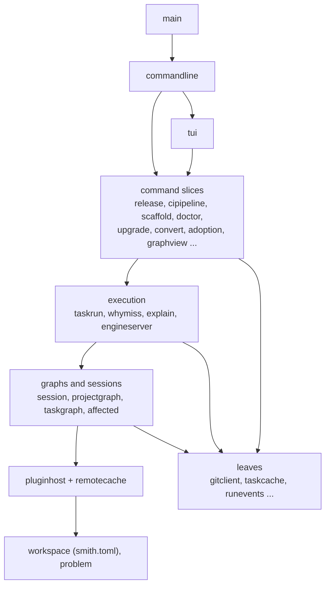
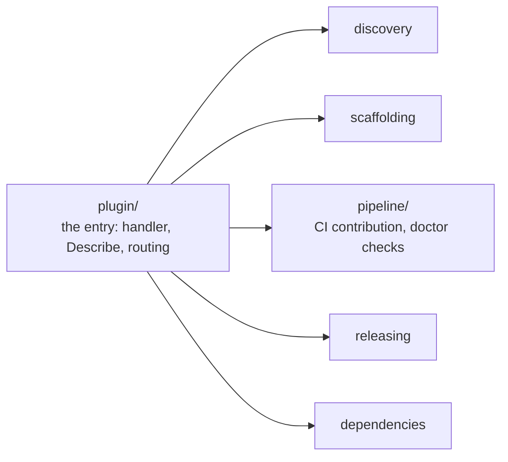

# The repository's own slice architecture

smith generates projects laid out as vertical feature slices, and checks that layout in the
projects it manages. This repository is such a project: its Go code, its plugins and its
TypeScript extension follow the same rules. This page describes how the code is organised,
which file names carry which role, which tool enforces what, what the dependency graph
between the slices looks like today, and where the repository departs from its own rules.

**Audience:** contributors who add or move code. It is the "why" behind the layout; the
checklist of slices is in [Working on MonoSmith](../contributing/development.md), and the
conventions smith applies to user projects are in [Conventions](../reference/conventions.md).

## The idea in four rules

1. **A slice is one outcome.** A package (in Go) or folder (in TypeScript) holds the files
   that together deliver one thing a user can name: `taskcache`, `affected`, `doctorfix`. Files
   that change together live together, whatever technology they use.
2. **A file's name says its role.** `cache_key_algorithm.go`, `run_tasks_use_case.go`,
   `diff_graph_algorithm.go`. The suffix before the extension is one of fifteen roles.
3. **A slice has one door.** In Go, the exported identifiers of the package are its public
   surface. In TypeScript it is the folder's `index.ts`. Nothing reaches into another slice's
   internals.
4. **No cycles.** Two slices never depend on each other, directly or through a third.

The decision to use this layout everywhere, in each language's own spelling, is
[ADR 0013](decisions/0013-vertical-slices-in-each-languages-naming.md). The reasons recorded
there are short; this page records what the layout looks like in practice.

## The workspace

```text
monosmith/
  go.work                  ties 18 Go modules together
  smith.toml               the repository is a smith workspace; [conventions.vertical-slices] is on
  apps/
    smith/                 the command: 79 top-level slice packages, one Go module
    vscode/                the VS Code extension (TypeScript, one folder per slice under src/)
  libs/
    actions/               the action catalogue shared by CLI, shell, MCP and engine server
    plugin-<language>/     one Go module per built-in language plugin: discovery, scaffolding,
                           pipeline, releasing, ... as slice packages, plus plugin/ as the entry
    plugin-node-toolchains/  eslint, jest, vitest, playwright, typescript, vite, angular, astro, vscode
    plugin-vertical-slices/  the structure plugin: the layout rules for nine languages
    plugin-docker/, plugin-recipe/
  packages/
    plugin-sdk/            the protocol, the server loop, the host client, the conformance suite
    eslint-config/         @monosmith/eslint-config, including the slice rules for TypeScript
  docs/
```

`apps/smith` is organised as a flat list of slices because most commands are one outcome.
There are 516 production Go files in it, 334 test files and 101 `doc.go` files; in `libs/`,
268 production files and 109 `doc.go`; in `packages/plugin-sdk`, 29 and 10 (counted by walking
the tree for this page; they change with every commit).

### A slice in `apps/smith`

```text
apps/smith/taskcache/
  doc.go                          the package comment: what the slice is for
  cache_key_algorithm.go          pure: KeyInputs -> key
  cache_key_algorithm_test.go     tests sit beside what they test
  cache_entry_contract.go         data that crosses a boundary: Entry, OutputFile
  storage_contract.go             the Storage interface
  local_storage_repository.go     business-oriented persistence
  store_result_use_case.go        Save, Lookup, Restore: the outcome, doing I/O
  prune_cache_use_case.go
  last_run_repository.go
  diff_key_inputs_algorithm.go
  select_inputs_algorithm.go
  file_digest_store.go            state the slice owns: memoised digests
```

A slice whose command is user-facing also holds its handler (`*_handler.go`), which builds
the cobra command; `commandline.Root` only assembles them.

### The roles in Go

The roles are fixed by `libs/plugin-vertical-slices/languages` (`Roles`). Counts are production
files in `apps/smith` at the time of writing:

| Suffix | Is | Files |
|---|---|---|
| `_mapper` | a deterministic conversion between two representations | 130 |
| `_use_case` | coordinates one outcome, does or delegates I/O | 128 |
| `_algorithm` | pure computation, no business decision | 54 |
| `_contract` | data that crosses a boundary | 41 |
| `_policy` | a reusable decision with business meaning | 40 |
| `_handler` | adapts a transport (here, a cobra command) | 37 |
| `_model` | a business concept with invariants | 35 |
| `_client` | an adapter for an external protocol, SDK or process | 18 |
| `_config` | configuration the module owns | 14 |
| `_validator`, `_store`, `_repository`, `_error` | a focused check; owned state; stored information; an error type | 8, 6, 3, 2 |

`_middleware` and `_enum` are also valid roles. In `libs/` the proportions differ because plugins
are mostly use cases (103), configuration tables (50) and mappers (48).

Files named `doc.go` and `main.go` are the only ones allowed at a module's root. Tests take the
production file's name plus `_test.go`.

## What enforces it

| Layer | Tool | What it checks | Where it runs |
|---|---|---|---|
| Go, all `go.work` modules | `smith slices check --lang go` (`apps/smith/slicecheck`, rules in `libs/plugin-vertical-slices/languages/go_rules_policy.go`) | every file is `<snake>_<role>.go`; only `doc.go` and `main.go` at a module's root; no folder named `util`, `helper`, `common`, `shared`, `manager`, `processor`, `data`, `misc` (or `Helpers`); a package with more than 12 production files is reported for review | the `slice-check` task of every Go project, which `[conventions.vertical-slices]` makes a dependency of `lint`, so `smith ci verify` runs it |
| TypeScript, `apps/vscode` and `packages/eslint-config` consumers | `@monosmith/eslint-config`, `configs/vertical-slices.config.js` | `file-role` (a kebab-case name ending in a role), `no-deep-import` (a sibling is reached only through its `index.ts`), `no-slice-cycle` (the subfeature import graph has no cycle, type imports included) | `eslint`, as the project's `lint` task |
| Go imports | the Go compiler | a package cycle does not compile | `go build` |

What nothing checks for Go: that one slice does not reach for an internal helper of another.
Go has no `index.ts`; every exported identifier is public, and the only guard is that the
`internal` directory feature is not used anywhere in the repository (no such directory exists). The conventions are followed by review, and by
the shape of the dependency graph below. The size limit is a warning, not an error: `smith
slices check` exits 0 and prints `review:` lines.

## The dependency graph between slices

The following was computed from `go list` for `apps/smith` (imports between top-level slice
packages; the 27 packages nested inside `tui` count for `tui`, the only slice that has
nested packages).
There is **no cycle** between top-level slices (the compiler would refuse one). Putting each
slice at one more than the deepest slice it imports gives these layers:

| Layer | Slices (abridged) |
|---|---|
| 0, no slice imports | `gitclient`, `taskcache`, `problem`, `runevents`, `githubrelease`, `sbom`, `mcpserver`, `slicecheck`, `releaselineage`, `releasepreview`, `npmbinaries`, `pypiwheels`, `nugettool`, `rubygems`, `packagemanifests`, `linuxpackages`, `cachecredentials`, `toolchainpin` |
| 1 | `workspace` (imports only `problem`), `remotecache`, `splitrepo`, `commandargs`, `nxworkspace` |
| 2 | `pluginhost`, `configedit`, `npmaudit`, `npmpack`, `turboworkspace` and the other per-ecosystem policies |
| 3 | `projectgraph`, `recipe`, `corefixes` |
| 4 | `session`, `taskgraph`, `affected`, `recipestack`, `buildoutputs` |
| 5 | `taskrun`, `graphview`, `stackview`, `dependencies`, `clicontract`, `recipedrift` |
| 6 | `explain`, `whymiss`, `release`, `engineserver`, `doctorfix`, `devservers` |
| 7 to 10 | `convertplan`, `nativebuild`, `cipipeline`, `doctor`, `scaffold`, `upgrade`, `adoption`, `removalplan`, `legacyinventory`, `turboplan` |
| 11 to 13 | `fullconversion`, `convert`, `adoptflow` |
| 14 | `tui` |
| 15 | `commandline` |
| 16 | `main` |



Reading the layers:

- `workspace` is the base: 27 slices import it and it imports only `problem`. It holds
  `smith.toml`'s contract (`workspace_config_contract.go`), loading, and the JSON Schema.
- `session` is the door for commands: 21 slices open one. It imports `gitclient`,
  `pluginhost`, `projectgraph`, `remotecache`, `taskcache` and `workspace` and nothing above
  them, which is why `taskrun`, `whymiss`, `graphview` and the rest can depend on it without a
  cycle.
- `projectgraph` is imported by 18 slices; it imports `pluginhost`, `splitrepo` and
  `workspace` only.
- Leaves are I/O adapters (`gitclient`, `githubrelease`) and release outputs that only
  produce files (`sbom`, `rubygems`).
- `commandline` is the single place that knows every command; `main` is `os.Exit` around it.
- `mcpserver` has no imports from other slices at all: it runs `smith` itself with the tool's
  command line, which is why it sits at layer 0 ([ADR 0022](decisions/0022-mcp-server-runs-smith-commands.md)).

Outside `apps/smith`, one rule holds without exception: `libs/*` and `packages/*` never
import `apps/smith`. The plugins depend on `packages/plugin-sdk` and on nothing of the core,
which is what makes them separable processes ([ADR 0002](decisions/0002-out-of-process-plugins.md)).
Between plugin modules there is one dependency: `plugin-node-toolchains` imports
`plugin-node/scaffolding` (nine imports), because every Node toolchain requires the `node`
plugin. Nothing in the repository writes that exception down.

Inside a plugin the slices are fixed by convention rather than by a list:



(`libs/plugin-node` and `libs/plugin-go` show it most completely: the `plugin` package imports
the others, and the others do not import `plugin` or each other, except that
`plugin-node/dependencies` imports `plugin-node/scaffolding` for its pinned versions. Other
plugins have a subset of these slices; `plugin-node` also has `declaredimports`,
`manifestfixes`, `pruning` and `registries`.)

## Where the repository departs from its own rules

These are what `smith slices check` reports today, and what the code shows.

| Where | Departure | Written down? |
|---|---|---|
| `apps/smith/tui` | 21 production files in the package root (limit 12): the methods of the one Bubble Tea model `Shell` | yes, as a temporary exception with a removal condition in `apps/smith/tui/README.md` |
| `apps/smith/convertplan` (29), `release` (21), `cipipeline` (17), `projectgraph` (15), `workspace` (14), `doctor` (13) | over the size limit; reported as `review:` | no |
| `packages/plugin-sdk/protocol` | 17 files: the protocol types, by nature one slice | no |
| `libs/plugin-node-toolchains` | imports `libs/plugin-node/scaffolding` | no |
| `apps/smith/tui` nested packages | a subfeature is meant to be flat; `tui` has 27 nested packages (`commands`, `theme`, `pane` ...) | partly: the README lists them as subfeatures with their own `doc.go` |

The convention asks for an exception to be written where the next reader will find it, stating
the path, the rule waived, the constraint that forces it and whether it is temporary. Only
the `tui` entry does. The others are open items, not decisions.

## Decisions

| Decision | Record |
|---|---|
| vertical slices, spelled in each language's own naming | [ADR 0013](decisions/0013-vertical-slices-in-each-languages-naming.md) |
| smith is written from scratch in Go, one package per outcome | [ADR 0001](decisions/0001-build-from-scratch-in-go.md) |
| plugins are processes that depend only on the SDK | [ADR 0002](decisions/0002-out-of-process-plugins.md) |
| one list of actions read by every interface | [ADR 0029](decisions/0029-one-list-of-actions.md) |

## Where in the code

| Concern | Path |
|---|---|
| the rules for nine languages | `libs/plugin-vertical-slices/languages` |
| the walk and the size limit | `libs/plugin-vertical-slices/layout/check_layout_use_case.go` (`SliceSize = 12`) |
| the command | `apps/smith/slicecheck`, `smith slices check` |
| the `slice-check` task and its dependency on `lint` | `libs/plugin-vertical-slices/plugin/slice_tasks_config.go` |
| TypeScript rules | `packages/eslint-config/configs/vertical-slices.config.js` |
| command assembly | `apps/smith/commandline/root_handler.go` |
