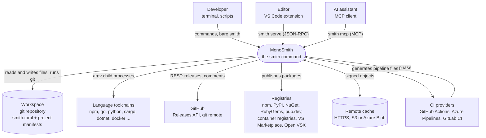
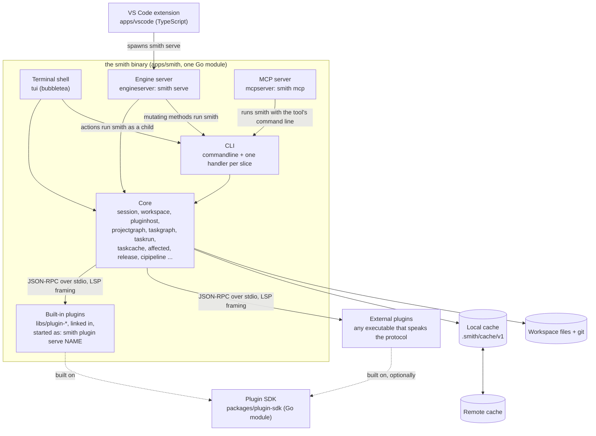
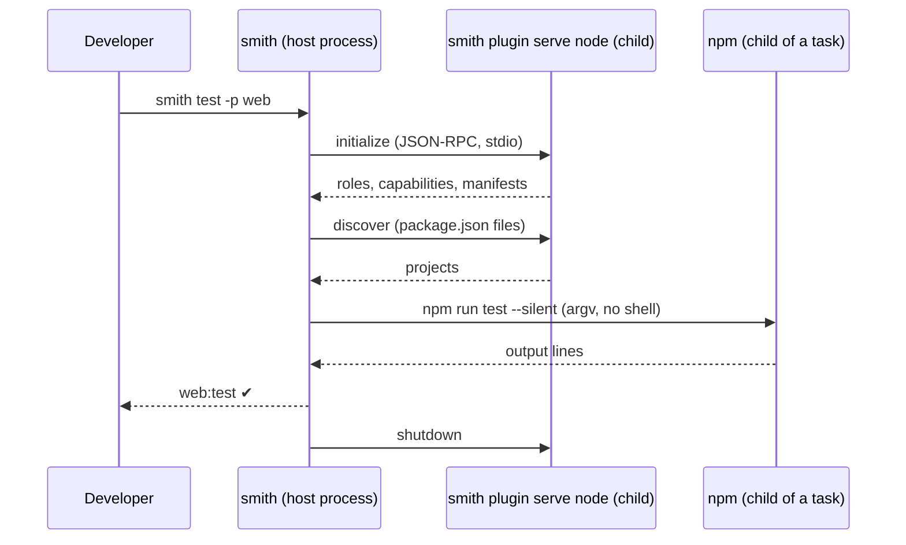

# MonoSmith system context and containers

This page shows smith from outside and then from inside: first who and what it talks to
(the system context), then the programs and stores it is made of (the containers). It
follows the C4 model's first two levels, drawn as Mermaid flowcharts so they live beside
the code.

**Audience:** engineers who need the big picture before they read a slice, and reviewers
who want to know what crosses a process or network boundary. For the code level see
[Architecture](architecture.md) and [The repository's own slice architecture](slice-architecture.md).

## Level 1: system context

smith is one command-line program. It reads a repository, runs the tools of each language
in it, and talks to a few outside systems only when a command needs them.

What each arrow stands for, and where it is decided:

| Arrow | What crosses it | Decision |
|---|---|---|
| developer to smith | argv; a bare `smith` in a terminal opens the shell | [ADR 0001](decisions/0001-build-from-scratch-in-go.md), [ADR 0032](decisions/0032-single-key-tui-keymap.md) |
| editor to smith | JSON-RPC 2.0 on the stdin and stdout of a `smith serve` child process; no port | [ADR 0025](decisions/0025-ide-plugins-run-the-installed-smith.md), [ADR 0026](decisions/0026-event-stream-and-smith-serve.md), [ADR 0030](decisions/0030-vscode-extension-is-a-serve-client.md) |
| assistant to smith | the Model Context Protocol on stdio (`smith mcp`); each tool runs one smith command line | [ADR 0022](decisions/0022-mcp-server-runs-smith-commands.md) |
| CI to smith | the generated YAML calls `smith ci <phase>`; the pipeline stays thin | [ADR 0005](decisions/0005-generated-ci-pipelines.md) |
| smith to the repository | git is the source of truth for the file list, history and tags; smith shells out to the `git` binary through one slice (`apps/smith/gitclient`) | [Technology](technology.md) |
| smith to toolchains | child processes started from an argv array, never through a shell | [Execution and cache](execution-and-cache.md) |
| smith to GitHub | REST, through one slice (`apps/smith/githubrelease`) | [ADR 0006](decisions/0006-conventional-commits-tag-only-releases.md) |
| smith to registries | each language plugin publishes; the core re-packs one binary for several package managers | [ADR 0010](decisions/0010-one-binary-for-every-package-manager.md), [ADR 0031](decisions/0031-marketplace-publishing-with-entra-id.md) |
| smith to the remote cache | HMAC-signed objects; a bad or missing object is a miss | [ADR 0003](decisions/0003-content-addressed-cache.md), [The cache key, hits and misses](cache.md) |

Not in the picture: there is no smith server, no database and no account. State lives in
files (`smith.toml`, `.smith/cache`, the manifests) and git tags.

## Level 2: containers

"Container" here means a separately running or separately deployable piece, not a Docker
container. Everything in the first group is one executable, `smith`, started in different
modes.

| Container | Code | What it is for | How it is reached |
|---|---|---|---|
| CLI | `apps/smith/commandline` assembles the cobra command tree; each slice supplies its own `*_handler.go` | every command in the [manual](../manual/README.md) | argv |
| Terminal shell | `apps/smith/tui` | the full-screen view a bare `smith` opens in a terminal; it reads the workspace in-process (`tui/sources`) and runs every action as a child `smith` process (`tui/runner`) | a bare `smith` on a terminal, `CI` unset |
| Engine server | `apps/smith/engineserver` | the engine as JSON-RPC: queries answer with the `--json` output, runs stream `event` notifications | `smith serve` |
| MCP server | `apps/smith/mcpserver` | the same actions for an assistant, each tool one command line | `smith mcp` |
| Core | the slices listed in [Architecture](architecture.md) | session, graphs, scheduling, cache, release, CI generation | in-process |
| Built-in plugins | `libs/plugin-*`, constructed by `pluginhost.Builtins` and `pluginhost.BuiltinAddons` | everything language-specific: discovery, tasks, scaffolding, versioning, publishing, CI needs, health checks | the host starts `smith plugin serve <name>` as a child process |
| External plugins | declared under `[plugins.external.<name>]` or found on `.smith/plugins`, `SMITH_PLUGIN_PATH`, `$SMITH_HOME/plugins` | languages and rules smith lacks | any executable; see [The plugin system](plugin-system.md) |
| Plugin SDK | `packages/plugin-sdk`: `protocol`, `serve`, `host`, `transport`, `conformance`, `templating`, `toolrun`, `jsondoc`, `projectkind` | the protocol types, a server loop for plugins, the client smith uses, and the conformance suite | a Go module, released as `packages/plugin-sdk/v<version>` |
| Local cache | `apps/smith/taskcache` | task results by key | files under `.smith/cache/v1` |
| Remote cache | `apps/smith/remotecache` | results shared between machines | HTTPS, `s3://` or `azblob://` |
| VS Code extension | `apps/vscode` (`smith-client`, `workspace-view`, `task-run` and others) | the editor front end | spawns `smith serve` in each workspace folder |
| Actions catalogue | `libs/actions/catalog` | the one list of actions the CLI, shell, MCP and engine server present | imported as Go code |

### One list of actions, four doors

The command line, the shell, `smith mcp` and `smith serve` do not keep lists of their own;
each reads `libs/actions/catalog`, and a test in each fails when an action is neither
presented there nor excused ([ADR 0029](decisions/0029-one-list-of-actions.md)). The doors
differ in how they present an action, not in what it does: the MCP server and the engine
server's mutating methods start the same executable (`os.Executable`) with the action's
command line, and the shell does the same through `tui/runner`. That is why every
interface can show the user the exact `smith ...` line that ran.

### Where the processes are

Every plugin, built in or not, is a separate process. The host starts all enabled plugins in
parallel (`pluginhost.Start`), asks each for its description (`initialize`), and shuts them
down when the command ends (`Session.Close`). A plugin that crashes fails the command that
needed it instead of corrupting the host ([ADR 0002](decisions/0002-out-of-process-plugins.md)).

## Trust boundaries

| Boundary | What is trusted | What is checked |
|---|---|---|
| plugin process | built-ins are part of the binary; an external plugin is code you run | its answers are decoded against the protocol types; `smith plugin check` tests conformance; `smith.toml` pins an external plugin's version |
| task process | the task's declared `inputs`; smith does not sandbox | the command is argv; the environment is the caller's plus `SMITH_*` variables |
| remote cache | nothing | every object is signed with `SMITH_CACHE_KEY`; failures are misses |
| MCP and `smith serve` params | nothing | values become single arguments; one that looks like an option is refused |
| registries and GitHub | credentials in the environment | secrets are named in the generated pipeline and listed by `smith ci check` |

## Decisions

| Decision | Record |
|---|---|
| a single Go binary, written from scratch | [ADR 0001](decisions/0001-build-from-scratch-in-go.md) |
| plugins are processes | [ADR 0002](decisions/0002-out-of-process-plugins.md) |
| one binary packaged for every package manager | [ADR 0010](decisions/0010-one-binary-for-every-package-manager.md) |
| editors run the installed smith | [ADR 0025](decisions/0025-ide-plugins-run-the-installed-smith.md) |
| event stream and `smith serve` | [ADR 0026](decisions/0026-event-stream-and-smith-serve.md) |
| MCP server runs smith commands | [ADR 0022](decisions/0022-mcp-server-runs-smith-commands.md) |
| one list of actions | [ADR 0029](decisions/0029-one-list-of-actions.md) |
| the VS Code extension is a `smith serve` client | [ADR 0030](decisions/0030-vscode-extension-is-a-serve-client.md) |

The full index is in [Decision records](decisions/README.md).

## Where in the code

| Concern | Path |
|---|---|
| command tree | `apps/smith/commandline/root_handler.go` (`Root`) |
| starting plugins | `apps/smith/pluginhost/start_plugins_use_case.go` (`Start`) |
| plugin client and handshake | `packages/plugin-sdk/host/plugin_client.go` |
| opening a workspace | `apps/smith/session/open_session_use_case.go` (`Open`) |
| the engine server | `apps/smith/engineserver` |
| the MCP server | `apps/smith/mcpserver` |
| the shell | `apps/smith/tui` |
| the cache tiers | `apps/smith/session/open_session_use_case.go` (`Session.Storage`), `apps/smith/remotecache` |
| the extension | `apps/vscode/src` |

The plugin protocol is documented in [Plugins](../reference/plugins.md); the shell and
extension get their own pages in this section.
