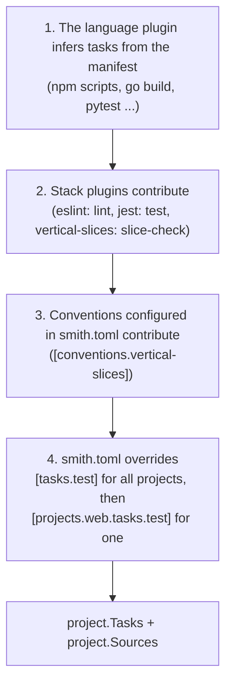
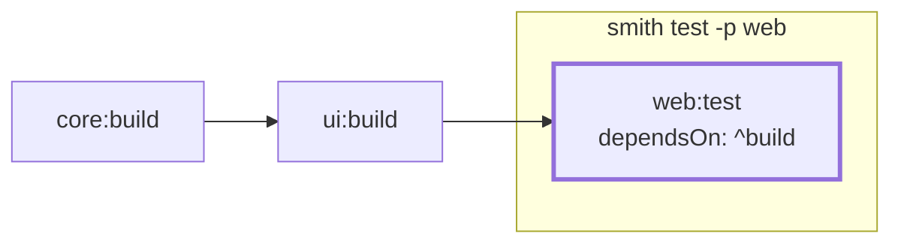
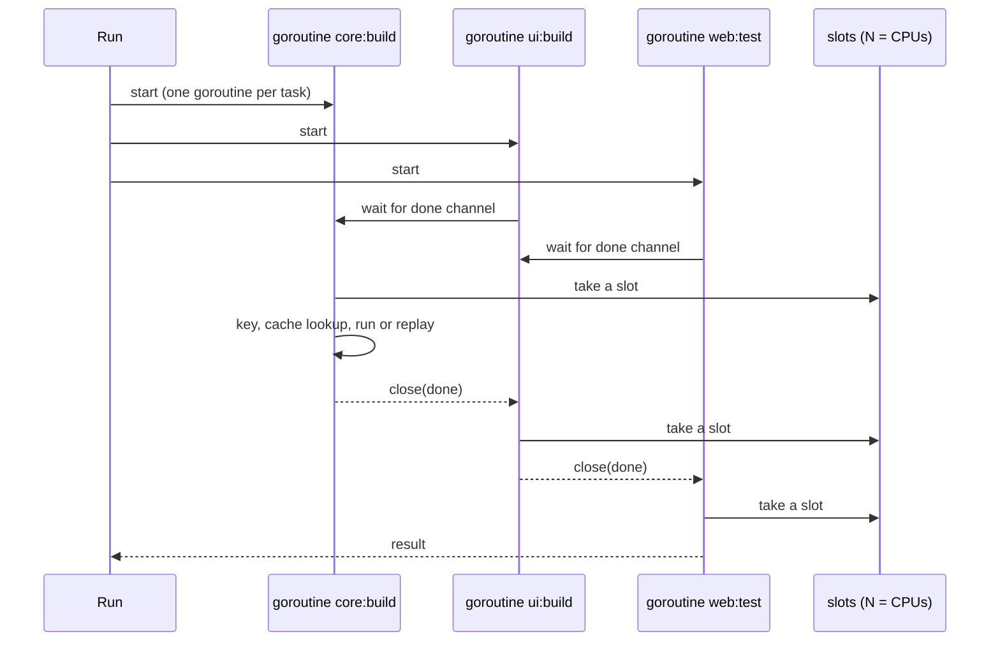

# The task graph and how tasks are ordered

A **task** is one command smith can run for one project (`web:build`). This page explains
where a project's tasks come from, how a request such as `smith run lint test -p web`
becomes a graph of tasks, and how the scheduler runs that graph: in what order, how many at
once, and what happens when one fails. Which results come from the cache is the subject of
[The cache key, hits and misses](cache.md).

**Audience:** engineers who need to know why a task ran (or did not), in which order, and
which file or setting defined it. The commands are [`smith run`](../manual/run.md),
[`smith explain`](../manual/explain.md) and [`smith dev`](../manual/dev.md).

## Where a project's tasks come from

Tasks are not looked up in a global table. Each project carries its own task map, assembled
during discovery ([How a project is discovered and classified](project-discovery.md)) from
four layers, each overriding the one before, and each field remembers the layer it came from:

| Layer | Rule | Source label shown by `smith explain` |
|---|---|---|
| plugin | the plugin's `discover` answer | `plugin node` |
| stack | `contribute` result: new tasks are added unless the project has one of that name; `replace` entries replace; `dependsOn` entries are appended | `plugin jest (stack node-jest)` |
| convention | same merge as a stack | `convention vertical-slices` |
| `[tasks.<task>]` | replaces the fields it sets, for every project that has the task | `smith.toml [tasks.test]` |
| `[projects.<name>.tasks.<task>]` | same, for one project; may add a task if it gives a `command` | `smith.toml [projects.web.tasks.test]` |

The fields tracked are `command`, `cwd`, `inputs`, `outputs`, `dependsOn`, `env` and `cache`
(`projectgraph.TaskFields`), plus `serve`, `serve_url` and `serve_timeout`. A `depends_on`
override replaces the whole list, with one exception made on purpose: a dependency on a task
that the same plugin contributed alongside (an `e2e-browsers` task that exists only for
`e2e`) is kept, because dropping it would break the task. Any other dependency the override
leaves out is recorded in `Project.Dropped`, which `smith doctor` names. The code is
`apps/smith/projectgraph/apply_stacks_use_case.go`, `apply_conventions_use_case.go` (the
`merge` function) and `task_overrides_mapper.go`.

The shape of a task is `protocol.Task` (`packages/plugin-sdk/protocol/project_contract.go`):

| Field | Meaning |
|---|---|
| `command` | an argv array; never passed through a shell |
| `cwd` | workspace-relative working directory; empty means the project root |
| `env` | extra environment variables |
| `inputs` | globs relative to the project (`{workspaceRoot}/x` for root files, `!` to exclude); empty means every file of the project |
| `outputs` | directories relative to the project, restored on a cache hit |
| `dependsOn` | task names that run first (below) |
| `cache` | whether the result may be stored and replayed |
| `verify` | `smith ci verify` runs the task too |
| `serve`, `serveUrl`, `serveTimeout` | an app to start around the task (below) |

## From a request to a graph

`smith run build test -p web --affected` becomes a `taskrun.Request`. `RunInWorkspace`
(`apps/smith/taskrun/run_in_workspace_use_case.go`) does this, in order:

1. `Graph.Select(req.Projects)` turns the `-p` patterns into project names
   ([The project graph](project-graph.md#selecting-projects)).
2. With `--affected`, `affected.Compute` narrows the list to the affected projects and prints
   `affected: <reason> → N project(s)` ([How affected projects are computed](affected.md)).
3. Projects that have none of the requested tasks are dropped; if none remain the command
   prints `no selected project has a [...] task` and ends as a successful, empty run.
4. `taskgraph.Build` creates the graph (below).
5. `Session.Storage` opens the cache, local or tiered.
6. `taskrun.Run` schedules and executes the graph.

`smith build`, `test`, `lint` and `typecheck` are the same call with the task fixed.

### `dependsOn`

`taskgraph.Build` (`build_task_graph_use_case.go`) creates a node for each requested
`project:task` and, recursively, for each task it depends on. A project that lacks a
requested task is skipped silently, since not every project has a `typecheck`; at least one
node must exist. An entry of `dependsOn` is one of:

| Entry | Meaning |
|---|---|
| `build` | the `build` task of the same project |
| `^build` | the `build` task of every project this one imports; a direct dependency that has no such task is skipped and **its** dependencies are used instead (`upstreamWith`) |
| `api:build` | a named task of a named project; an unknown project or task is an error that names both |

The `^` form is why the project graph matters: `web:build` waits for `ui:build` and
`core:build` only because `web` imports them.

(`web` imports `ui`, and `ui` imports `core`. With `^build` only direct imports are added
at each level, and each of them adds its own, so the chain `core:build`, `ui:build`,
`web:test` follows.)

The result is a `taskgraph.Graph`: `Tasks` by id, each with sorted `Deps` and a `Requested`
flag (true for tasks the user named, false for tasks pulled in), and `Order`, a
topological order from a depth-first walk over the sorted ids. A cycle among tasks stops the
command with `tasks depend on each other in a cycle: a:build → b:build → a:build`.

### Serving an app around a task

A task with `serve = "web:start"` (or `"start"` in its own project) needs a running app. The
served task is **not** a node in the graph. Instead, what the served task depends on is added
as dependencies of the task that serves it (`ServeTarget` resolves the name; `add` appends the
served task's `dependsOn`, resolved against the served project). The runner starts the app
around the task, after a cache miss ([The cache key](cache.md) explains why the served app is
part of the key):

1. start the served task in the background, its output prefixed with its own id;
2. poll `serve_url` every 200 ms until it answers with a 2xx; if the app exits first, or
   `serve_timeout` (default `60s`) passes, the task fails with the reason;
3. run the task with `E2E_BASE_URL` set to `serve_url`;
4. stop the app and its process tree whatever the result, and wait until it is gone.

(`taskrun/serve_task_use_case.go`.) `smith dev web api` is a variation on the same idea: it
runs the `start` task of the named projects at once with enough parallelism for all of
them, after building what they depend on, and Ctrl+C stops them together.

## The scheduler

`taskrun.Run` (`run_tasks_use_case.go`) is deliberately small:

Facts the diagram stands for:

- Every task gets a goroutine and a `done` channel. A task first waits for the channels of
  its `Deps`, so it never starts before they finish, and then takes a slot from a counting
  semaphore. A task that is waiting for its dependencies holds no slot, so a deep graph
  cannot starve itself.
- The number of slots is `--parallel N`, default the number of CPUs (`runtime.NumCPU`).
  Independent branches run together; the number of running task processes never exceeds the
  limit. (A served app is not counted against the limit.)
- **Skip semantics.** After its dependencies finish, a task is **skipped**, not failed, if
  any of them failed or was skipped (`because core:build did not succeed`).
- **Bail.** With `--bail` the first failure cancels the run's context. Tasks that have not
  started are skipped (`after an earlier failure (--bail)`, or `cancelled` if they were
  waiting for a slot); running processes are stopped.
- **Cancel.** Ctrl+C, or the `cancel` method of `smith serve`, cancels the context the same
  way. The child's whole process tree is killed: a process group with `SIGTERM` and, after
  three seconds, `SIGKILL` on Unix; a Job Object with kill-on-close on Windows
  (`taskrun/process_tree_client*.go`).
- **Output.** Each line is prefixed `project:task | ` so parallel output stays readable;
  a cached task's stored log is replayed with the same prefix. After a failure the runner
  looks for a known pattern in the log and prints a one-line hint (`failure_hint_algorithm.go`).
- **Environment.** The command is expanded for `{workspaceRoot}`, `{projectRoot}` and
  `{smith}`; the environment is the caller's plus `SMITH_TASK`, `SMITH_TASK_KEY`,
  `SMITH_WORKSPACE_ROOT`, the task's `env`, `E2E_BASE_URL` when it serves an app, and the
  workspace's Python virtual environment first on `PATH`.
- **Outputs.** Before a task that did not come from the cache runs, its declared output
  directories are removed, so a stale file from an earlier build cannot leak into the new
  result (a `generate` task gets its directory recreated empty).

When the run ends, `Summary` counts succeeded, cached, failed and skipped tasks, the
elapsed time and the time the cache saved; the exit code is non-zero if anything failed or
was skipped. Every transition is also emitted as an event
(`run.started`, `task.queued`, `task.started`, `task.output`, `task.finished`, `run.finished`)
for `--json-events` and `smith serve` ([ADR 0026](decisions/0026-event-stream-and-smith-serve.md),
[Serve and the event stream](../reference/serve.md)).

## Why it is built this way

- **One goroutine per task and a semaphore** make the scheduler almost the whole of its
  implementation, which is one of the reasons for Go ([Technology](technology.md),
  [ADR 0001](decisions/0001-build-from-scratch-in-go.md)).
- **Commands are argv arrays** so that the same command means the same on Windows and Linux,
  with no word splitting or globbing to guess at ([Technology](technology.md)).
- **Tasks come from plugins and are overridden in `smith.toml`** so that the core knows no
  language and a team can still change one command in one place
  ([ADR 0002](decisions/0002-out-of-process-plugins.md),
  [ADR 0004](decisions/0004-minimal-toml-configuration.md)). The reason for recording a
  source on every field is `smith explain`: a task that behaves unexpectedly can be traced to
  a plugin, a stack or a line of `smith.toml`; the decision log does not record more than
  that.
- **Stacks and conventions** let a project's tasks come from several plugins without any of
  them calling another ([ADR 0021](decisions/0021-plugin-roles-and-per-project-stacks.md)).

## Where in the code

| Concern | Path |
|---|---|
| layering tasks and sources | `apps/smith/projectgraph/task_overrides_mapper.go`, `apply_conventions_use_case.go`, `apply_stacks_use_case.go` |
| the graph | `apps/smith/taskgraph/build_task_graph_use_case.go`, `serve_target_policy.go`, `task_graph_model.go` |
| a run, from request to summary | `apps/smith/taskrun/run_in_workspace_use_case.go`, `run_tasks_use_case.go` |
| starting and killing processes | `apps/smith/taskrun/run_process_use_case.go`, `process_tree_client.go`, `process_tree_client_windows.go` |
| serving an app | `apps/smith/taskrun/serve_task_use_case.go` |
| events | `apps/smith/runevents` |
| `smith explain` | `apps/smith/explain` |
