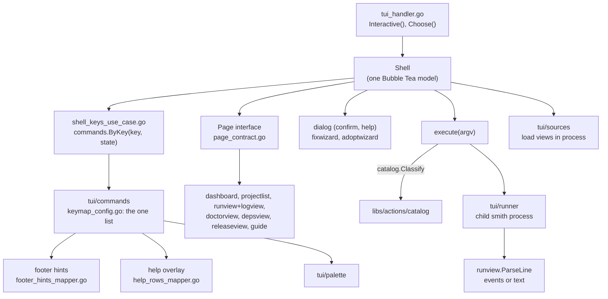
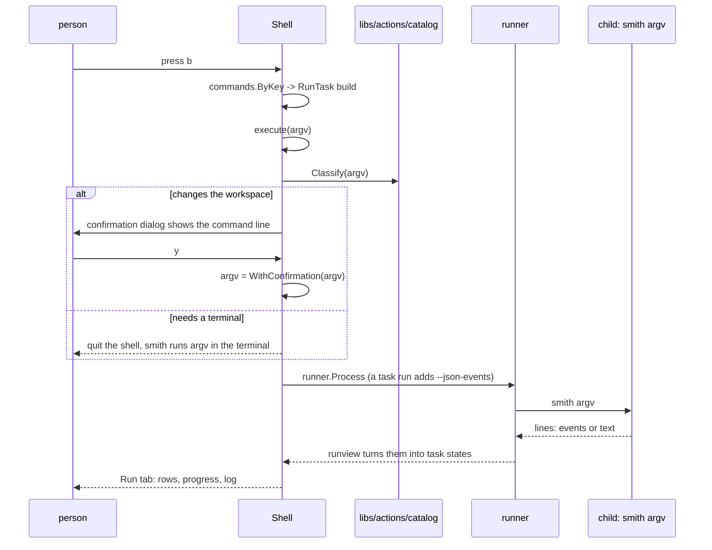

# The architecture of the terminal interface

A bare `smith` in a terminal opens a full-screen shell for the workspace. This page explains how
that shell is put together: one Bubble Tea model, a single keymap that the keys, footer, help and
palette are all drawn from, pages that draw themselves into one pane, wizards built on one dialog,
and a runner that starts the same `smith` binary as a child. The organising rule is that the shell
never does what a command line could not.

Audience: contributors to `apps/smith/tui`. For what the screens and keys are, see
[The smith terminal interface](../manual/tui.md). The design proposal that preceded the build, with
its history, is [The TUI and the IDE plugins](tui-and-ide.md).

## The rule: the shell runs smith commands

The shell is a front end. Every action it offers ends as a `smith` command line that is printed in
the status bar before it runs, and a command that changes the workspace, installs or publishes asks
first in a dialog that shows the line. The point is that anything done in the shell can be repeated
in a script or in CI, and that the shell and the command line cannot disagree.

Two things need qualifying, because the code does both:

- **Reading is in process.** The views (Home, Projects, Doctor, Deps, Release) are loaded by
  `tui/sources` calling the engine's Go packages directly: `doctor`, `release`, `affected`,
  `projectgraph`, `taskgraph` (`sources/load_views_use_case.go`). Reading changes nothing and does
  not need a command line.
- **Acting is a child process.** Anything that runs, writes or publishes goes through
  `tui/runner`, which starts `os.Executable()`, that is this very smith, as `smith <argv>`
  (`runner/child_process_client.go`).

The decision is recorded in [ADR 0032](decisions/0032-single-key-tui-keymap.md) ("the shell never
acts by itself") and, for the list of what the shell may offer, [ADR 0029](decisions/0029-one-list-of-actions.md).

## Components

| Package | Responsibility |
|---|---|
| `tui` (root, 21 production files) | the `Shell` model: keys, mouse, runs, render, detail panel. One type's methods cannot be split across Go packages, which is the written reason the root exceeds the slice size limit (`apps/smith/tui/README.md`, temporary) |
| `tui/commands` | the keymap and everything computed from it: availability, footer hints, help rows, key labels, parsing a run request |
| `tui/theme` | tokens (dark, light, plain), icons (Unicode, ASCII), the theme chosen from the environment |
| `tui/layout`, `pane`, `tabs`, `footer`, `statusbar`, `toast`, `detail` | geometry and drawing of the pieces |
| `tui/dialog`, `palette`, `guide` | confirmation and help dialogs, the command palette, guided forms |
| `tui/dashboard`, `projectlist`, `runview`, `logview`, `doctorview`, `depsview`, `releaseview` | the views |
| `tui/fixwizard`, `tui/adoptwizard` | the doctor fix dialog and the adopt dialog |
| `tui/runner` | starting and stopping child smith processes |
| `tui/sources` | loading what the views show (replaceable in tests) |
| `tui/screenreader`, `clipboard`, `pointer`, `progress` | plain mode, OSC 52 copy, double-click detection, progress bars |

## One keymap, three consumers

`tui/commands/keymap_config.go` holds `all`, a list of `Command`s. A `Command` has an ID, a group
for the help, a title, its keys, a `Kind` (what happens when chosen: `ShowTab`, `Execute`, `RunTask`,
`Guided`, `OpenDoctor`, `OpenFixWizard`, `OpenAdoptWizard`, `Stop`, `PaneKey`, and others), the
views where it applies (`Views`, `ShowIn`), its preconditions (`NeedsWorkspace`, `NeedsIdle`,
`NeedsRunning`, `NeedsNarrowList`, `OnlyInside`, `OnlyOutside`) and the footer label.

The same list produces:

| Consumer | Function |
|---|---|
| key dispatch | `commands.ByKey(key, state)` returns the command, or the reason it is unavailable, which becomes the toast |
| footer hints | `commands.Hints(state)` returns the view's keys then the tail every view ends with |
| help overlay (`?`, `F1`) | `commands.HelpRows(state, viewTitle)` |
| palette | one plain-worded line per intent, grouped by section, with its key and the command it runs; the commands that have no key are reached here |

Because one list feeds all of them, a hint cannot name a key that does nothing; that is the design
claim of [ADR 0032](decisions/0032-single-key-tui-keymap.md). Keys are single keys, no plain key
fires while a text field or form has the keyboard (`plain(key)` in `command_availability_policy.go`),
and the keys of a view's own pane come first in the list so they win over a global key of the same letter
(Deps marks all with `a`, which elsewhere adds a project). `PaneKey` entries are listed for the footer
and help but never run by the shell: the open view handles them.

## Pages

A view that appears in the one content pane implements `Page` (`page_contract.go`): a title, the
footer hints, `Update(msg)` for keys meant for it, and `View(width, height)`. The shell asks the
open tab for its `Page` and draws nothing else of the view. The layout is adaptive: below 100
columns the list takes the whole width and Enter opens the detail; wider, the list and the detail
sit side by side (`layout.divide_screen_algorithm.go`). Tabs shorten their names before the strip
would scroll, and below 24 rows they become one plain row.

Views load lazily: Doctor, Deps and Release load on first open; Doctor also starts in the
background when the shell opens, so the header shows its counts before any tab is visited.

## Running commands

`Shell.execute` (`shell_run_use_case.go`) classifies the command line with
`libs/actions/catalog.Classify` into three kinds: needs a terminal (a command that asks questions;
the shell quits and smith runs it), changes the workspace (ask first), and the rest. The rest,
which includes every task run and the commands that print and end (`plugin`, `config`, `graph`,
`explain`...), runs through `runner.Process` and stays in the Run tab: the interface never gives up
the terminal for them (`tea.Exec` is not used for runs). Outside a workspace there is no Run tab,
so `smith new`, `adopt` and `convert` quit the shell and run in the terminal.

### The Run tab

A run shows one row per task (queued, running with a spinner and its elapsed time, passed, failed,
cached, skipped), a progress bar with totals, and the captured log of the selected row (all output
when none is selected). Failures are listed first and the first failed task is selected when the
run ends, so its output is the first thing read. The runs of the session (the last 20) are kept
in memory and shown again with `,` and `.`; `r` runs the shown run again, `R` runs the tasks that
failed or were skipped, `Ctrl+C` stops the run. `y` copies the command line, `Y` the log shown (one
task's output or all of it). The status bar and the Run header keep the exact command line, as
typed. Full logs stay reachable: `Y` puts them on the clipboard, `m` turns mouse reporting off so
the terminal selects text with a plain drag, and `smith run ...` with the copied command line
prints them in any terminal.

### runview reads events, and text as a fallback

For a task run the shell starts the child with `--json-events`
([ADR 0026](decisions/0026-event-stream-and-smith-serve.md), `sources.withEventStream`): the output
is one JSON event per line (`run.started` with the planned tasks, `task.queued`, `task.started`,
`task.output`, `task.finished`, `run.finished`), so a task's own output cannot be mistaken for a
status, and the plan arrives with the first line. `runview.ParseLine` reads such a line
(`parse_run_event_algorithm.go`) and turns it into the same events the text lines give; any line
that is not an event (smith's own messages and errors before the run starts) is read as text. The
text parser (`<task> ▶ <command>`, `<task> ✔ <duration>`, `<task> ✔ from cache`, `<task> ✖ <reason>`,
the skip and failure lines of the closing summary, the `✔ 3/4 tasks succeeded` line) stays for
every command that has no event stream (`smith doctor`, `plugin list`...) and for tests. The log
shows each event as the text format would print it. `smith run --json` was not used: since #589 it
prints the task output to stderr and the summary as one JSON document at the end, which gives no
live status.

## Wizards

The doctor fix wizard (`tui/fixwizard`) is a state machine of stages: questions (one per
decision), a scrollable review (files as diffs, commands, projects covered), progress with a bar,
and a failure screen with the step's output and Retry. It renders a `doctorfix.Planned` and applies
it through `doctorfix`, so it asks exactly what `smith doctor --fix` asks
([ADR 0033](decisions/0033-doctor-fixes-with-steps-and-choices.md)).

The adopt wizard (`tui/adoptwizard`) is a second state machine layered on the first: every screen is
a `fixwizard.Wizard`, so keys, mouse and drawing are identical. It holds no logic; steps that take
time come out as `Job`s the shell runs off the UI goroutine, and `adoptflow.Session` does the work.
The stages and calls are in [How adopt and convert work](adopt-and-convert.md).

## Themes, plain mode, mouse

| Setting | Effect | Code |
|---|---|---|
| the choice saved in the Settings tab (`$SMITH_HOME/tui.json`: `theme`, `icons`) | tokens and symbols, under the variables below | `userprefs`, `theme.ChooseWith` |
| `NO_COLOR` (any value) | plain tokens | `theme.Choose` |
| `SMITH_THEME=light\|dark\|plain` | forces tokens; `plain` also requests plain mode | `theme.Choose`, `screenreader.Plain` |
| terminal background | decides light or dark when `SMITH_THEME` is unset | `theme/dark_background_policy.go` |
| `SMITH_ASCII`, `TERM=dumb\|linux` | ASCII symbols | `theme.Choose` |
| `SMITH_SCREEN_READER` (anything but empty, `0`, `false`, `no`, `off`) | no full-screen shell, no colour, no mouse; numbered questions | `screenreader.Wanted` |
| stdout not a terminal | plain questions on stderr | `screenreader.Plain` |
| stdin not a terminal, or `CI` set | `Interactive()` is false: `smith` prints its help | `tui_handler.go` |

Every state keeps its word beside its symbol, so colour is never the only signal. The mouse reports
cell motion only, so Shift+drag still selects text, and `m` turns it off. Copy uses the OSC 52
terminal sequence, which also works over SSH.

## Where in the code

| Concern | Path |
|---|---|
| Entry and mode choice | `apps/smith/tui/tui_handler.go` |
| Shell model | `apps/smith/tui/shell_*.go` |
| Keymap | `apps/smith/tui/commands/keymap_config.go` |
| Classifying actions | `libs/actions/catalog` |
| Runner | `apps/smith/tui/runner` |
| Output parsing | `apps/smith/tui/runview` |
| Settings tab | `apps/smith/tui/settingsview` (the view), `settingssource` (what it reads and calls), `userprefs` (the personal preferences file), `shell_settings_use_case.go` |
| Wizards | `apps/smith/tui/fixwizard`, `apps/smith/tui/adoptwizard`, `apps/smith/adoptflow`, `apps/smith/doctorfix` |

## Decisions

| Decision | Record |
|---|---|
| Single-key keymap, one adaptive pane, no menu bar | [ADR 0032](decisions/0032-single-key-tui-keymap.md) |
| One list of actions shared by shell, MCP and serve | [ADR 0029](decisions/0029-one-list-of-actions.md) |
| Event stream and `smith serve` (the Run tab reads it for task runs) | [ADR 0026](decisions/0026-event-stream-and-smith-serve.md) |
| Doctor fixes with steps and choices | [ADR 0033](decisions/0033-doctor-fixes-with-steps-and-choices.md) |
| Adopt and convert depth levels | [ADR 0034](decisions/0034-adopt-and-convert-depth-levels.md) |

The choice of Bubble Tea as the library has no decision record; the dependency is in `go.mod` and
the package comments name it.
