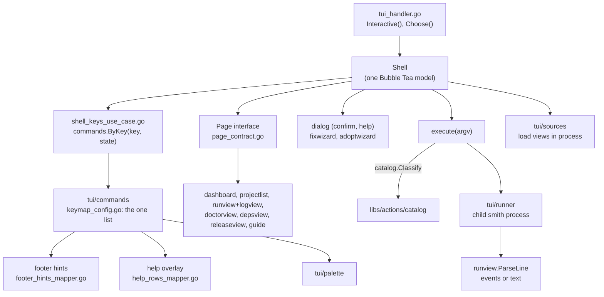
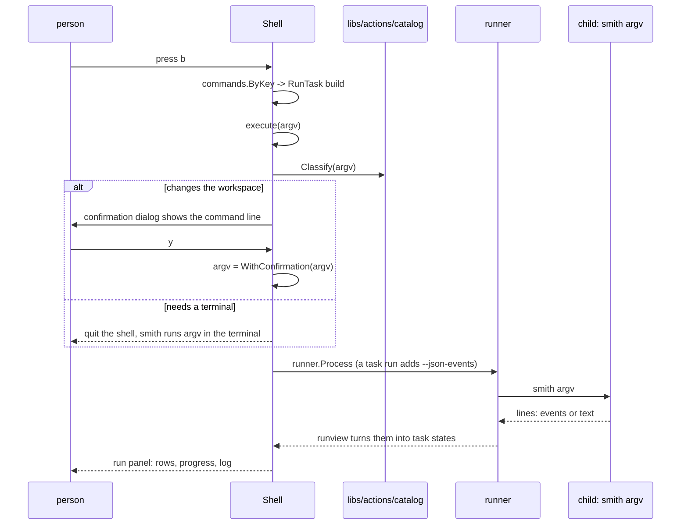

# The architecture of the terminal interface

A bare `smith` in a terminal opens a full-screen shell for the workspace. This page explains how
that shell is put together: one Bubble Tea model, a single keymap that the keys, footer, help and
palette are all drawn from, pages that draw themselves into one pane, wizards built on one dialog,
and a runner that starts the same `smith` binary as a child. The organising rule is that the shell
never does what a command line could not.

Audience: contributors to `apps/smith/tui`. For what the screens and keys are, see
[The smith terminal interface](../manual/tui.md). The design proposal that preceded the build, with
its history, is [The TUI and the IDE plugins](tui-and-ide.md).

## The rule: the shell runs smith commands

The shell is a front end. Every action it offers ends as a `smith` command line that is printed in
the status bar before it runs, and a command that changes the workspace, installs or publishes asks
first in a dialog that shows the line. The point is that anything done in the shell can be repeated
in a script or in CI, and that the shell and the command line cannot disagree.

Two things need qualifying, because the code does both:

- **Reading is in process.** The views (Home, Projects, Doctor, Deps, Release) are loaded by
  `tui/sources` calling the engine's Go packages directly: `doctor`, `release`, `affected`,
  `projectgraph`, `taskgraph` (`sources/load_views_use_case.go`). Reading changes nothing and does
  not need a command line.
- **Acting is a child process.** Anything that runs, writes or publishes goes through
  `tui/runner`, which starts `os.Executable()`, that is this very smith, as `smith <argv>`
  (`runner/child_process_client.go`).

The decision is recorded in [ADR 0032](decisions/0032-single-key-tui-keymap.md) ("the shell never
acts by itself") and, for the list of what the shell may offer, [ADR 0029](decisions/0029-one-list-of-actions.md).

## Components

| Package | Responsibility |
|---|---|
| `tui` (root, 31 production files) | the `Shell` model: keys, mouse, runs, render, detail panel. One type's methods cannot be split across Go packages, which is the written reason the root exceeds the slice size limit (`apps/smith/tui/README.md`, temporary) |
| `tui/commands` | the keymap and everything computed from it: availability, footer hints, help rows, key labels, parsing a run request |
| `tui/theme` | tokens (dark, light, plain), icons (Unicode, ASCII), the theme chosen from the environment |
| `tui/layout`, `pane`, `tabs`, `footer`, `statusbar`, `toast`, `detail` | geometry and drawing of the pieces |
| `tui/dialog`, `helpdialog`, `palette`, `guide` | the confirmation dialog, the shortcuts overlay, the command palette, guided forms |
| `tui/dashboard`, `projectlist`, `runview`, `logview`, `doctorview`, `depsview`, `releaseview` | the views |
| `tui/fixwizard`, `tui/adoptwizard` | the doctor fix dialog and the adopt dialog |
| `tui/composer` | the screen of `smith compose` and of the first question of `add` ("What are you building?"), over the catalogue of the `compose` slice ([ADR 0076](decisions/0076-one-composer-for-the-stack-of-a-project.md), [ADR 0078](decisions/0078-the-first-run-is-a-set-of-choices-not-a-manual.md)) |
| `tui/resultdialog` | the dialog that closes a run that changed the workspace: what happened and the next steps as choices, the first being the one that does nothing (leave uncommitted, install a missing tool, check again) |
| `tui/toolsdialog` | the "Install the missing tools" dialog: one question per tool with the exact command and the marked default, then the administrator question, the streamed output and a result per tool ([ADR 0077](decisions/0077-smith-offers-to-install-the-tools-a-stack-needs.md)) |
| `tui/packageprompt`, `tui/languagenames` | which packages to install on or remove from a project; language and kind ids said the way people say them |
| `tui/runner` | starting and stopping child smith processes |
| `tui/sources` | loading what the views show (replaceable in tests) |
| `tui/screenreader`, `clipboard`, `pointer`, `progress` | plain mode, OSC 52 copy, double-click detection, progress bars |
| `tui/choicerow` | the one pick-list and tick-box row: `Row`, `Lines`/`Line` (cursor mark, lead, label, hint; selected, hovered and disabled looks), `Toggle` (a lone box), `At` (a click or a hover on a row that wraps). Every list of choices draws its rows with it: composer, guide, doctorview, fixwizard, resultdialog, toolsdialog, cachewizard, releasepick and settingsview |
| `tui/button`, `tui/detail` | the one button (rest, hover, active, disabled; its key spelled as the footer and the help spell it, `Enter`, `Esc`, `Ctrl+C`, whatever name the caller passes; a row of buttons centred with `RowSpans` in every dialog, the remote cache setup included) and the detail panel with its split action panel |

## One keymap, three consumers

`tui/commands/keymap_config.go` holds `all`, a list of `Command`s. A `Command` has an ID, a group
for the help, a title, its keys, a `Kind` (what happens when chosen: `ShowTab`, `Execute`, `RunTask`,
`Guided`, `OpenDoctor`, `OpenFixWizard`, `OpenAdoptWizard`, `Stop`, `PaneKey`, and others), the
views where it applies (`Views`, `ShowIn`), its preconditions (`NeedsWorkspace`, `NeedsIdle`,
`NeedsRunning`, `NeedsNarrowList`, `OnlyInside`, `OnlyOutside`) and the footer label.

The same list produces:

| Consumer | Function |
|---|---|
| key dispatch | `commands.ByKey(key, state)` returns the command, or the reason it is unavailable, which becomes the toast |
| footer hints | `commands.Hints(state)` returns the view's keys then the tail every view ends with |
| help overlay (`?`, `F1`) | `commands.HelpRows(state, viewTitle)` |
| palette | one plain-worded line per intent, grouped by section, with its key and the command it runs; the commands that have no key are reached here |

Because one list feeds all of them, a hint cannot name a key that does nothing; that is the design
claim of [ADR 0032](decisions/0032-single-key-tui-keymap.md). Keys are single keys, no plain key
fires while a text field or form has the keyboard (`plain(key)` in `command_availability_policy.go`),
and the keys of a view's own pane come first in the list so they win over a global key of the same letter
(Deps shows the major releases with `M`, a key no other view uses). `PaneKey` entries are listed for the footer
and help but never run by the shell: the open view handles them.

### Which panel has the keyboard

A view with two panels (Projects and Doctor beside their detail) has one more piece of state, and the
keymap reads it the same way as the run panel: `State.SideFocus` (the keyboard is on the right panel),
`State.SideNext` (Tab goes to the right panel next, not to the recent runs) and `State.RecentFocus`.
A command says where it works with `NeedsSideFocus`, `NotInSideFocus`, `NeedsSideNext` and `NotSideNext`
(like `NeedsRecentFocus`), so the footer, the help and the key dispatch agree. The shell sets them in
`state()` from `sideFocus` and `recentFocus` (`shell_focus_use_case.go`): `sideKeys()` says whether the
keys go to the detail or the run, `beside()` whether the detail is beside the list at all. The cycle of
Tab in Projects is list, recent runs (when a run is kept), detail, list; in Doctor it is list, detail.
`Right` and `Left` do the same as `Tab` where they have no other meaning (a Doctor group header folds).
A run that opens takes the keyboard (`revealRun`), a click gives it to the panel it lands on.

### The action panel of a detail

`detail.Panel` draws the actions of every detail pane. `Panel.Splits()` holds the one rule: two or
more actions, and at least one with a `Hint`. A split panel draws each action as one compact button
that only chooses, then a thin rule, the `Hint` of the chosen action and one run button. The run
button has the hit, hover and cursor ID `detail.RunID`. `Panel.Chosen` names the chosen action, and
`Panel.ChosenAction()` falls back to the first one. The shell keeps the choice in `detailCursor` (the
same index the keyboard cursor uses) and the keyboard stop on the run button in `detailOnRun`.
`forgetDetailPlace` resets both when the selection changes. `detailContent` gives the chooser rows
the hit kind `choose` and the run button the kind `action`, so only the run button takes the press,
release and active look of a button. The shortcut keys go through the keymap, not the panel, so they
run the action at once. When the whole panel does not fit, `pinRun` sets `Panel.PinRun`: `View` leaves
the run part out and `Panel.PinnedRun` draws it under the scrolling body, in at most half of the rows
(the rule and the button always stay), so it never falls below the fold; `scrollDetail` and
`keepDetailCursorVisible` count the body without it. The footer says `go to run (Enter)` while the
keyboard is above the rule (`tabPage.Footer`), since `Enter` there moves to the run button.

Home has no second panel. Its keys are `home.move`, `home.scroll` and `Ctrl+U`/`Ctrl+D`
(`shell_home_keys_use_case.go`): the keyboard is on one target of the page (`homeSel`, counted in
reading order over the `Targets` that `dashboard.PageAt` returns), and a page taller than its pane
scrolls (`homeTop`). `pane.WindowMarked` draws the `↑ more` and `↓ more` rows and `pane.KeepVisible`
moves the window just enough to show the target under no marker. The footer offers `PgUp/PgDn scroll`
only while the page is taller than the pane (`Reasons["home.scroll"]`).

### Where a dialog sits

Every dialog (`dialog.Confirm`, `helpdialog`, `composer`, `fixwizard` and the `adoptwizard` built on it,
`toolsdialog`, `cachewizard`, `resultdialog`, `packageprompt`, `releasepick`) takes the shell's
`dialogMargins()` with `Within(top, bottom)` before `Place`, and centres itself with
`layout.Margins.Centre` in the rows between the rule under the tab strip and the footer. `Centre`
never gives a dialog more rows than that room (`Margins.Room`), so a dialog never covers the tab
strip or the footer, and no dialog has a minimum height. A dialog draws itself in the height of its
`Rect`: the part that scrolls goes through `pane.DialogBody` (the window from `top`, the `↑ more` and
`↓ more` rows of `WindowMarked`, the shared scrollbar) and the foot (its key line, its buttons, the
spinner of a confirmation that waits for its plan) is pinned under it. The text that scrolls is
wrapped one cell narrower than the inside, so the scrollbar never takes a last letter.
`pane.FollowLines` keeps every line of the choice under the cursor in view (`pane.KeepVisible` for a
one-line row), and `pane.BodyLine` maps a click or a hover row back to a body line, `-1` on a marker,
before `choicerow.At` finds the choice, so what is drawn and what is clicked never differ. Every
dialog that scrolls takes the wheel, `PgUp`, `PgDn`, `Ctrl+U` and `Ctrl+D`, which the markers name.
The composer's browse screen keeps its own list window (`pane.Window`). Under 14 body rows it gives
the list the rows: the summary moves into the frame title (`Compose a stack · Stack: Go + React`,
cut with `…` when too long; Tab shows the whole stack), the spacer goes and the key line is the
short one, so the list keeps six rows at 100x16. Its question, name and plan screens use
`DialogBody`. The cache wizard is as tall as its screen, up to 22 rows, and `Rect` centres that
height with `Margins.Centre`, so a short screen sits in the middle like every other dialog. `packageprompt` keeps the
screen size from `Place` and sizes itself again after every key and click (`refit`), so an error or
a longer command makes it taller, up to the room. The release picker's list draws the shared
`pane.Scrollbar`. The palette
takes the same margins and centre (`paletteBox`). The shell places them again
on a resize. A toast never covers the border of an open dialog (`toastSpot`): it sits under the
dialog or over it when three rows are free there, and inside the dialog's border, over its first
rows, when the dialog takes the whole height. While one is open, `footerHints` is empty: `modalOpen()` gives the dialog every key and
click, so a hint of the view behind it would promise a key that does nothing.

## Pages

A view that appears in the one content pane implements `Page` (`page_contract.go`): a title, the
footer hints, `Update(msg)` for keys meant for it, and `View(width, height)`. The shell asks the
open tab for its `Page` and draws nothing else of the view. The layout is adaptive: below 100
columns the list takes the whole width and Enter opens the detail; wider, the list and the detail
sit side by side (`layout.divide_screen_algorithm.go`). Tabs shorten their names before the strip
would scroll, and below 24 rows they become one plain row.

The detail beside the list is the same panel for four tabs: the finding of Doctor, the project of Projects, the
one-version policy of Deps and the option of Settings (`hasDetail`, `selectionPanel`). Only Projects and
Doctor take the keyboard there (`beside`, `Tab`); in Deps and Settings the panel scrolls with `Ctrl+U` `Ctrl+D` and the wheel. Below the wide
layout Deps and Settings keep their text under the list (`depsview.Model.Beside`, `settingsview.WithSideDetail`).
The detail of a project has two parts (`shell_detail_split_mapper.go`): the facts, drawn at the top and never scrolled, and the
actions, which scroll and keep `keepDetailCursorVisible` in the part under the rule. Deps filters with the chips of
`depsview.Filter`, drawn like the Doctor ones (`HeadlineSpans`). The pending version of a project is read from
the plan of the Release tab (`pendingNext`), never computed again.

Views load lazily: Doctor, Deps and Release load on first open; Doctor also starts in the
background when the shell opens, so the header shows its counts before any tab is visited.

## Running commands

`Shell.execute` (`shell_run_use_case.go`) classifies the command line with
`libs/actions/catalog.Classify` into three kinds: needs a terminal (a command that asks questions;
the shell quits and smith runs it), changes the workspace (ask first), and the rest. The rest,
which includes every task run and the commands that print and end (`plugin`, `config`, `graph`,
`explain`...), runs through `runner.Process` and stays in the run panel of Projects: the interface never gives up
the terminal for them (`tea.Exec` is not used for runs). Outside a workspace there is no run panel,
so `smith new`, `adopt` and `convert` quit the shell and run in the terminal.

### The run panel

A run shows one row per task (queued, running with a spinner and its elapsed time, passed, failed,
cached, skipped), a progress bar with totals, and the captured log of the selected row (all output
when none is selected). Failures are listed first and the first failed task is selected when the
run ends, so its output is the first thing read. The runs of the session (the last 20) are kept
in memory and shown again with `,` and `.`; `r` runs the shown run again, `R` runs the tasks that
failed or were skipped, `Ctrl+C` stops the run. `y` copies the command line, `Y` the log shown (one
task's output or all of it). The status bar and the run panel header keep the exact command line, as
typed. Full logs stay reachable: `Y` puts them on the clipboard, `m` turns mouse reporting off so
the terminal selects text with a plain drag, and `smith run ...` with the copied command line
prints them in any terminal.

### runview reads events, and text as a fallback

For a task run the shell starts the child with `--json-events`
([ADR 0026](decisions/0026-event-stream-and-smith-serve.md), `sources.withEventStream`): the output
is one JSON event per line (`run.started` with the planned tasks, `task.queued`, `task.started`,
`task.output`, `task.finished`, `run.finished`), so a task's own output cannot be mistaken for a
status, and the plan arrives with the first line. `runview.ParseLine` reads such a line
(`parse_run_event_algorithm.go`) and turns it into the same events the text lines give; any line
that is not an event (smith's own messages and errors before the run starts) is read as text. The
text parser (`<task> ▶ <command>`, `<task> ✓ <duration>`, `<task> ✓ from cache`, `<task> × <reason>`,
the skip and failure lines of the closing summary, the `✓ 3/4 tasks succeeded` line) stays for
every command that has no event stream (`smith doctor`, `plugin list`...) and for tests. The log
shows each event as the text format would print it. `smith run --json` was not used: since #589 it
prints the task output to stderr and the summary as one JSON document at the end, which gives no
live status.

## Wizards

The doctor fix wizard (`tui/fixwizard`) is a state machine of stages: questions (one per
decision), a scrollable review (files as diffs, commands, projects covered), progress with a bar,
and a failure screen with the step's output and Retry. It renders a `doctorfix.Planned` and applies
it through `doctorfix`, so it asks exactly what `smith doctor --fix` asks
([ADR 0033](decisions/0033-doctor-fixes-with-steps-and-choices.md)).

The adopt wizard (`tui/adoptwizard`) is a second state machine layered on the first: every screen is
a `fixwizard.Wizard`, so keys, mouse and drawing are identical. It holds no logic; steps that take
time come out as `Job`s the shell runs off the UI goroutine, and `adoptflow.Session` does the work.
The stages and calls are in [How adopt and convert work](adopt-and-convert.md).

The convert form is a guided form that reads the plan before it opens, as the recipe form reads its
levels: `openConvertForm` captures `smith convert --dry-run --json` once (`capConvertOutputs`),
`guide.ParseConvertOutputs` reads its `outputChoices`, and `guide.ConvertOutputsAction` adds one
question per build task before the commit question. The answers become `--outputs
<project>:<task>=detected|declared` on the command line, which `convert.ApplyOutputAnswers` applies
before the terminal would ask.

## Themes, plain mode, mouse

| Setting | Effect | Code |
|---|---|---|
| the choice saved in the Settings tab (`$SMITH_HOME/tui.json`: `theme`, `icons`) | tokens and symbols, under the variables below | `userprefs`, `theme.ChooseWith` |
| `NO_COLOR` (any value) | plain tokens | `theme.Choose` |
| `SMITH_THEME=light\|dark\|plain` | forces tokens; `plain` also requests plain mode | `theme.Choose`, `screenreader.Plain` |
| terminal background | decides light or dark when `SMITH_THEME` is unset | `theme/dark_background_policy.go` |
| `SMITH_ASCII`, `TERM=dumb\|linux` | ASCII symbols | `theme.Choose` |
| `SMITH_SCREEN_READER` (anything but empty, `0`, `false`, `no`, `off`) | no full-screen shell, no colour, no mouse; numbered questions | `screenreader.Wanted` |
| stdout not a terminal | plain questions on stderr | `screenreader.Plain` |
| stdin not a terminal, or `CI` set | `Interactive()` is false: `smith` prints its help | `tui_handler.go` |

Every state keeps its word beside its symbol, so colour is never the only signal. The mouse reports
all motion (`tea.WithMouseAllMotion`), because the hover looks need the motion with no button
held. Terminals keep Shift+drag for their own text selection in every report mode, and `m` turns
the mouse off. A motion with no button held does not draw at once: `deferHover` keeps the last
one and asks for one `hoverMsg` frame after `hoverDelay` (25 ms). Until that frame, `View` gives
back the last screen (`lastFrame`), so a pointer that sweeps the screen costs about 15 µs a cell
instead of a full drawing (4 ms on Projects). A press, a release, a drag or the wheel forgets the
kept motion and runs at once. The hover looks come from the theme: `ButtonHover` (a colour between
`Button` and `ButtonActive`) for buttons, tabs and footer hints, and `RowHover` (between the
terminal's background and `Highlight`) for rows. `withRowHover` paints the row under the pointer
for every hit kind in `rowHoverKinds`, in one place for the list and the detail. Copy uses the OSC 52
terminal sequence, which also works over SSH.

## Where in the code

| Concern | Path |
|---|---|
| Entry and mode choice | `apps/smith/tui/tui_handler.go` |
| Shell model | `apps/smith/tui/shell_*.go` |
| Keymap | `apps/smith/tui/commands/keymap_config.go` |
| Classifying actions | `libs/actions/catalog` |
| Runner | `apps/smith/tui/runner` |
| Output parsing | `apps/smith/tui/runview` |
| Settings tab | `apps/smith/tui/settingsview` (the view), `settingssource` (what it reads and calls), `userprefs` (the personal preferences file), `shell_settings_use_case.go` |
| Wizards | `apps/smith/tui/fixwizard`, `apps/smith/tui/adoptwizard`, `apps/smith/adoptflow`, `apps/smith/doctorfix` |

## Decisions

| Decision | Record |
|---|---|
| Single-key keymap, one adaptive pane, no menu bar | [ADR 0032](decisions/0032-single-key-tui-keymap.md) |
| One list of actions shared by shell, MCP and serve | [ADR 0029](decisions/0029-one-list-of-actions.md) |
| Event stream and `smith serve` (the run panel reads it for task runs) | [ADR 0026](decisions/0026-event-stream-and-smith-serve.md) |
| Doctor fixes with steps and choices | [ADR 0033](decisions/0033-doctor-fixes-with-steps-and-choices.md) |
| Adopt and convert depth levels | [ADR 0034](decisions/0034-adopt-and-convert-depth-levels.md) |

The choice of Bubble Tea as the library has no decision record; the dependency is in `go.mod` and
the package comments name it.
