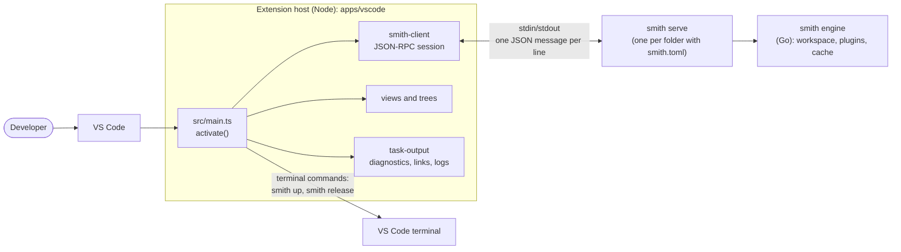
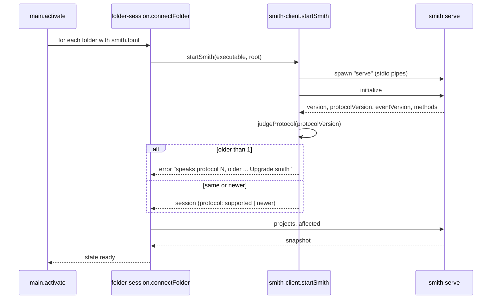

# The architecture of the VS Code extension

The MonoSmith extension (`apps/vscode`) shows a workspace's projects, runs its tasks and reports its
health, dependencies and release preview inside VS Code. It carries no engine of its own: it finds
the `smith` the team installed, starts `smith serve` for each workspace folder, and talks JSON-RPC
to it. This page explains how it is organised and why.

Audience: contributors to `apps/vscode`. For what the extension offers a user, see
[The MonoSmith VS Code extension](../manual/vscode.md) and the extension's own README
(`apps/vscode/README.md`). The server side is described in
[Serve and the event stream](../reference/serve.md).

## The rule: the editor runs the installed smith

The extension never bundles or downloads smith. It runs the one the team installed, so the editor,
the terminal and CI give the same answer ([ADR 0025](decisions/0025-ide-plugins-run-the-installed-smith.md),
[ADR 0030](decisions/0030-vscode-extension-is-a-serve-client.md)). Everything the extension knows
about a workspace comes from `smith serve` answers: it parses no manifest and reads no `smith.toml`.
Where it acts on the workspace, it asks smith to act: a doctor fix is `doctor.fix`, an update is the
command `smith up <name>` opened in a terminal, because smith serve has no method to update through
the editor and the editor never rewrites a manifest itself.

## Context and containers

`smith serve` speaks JSON-RPC 2.0 on its standard input and output, one JSON message per line, and
opens no port. (Plugins use a different framing, `Content-Length` headers, see
[the plugin protocol](plugin-protocol.md#transport-and-framing).)

## Source layout

The extension follows the repository's vertical-slice rules in TypeScript: a folder per outcome with
an `index.ts` as its only door, and files named for their role (`*.use-case.ts`, `*.policy.ts`,
`*.mapper.ts`, `*.client.ts`, `*.store.ts`, `*.contract.ts`, `*.algorithm.ts`). Anything that touches
the `vscode` API is a `*.client.ts`; the rest runs without VS Code and is unit tested with Vitest.
`src/main.ts` is the one file that wires the slices together.

| Slice (`apps/vscode/src/…`) | Outcome |
|---|---|
| `smith-client` | find smith (`locateSmith`), start `smith serve` (`startSmith`), a JSON-RPC session with events (`openSession`), the protocol range (`judgeProtocol`) |
| `smith-version` | read smith's version, say where it came from, warn once when the editor and the terminal run different smiths |
| `workspace-folders`, `folder-session` | find folders that hold a `smith.toml`; the state of each (`starting`, `ready`, `missing`, `failed`, `untrusted`) and what the view shows for the set |
| `workspace-trust` | whether the folder is trusted; start again when it becomes trusted |
| `workspace`, `workspace-view`, `list-view` | the snapshot of projects (`projects`, `affected`), the Projects tree with filter, and the generic list tree used by the other views |
| `task-run`, `quick-pick` | plan and run tasks (`run`, `cancel`), keep the status of each task, choose what to run, the status bar menu |
| `task-provider` | VS Code tasks of type `smith`, and the problem matchers declared in `package.json` |
| `task-output` | parse failures of `tsc`, ESLint, go, gcc, ruff and rustc into Problems entries, make paths in output clickable, keep each task's last log as a document |
| `health` | `doctor`, the Health tree, the fix preview and `doctor.fix` |
| `dependencies`, `release-preview` | `updates` and `release.preview` as trees |
| `project-insight` | `explain` and `graph` rendered as documents |
| `empty-folder` | find a folder with no files and offer `smith new --here` in a terminal (`findBlankFolders`, `toNewArguments`) |
| `adopt-offer` | find a folder that holds a repository smith can bring in, and offer a bare `smith` (its screen asks how far to go) or `smith adopt --dry-run` in a terminal (`findRepositoryOffers`, `toAdoptArguments`) |
| `agent-install` | offer the MonoSmith agent and the `smith mcp` registration (`monosmith.installAgent`, `monosmith.installMcp`), run `smith agent install --claude --vscode` (or `smith mcp install --vscode`) as a preview first and write with `--yes`, open Claude Code on the agent (`monosmith.talkToAgent`), and record an opt-out with `smith config set agent.enabled false` |
| `refresh` | what makes the views stale, and a coalescer |
| `settings`, `status-bar`, `context-keys`, `smith-terminal`, `extension-api` | `monosmith.*` settings, the status item, context keys, opening a terminal, and the small state API the integration tests read |

## Finding smith and keeping to the trust model

`locateSmith` (`smith-client/locate-smith.policy.ts`) returns the first that exists:

1. the `monosmith.path` setting;
2. the folder's own install, `node_modules/.bin/smith(.cmd)` or `.smith/bin/smith(.exe)`, only when
   the folder is trusted;
3. the first `smith` on the `PATH`.

It also reports the `PATH` smith and whether the folder holds its own smith that was skipped
because it is not trusted. A folder's own smith is an executable the folder brings, so in
Restricted Mode the extension does not run it and does not run tasks either; it shows projects
with the setting or the `PATH` smith and starts again by itself when trust is granted
(`package.json` `capabilities.untrustedWorkspaces`: `limited`, with `monosmith.path` among the
restricted configurations). `judgeSkew` warns once per session when the editor's smith and the
terminal's differ in version.

## Starting a session and negotiating the protocol

`SUPPORTED_PROTOCOLS` is `{oldest: 1, newest: 1}`. An older server is refused with a message that says
to upgrade smith. A newer one is worked with, because the protocol only ever adds optional fields;
the session records `protocol: 'newer'`. Stderr of `smith serve` goes to the MonoSmith output
channel, the last lines are kept to explain a failure, and a process that ends by itself is noticed
at once with an offer to restart it. On Windows a `.cmd` shim runs smith as a grandchild, so `stop`
ends the whole tree with `taskkill`.

## Running tasks

`task-run` builds a `RunPlan` from the choice (project and task, all projects, affected, last run)
and `runTasks` sends one `run` request with `tasks`, `projects`, `affected`, `bail`, `noCache`,
`parallel` and a client-chosen `run` id. While the request is in flight the server sends `event`
notifications with that run id (`run.started`, `task.queued`, `task.started`, `task.output`,
`task.finished`, `run.finished`); the extension filters on the id, updates a per-folder
`TaskStatusStore` (which redraws the tree and status bar) and appends output to the MonoSmith channel and to
a per-task log store. A failed run is a result with `ok: false`, not an error. `cancel` with the same
id stops the run and its processes. The event contract is
[ADR 0026](decisions/0026-event-stream-and-smith-serve.md).

The Problems panel is fed from the captured output: `task-output` parses the diagnostics of
`tsc`, ESLint, Go, gcc, ruff and rustc, resolves each path from the project the task belongs to
(`resolveSourcePath`, `sourceBases`), and clears them when the task runs again. Tasks of type
`smith` can be written in `tasks.json`; the matchers `$smith`, `$smith-tsc` and `$smith-eslint`
read failures out of a terminal run, which does not know the project, so paths are resolved
against the workspace folder only.

## Refreshing

`watchRefreshTriggers` turns three things into refresh requests: `smith.toml` created, changed or
deleted and the git `HEAD` moving (scope `full`: projects may differ), and a relevant file saved
(scope `affected`: only the affected set may differ). `createRefreshCoalescer` waits for
`monosmith.refresh.debounceMs` (default 1500) of quiet after the last request and fires once with
the widest scope asked for, so saving twenty files or switching branch is one refresh. After each
run the status stores refresh the views directly. `monosmith.refresh.auto = false` turns the
watching off.

## Tests

| Layer | Tool | What it covers |
|---|---|---|
| Unit | Vitest (`npm test`, `smith test -p vscode`) | policies, mappers, algorithms, stores, the JSON-RPC session; no VS Code needed |
| Integration | `@vscode/test-electron` (`npm run test:integration -w monosmith-vscode`) | starts a real VS Code with the bundle from `dist`, once per scenario in `integration/run-integration.mjs`: `ready` (smith from the setting, trusted), `missing` (no smith), `untrusted` (restricted mode, smith on the `PATH`) |

The integration tests put a stand-in on the path: `integration/fake-smith/fake-smith.cjs` speaks
the serve protocol for a fixed workspace of two projects (`demo`, `lib`) so no toolchain is needed;
its task `hang` never ends by itself, only `cancel` ends it. On Linux without a display the tests run
under `xvfb-run -a`.

## Packaging and publishing

`build` bundles `src/main.ts` with esbuild into `dist/apps/vscode/main.js` (CommonJS, Node 20,
`vscode` external) and copies the media without the README screenshots, which stay out of the
`.vsix`. The extension is an app of this workspace with a release section
(`[projects.vscode.release]` in the repository's `smith.toml`), so it is versioned by its tag and
the `vscode` plugin (`libs/plugin-node-toolchains/vscode`) packs and publishes it. Publishing to the
Marketplace uses `VSCE_PAT`, or, with `[release] vsce_entra = true` as in this repository, a
Microsoft Entra ID identity that the workflow signs in as, with no token secret
([ADR 0031](decisions/0031-marketplace-publishing-with-entra-id.md); how the release job gets there
is in [How CI pipelines are generated](ci-generation.md) and
[How a release is decided and published](release-design.md)). The repository's `smith.toml` comment
also says the package goes to Open VSX; that path was not checked for this page.

## Where in the code

| Concern | Path |
|---|---|
| Activation and wiring | `apps/vscode/src/main.ts` |
| Finding and starting smith | `apps/vscode/src/smith-client` |
| Folder state | `apps/vscode/src/folder-session`, `workspace-folders`, `workspace-trust` |
| Running and output | `apps/vscode/src/task-run`, `task-output`, `task-provider` |
| Contributions (commands, views, settings, matchers) | `apps/vscode/package.json` |
| Integration tests | `apps/vscode/integration` |
| Server side | `apps/smith/engineserver` |

## Decisions

| Decision | Record |
|---|---|
| IDE plugins run the installed smith | [ADR 0025](decisions/0025-ide-plugins-run-the-installed-smith.md) |
| The extension is a `smith serve` client | [ADR 0030](decisions/0030-vscode-extension-is-a-serve-client.md) |
| Event stream and `smith serve` | [ADR 0026](decisions/0026-event-stream-and-smith-serve.md) |
| Marketplace publishing with Entra ID | [ADR 0031](decisions/0031-marketplace-publishing-with-entra-id.md) |
