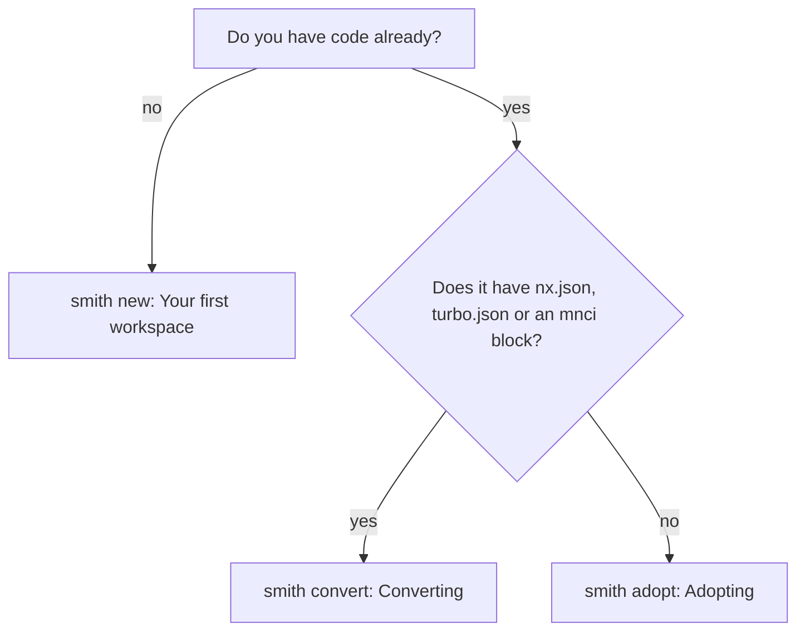

# Getting started

These pages take you from nothing to a working workspace. Read them in order the first
time; each stands alone afterwards.

| Page | Read it when |
|---|---|
| [Installing smith](installing.md) | you have not installed `smith` yet, or want another channel (npm, pipx, .NET tool, gem, pub, a plain download, `.deb`, `.rpm`), to upgrade, or to check a download |
| [Your first workspace](first-workspace.md) | you are starting a monorepo from nothing: `smith new`, `smith add`, tasks and the cache, `smith doctor`, CI and a first release, in about twenty minutes |
| [Adopting an existing repository](adopting.md) | you already have a repository with npm workspaces, Go modules or Python projects and want smith to run it without moving files |
| [Converting from Nx (and from the old mnci)](converting.md) | your repository is an Nx, Turborepo or mnci workspace |

Which one?

In a terminal, a bare `smith` in a folder that holds files but no workspace offers
"Bring this repository into MonoSmith", and that one wizard handles both cases (so does `smith adopt`, which hands an Nx or Turborepo workspace to `smith convert`)
([the terminal interface](../manual/tui.md#the-adopt-wizard)).

After these pages, the [manual](../manual/README.md) documents every command and flag, the
[reference](../reference/README.md) documents the configuration file and the concepts, and
the [guides](../guides/README.md) answer "how do I..." questions.
