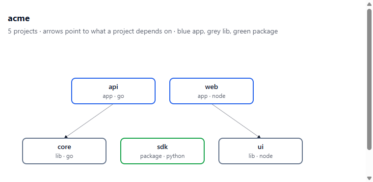
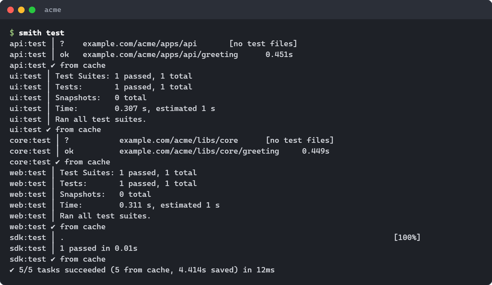
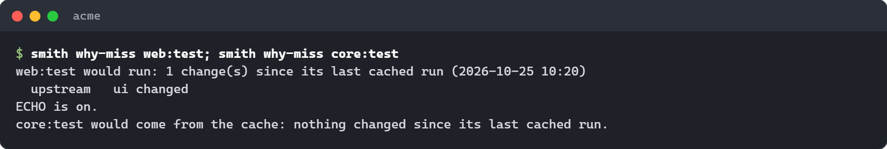
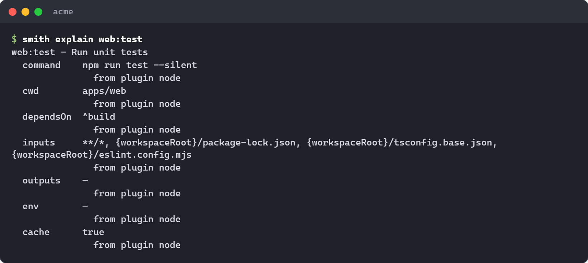
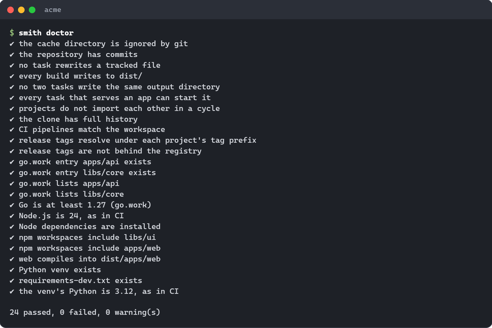
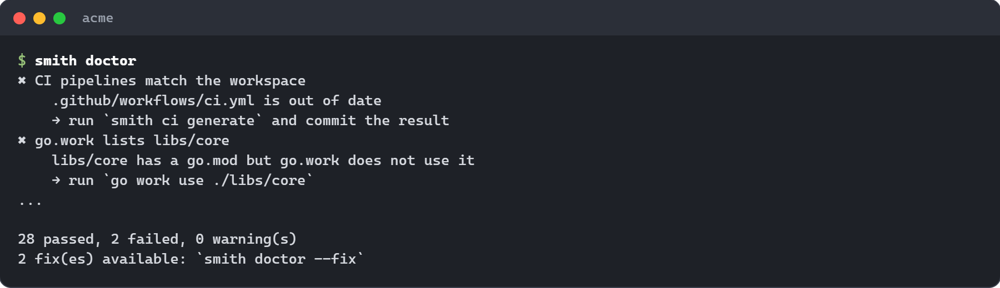
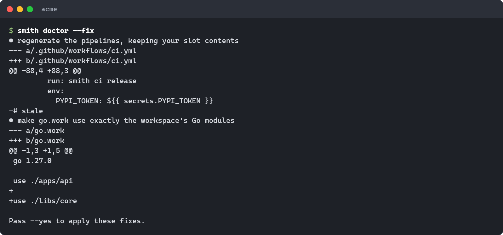
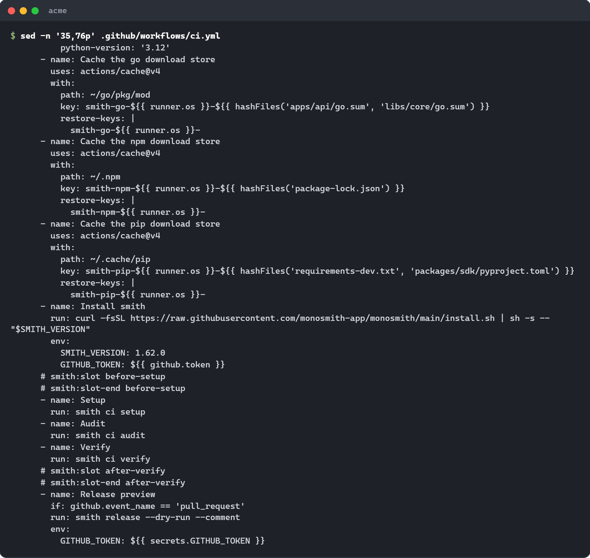
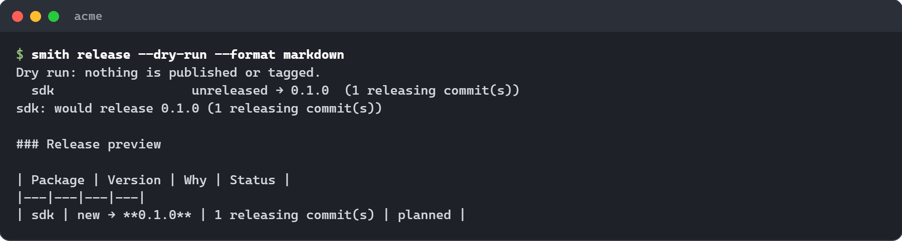

# Your first workspace

This is a hands-on tour. In about twenty minutes you will install `smith`,
make a workspace with projects in two languages, let one project use another,
run tasks and watch the cache answer, see what a change affects, check the
workspace's health, open the interactive shell, look at the CI pipeline smith
wrote for you, and preview a release.

Every command below was run for real, and every output is copied from that
run. Paths and timings will differ on your machine.

**One rule to know first.** smith never commits for you. Every command that
changes files leaves them in your work tree, so you can read them with
`git status`. Add `--commit` to a command, or run `smith commit` afterwards, and
smith makes one commit that `smith undo` can revert. The only commit smith makes
without being asked is the first one of `smith new`, and `--no-commit` skips it.

**The other rule.** smith asks before it decides. In a terminal, a choice is a
question with the consequence in plain words and the default marked. Without a
terminal (a script, CI), smith does not guess: it stops, says what it needs and
names the flag that answers it. `--yes` takes the default of every question.

**Words you will meet.** A *workspace* is your repository as smith sees it: a
folder with a `smith.toml` file at the top. A *project* is one folder inside
it that has a manifest (`package.json`, `go.mod`, `pyproject.toml`, and so on).
A *task* is a command smith runs for a project, such as `build` or `test`. A
*kind* says what a project is for (`app`, `lib` or `package`). A *stack* is the
set of tools a project is built with. The [glossary](../reference/glossary.md)
defines the rest, and each word is explained again where it first matters.

## 1. Install smith

The shortest way:

```sh
curl -fsSL https://raw.githubusercontent.com/monosmith-app/monosmith/main/install.sh | sh     # Linux, macOS, Git Bash
irm https://raw.githubusercontent.com/monosmith-app/monosmith/main/install.ps1 | iex           # Windows PowerShell
```

Check it:

```sh
smith --version
```

[Installing](installing.md) lists every other channel (npm, pipx, dotnet tool,
gem, pub, a plain download, `.deb` and `.rpm`), how to upgrade and how to check
a download.

You also need **git**, and the toolchain of each language you use. `smith tools`
lists the programs your workspace needs and which are installed. When one is
missing, `smith tools install` shows the ways to get it (a package manager on
your machine, the official page, or doing it yourself) and asks which you want.
Nothing is installed before you choose.

| Language | You need |
|---|---|
| Node | Node 24 with npm |
| Go | Go 1.24 or newer. The workspace's `go.work` records the version (1.27.0 when this tour was run with Go 1.27), and generated CI installs that one |
| Python | Python 3.12 or newer |
| Rust | Rust, with clippy and rustfmt |
| .NET | the .NET 10 SDK |
| Ruby | Ruby 3.2 or newer, with Bundler |
| PHP | PHP 8.2 or newer, with Composer |
| C and C++ | CMake 3.25 or newer, Ninja, a C++ compiler, cppcheck |
| Dart, Flutter | Dart (Flutter carries it) |
| JVM | JDK 21 with Maven; Gradle 9 for Kotlin; the Android SDK for Android |
| Bicep | the Azure CLI with Bicep |
| Lua | Lua with LuaRocks, luacheck and busted |
| Swift | the Swift toolchain (SwiftPM, XCTest) |
| Objective-C | a Mac with Xcode and CocoaPods (`pod lib lint`) |
| AppleScript | macOS, for `osacompile` (it ships with the system) |

This tour uses Node, Go and Python.

## 2. Start a workspace

### A new one

```sh
smith new acme --yes
cd acme
```

```text
Chosen for you:
  agent files (.claude/agents/smith.md, .mcp.json, .vscode/mcp.json): written; --no-agent leaves them out
  .devcontainer/devcontainer.json: written; --no-devcontainer leaves it out
  CI: github; --ci github,azure,gitlab,circleci,bitbucket changes it

Go module prefix: example.com/acme (no git remote; --module-prefix <prefix> sets the real one before Go code imports it)
  wrote smith.toml
  wrote README.md
  wrote .gitignore
  wrote .gitattributes
  wrote .github/workflows/ci.yml
  wrote .devcontainer/devcontainer.json
  wrote tools/smith/install.sh
  wrote .claude/agents/smith.md
  wrote .mcp.json
  wrote .vscode/mcp.json
  committed

Created acme. Next:
  cd acme
  smith add app web --lang <language>   # smith kinds lists the languages
```

The last three files are the MonoSmith agent, which lets Claude Code and VS Code work in the
workspace through smith (see [the agent guide](../guides/agent.md)). `--no-agent` leaves them out.

smith writes the files, runs `git init` on `main` and makes the first commit
(`chore: create the acme workspace with smith`). It is the one commit smith makes
unasked, because a repository with no commit has nothing to undo to. Pass
`--no-commit` to commit nothing.
The `smith.toml` it wrote is mostly comments explaining each setting; the only
live lines are the workspace's name, the npm scope, the Go module prefix, the CI
provider, a default stack for Node and the code layout smith checks.

At a terminal, `smith new` without `--yes` first asks a few questions (the CI,
the main language, the tests and lint for Node, the code layout, and behind
"more options" the release branch, GitHub Releases and the cache). Enter keeps
the default shown, and every answer is a flag too; the
[`smith new` manual](../manual/new.md#the-questions) lists them. The listing
above is what you get without a terminal or with `--yes`. In the
[terminal interface](../manual/tui.md) and in VS Code, a new workspace first
offers "Start with the defaults", which lists what is chosen and how to change
each later, or "Customise", which asks the questions.

Options (see [`smith new`](../reference/cli.md#smith-new)):

| Option | Default | Meaning |
|---|---|---|
| `--scope @acme` | `@<name>` | the npm scope for Node packages |
| `--module-prefix github.com/acme/acme` | from the `origin` remote, else `example.com/<name>` | the Go module path prefix |
| `--ci github,azure` | `github` | pipelines to write (`github`, `azure`, `gitlab`, `circleci`, `bitbucket`) |
| `--yes` | off | ask nothing; take the default of every question without a flag |
| `--dir .` | `./<name>` | create the workspace in an existing clone |
| `--recipe <path or URL>` | none | the [recipe](../reference/recipes.md) `smith add` builds projects from |
| `--no-agent` | off | leave out the agent files (`smith agent install` adds them later) |
| `--no-commit` | off | write the files and make no first commit |
| `--here` | off | create the workspace in the current empty folder, named after it |

With `--dir .`, files smith does not own are kept. In a folder that is not a git
repository smith runs `git init`, and the first commit holds everything in the
folder. In a clone you already have, the first commit holds only the files smith
wrote, so your other changes stay uncommitted. A workspace made in a folder below
the top of an existing repository is left uncommitted; commit it yourself.

If you already have a repository with code in it, do not run `smith new` over it:
see [Adopting an existing repository](adopting.md).


## 3. Add projects

A project has a **kind**, which tells smith what to do with it at release time:

| Kind | Lives in | What release does |
|---|---|---|
| `app` | `apps/<name>` | never published; your pipeline deploys it |
| `lib` | `libs/<name>` | never published; other projects import it |
| `package` | `packages/<name>` | published to its registry when it has releasable commits |

### Start from what you are building

In a terminal, run `smith add` with nothing after it, or press `a` in the
[terminal interface](../manual/tui.md). The first question is **"What are you
building?"**, and the answers are things, not settings:

| You pick | You get |
|---|---|
| A website or web app | an `app` with a dev server, tests and a build; next you pick a framework (React, Vue, Svelte and others) |
| An API or backend service | an `app` that answers requests; next you pick a language |
| A function app (Azure, AWS, Google) | an `app` the cloud runs when something happens, for Node, Python or C#; next you pick the cloud |
| A desktop app (Tauri, Electron) | an `app` with the tasks that package it |
| A library for my other projects | a `lib` the projects of this workspace import; it is never published |
| A package I publish | a `package` that goes to a registry (npm, PyPI, NuGet, crates.io) when you release |

Not sure? Type a word (`react`, `azure function`, `desktop`) and the list
filters. "I know the language" keeps the long way: kind first, then the
language from the full list. smith asks the language only when more than one
fits, then the name, then the tools (tests, lint, style) with the defaults
ticked. `smith compose` shows the same catalogue as one screen: search it,
tick what you want, see each conflict explained as you tick, and end with the
exact `smith add` line. [`smith add`](../manual/add.md) and
[`smith compose`](../manual/compose.md) have the details.

Every answer ends as an ordinary command line, shown in the plan before smith
writes anything. The commands below are those lines, so they also work in a
script. A project has a **kind**, which is the `app`, `lib` or `package` of the
table above.

### Add one of each

Without a terminal, `smith add` needs the kind, the name and `--yes`. Add one
of each, in two or three languages:

```sh
smith add app web --lang node --yes
smith add lib core --lang go --yes
smith add lib ui --lang node --yes
smith add app api --lang go --yes
smith add package sdk --lang python --yes
```

(No Python? Use `smith add package sdk --lang node --yes`; the rest of the tour
works the same, but its screenshots show the Python version.) Each command installs what the project needs (the first Node
project runs `npm install`, the first Python project makes a `.venv`) and ends
by telling you how to import it and what to try. Before it writes anything,
`smith add` prints a plan of what it will create and change. In a terminal it
asks `Go ahead? [y/N]`. `--dry-run` prints the plan and writes nothing. Without
a terminal and without `--yes` it stops with `nobody can confirm this change`.
After it writes, it builds and tests the new project. For the Go library:

```text
Plan: add lib core
  Project core
    create  libs/core/  (made by the go plugin)
  Generated files smith may rewrite
    change  .github/workflows/ci.yml  (generated by smith and regenerated after the add, so a toolchain the project needs joins it; ...)
    change  .devcontainer/devcontainer.json  (...)
Creating lib core in libs/core: go
go: creating new go.mod: module example.com/acme/libs/core
Updating the CI pipelines
Wrote 9 file(s):
  .devcontainer/devcontainer.json
  .github/workflows/ci.yml
  go.work
  libs/core/doc.go
  libs/core/go.mod
  libs/core/greeting/doc.go
  libs/core/greeting/greet_use_case.go
  libs/core/greeting/greet_use_case_test.go
  libs/core/greeting/greeting_contract.go
Import it from another Go project as example.com/acme/libs/core/<slice>.
Use it from an app: smith install -p <app> core (in the terminal interface, press + on the app and pick it).
Verifying: smith run build test -p core
Verified: build and test passed in 800ms
Done: lib core is ready (9 files written, 1.1s).
Try: smith test -p core
Not committed. Review it with git status; add --commit next time to commit it as one operation that smith undo can revert.
```

Notice that adding a project also rewrote the CI pipeline and the dev container,
so they always match what is in the repository.

### Commit, and undo

The last line of the output is the rule from the start of this page: the files
are in your work tree and nothing is committed. You have three ways to go on:

| You want | Do |
|---|---|
| to read the change first | `git status`, then `git diff` |
| to commit it so you can undo it | `smith commit` (lists every changed file, asks, then makes one commit named from the operation, such as `chore: add lib ui`) |
| to commit as you go | add `--commit` to the command (`smith add app web --lang node --commit`), or set `commit_operations = true` under `[workspace]` in `smith.toml` |

`smith commit` takes only the files of the last operation by default, so it
does not sweep up your own work. `--all` takes everything git shows as changed;
without a terminal you must name `--only-operation` or `--all`. Once a change
is committed this way, `smith undo` reverts it with `git revert`, a new commit
that leaves the history alone. [`smith undo`](../manual/undo.md) refuses when a
later commit or an uncommitted change touches the same files.

Commit now, so the next steps start from a clean tree:

```sh
smith commit --all --yes
```

```text
Committed 59aa74d0: chore: add lib ui (smith undo reverts it)
```

(The name of the commit is the last operation. Your hash differs.)

### If an add fails

| smith says | What to do |
|---|---|
| `nobody can confirm this change: there is no terminal and --yes was not given` | add `--yes` to apply the plan, or `--dry-run` to read it only |
| a tool is missing, and the project exists | the project is kept. Run `smith tools install`, then `smith run build test -p <project>` |
| `smith: ... a project of this workspace ... and a package on the registry` | see [Use one project from another](#use-one-project-from-another) |

Every project starts with one worked example (`greeting`) laid out as a
*vertical slice*: a folder for one outcome, with files named for the role they
play (`greet.use-case.ts`, `greet_use_case.go`). It passes lint, type-check,
test and build straight away. The [conventions](../reference/conventions.md)
page explains the layout and how to turn the check on or off.

`--lang` picks the language: `node`, `go`, `python`, `rust`, `dotnet`, `ruby`,
`php`, `cpp`, `dart`, `jvm`, `bicep`, `lua`, `applescript`, `vba`, `swift` or `objc`. When the workspace has only one
language, it is the default. `--stack` picks the set of plugins the project is
built with instead (`smith add app web --stack react`); `smith stacks` lists
them, and [stacks](../reference/stacks.md) explains them. `--with` builds the
project from separate choices, one for each axis (`--with react,vitest`);
`smith choices` lists them. If your team keeps a
[recipe](../reference/recipes.md), `smith add` asks the recipe's questions
instead; `--choice language=python` answers one without asking, which is how
scripts add projects.

The new project follows its siblings. When at least three projects of the same
kind and language, and at least two thirds of them, share a build tool or a test
runner, the new one does the same and says why. `--fresh` gives the stack's
default instead, and `--like <project>` copies one project's shape.

For the other outcomes, the commands are the same with a different choice:

```sh
smith add app site --lang node --with react,vitest                            # a website
smith add app hooks --lang node --with azure-functions,http-trigger,node24    # a function app
smith add app desk --lang node --with electron                                # a desktop app
```

A function app needs three answers that smith never picks for you: the cloud
(`azure-functions`, `aws-lambda` or `gcp-functions`), what starts the function
(`http-trigger`, `timer-trigger`, `queue-trigger` or `blob-trigger`) and the
runtime (`node24`). In a terminal smith asks each one; with a flag missing and
no terminal it stops and lists the answers. `smith choices` and
`smith compose` list every name.

List what smith sees:

```sh
smith projects
```

```text
api                  app      go       apps/api
core                 lib      go       libs/core
sdk                  package  python   packages/sdk
ui                   lib      node     libs/ui
web                  app      node     apps/web
```

To take a project out again, `smith remove web --dry-run` shows what would
change, and `smith remove web` asks before deleting. It removes the folder, the
traces the language plugin owns elsewhere (the `go.work` entry, the lockfile
entry), the project's tables in `smith.toml` and its CI. A project another one
imports is refused unless you pass `--force`. If the folder holds files git
cannot bring back, smith never deletes them by surprise: it moves the folder to
`.smith/removed/<name>-<time>/` (`--keep-copy`, the default in a terminal) or
deletes it for good (`--delete`). When it ends, smith lists the tracked files
that still name the project, such as a workflow or a doc of yours. It does not
change them.

### Use one project from another

A project uses a library when you say so. The command writes the dependency in
the form of the language, so there is nothing to edit by hand. Make `web` use
`ui`, and `api` use `core`:

```sh
smith install -p web workspace:ui --yes
smith install -p api workspace:core --yes
```

```text
web: no terminal to ask in, so smith writes * (Any version (*)). To choose another: --range <range>
web will use ui: smith adds "@acme/ui": "*" to apps/web/package.json.
Running npm install --no-audit --no-fund ...
✓ web: linked ui (apps/web/package.json, package-lock.json)

api will use core: smith adds require example.com/acme/libs/core v0.0.0 to apps/api/go.mod.
✓ api: linked core (apps/api/go.mod)
```

Nothing is downloaded. The `workspace:` prefix says "the project of this
workspace". Without it (`smith install -p web ui`) smith links a library too,
but when the registry has a package of the same name (`ui` and `core` both
exist on npm) it has to ask which you mean. In a terminal it asks. Without a
terminal it stops, and the message names the fix: `workspace:ui` for the
project, or `--registry ui` for the registry package. In a terminal you can also press `+`
on the app in the terminal interface and pick the library. `--range '^1.2.0'`
sets the version range smith writes.

Now import it in the code:

```ts
// apps/web/src/main.ts
import { greet } from '@acme/ui'
```

```go
// apps/api/main.go
import "example.com/acme/libs/core/greeting"
```

npm workspaces, `go.work` and the workspace's Python venv (editable installs)
make the library importable. smith reads the dependencies and the imports to
learn the graph:

```sh
smith graph
```

```text
api  app · go · apps/api
  └─ core
core  lib · go · libs/core
sdk  package · python · packages/sdk
ui  lib · node · libs/ui
web  app · node · apps/web
  └─ ui
```



*`smith graph --format html -o graph.html` writes a page you can share. Arrows
point at what a project depends on; blue is an app, grey a lib, green a
package.*

The other formats are `--format tui` (browse: what a project uses, what uses
it), `json` and `dot`. `--blast-radius <project or file>` lists everything a change to
it reaches, across languages and through shared schemas. `--focus web` keeps web and everything connected to it,
`--affected` keeps what a change touches, and `--diff v1.4.0` shows how the
graph changed since a revision. Projects that import each other in a cycle
cannot be ordered: `smith graph` and `smith doctor` still open the workspace and report the path and the import to remove,
while the commands that need an order stop with it
(`smith: projects import each other in a cycle: ui → web → ui`) until you break the cycle.

## 4. Run tasks and see the cache

```sh
smith build              # every project, in dependency order
smith test               # every project
smith test -p web        # web and what it depends on
smith run lint typecheck test   # several tasks
smith dev web api        # start several apps together; Ctrl+C stops them all
```

Run `smith test` the first time:

```text
api:test ▶ go test ./...
core:test ▶ go test ./...
sdk:test ▶ {workspaceRoot}/.venv/Scripts/python.exe -m pytest -q -p no:cacheprovider
web:test ▶ npm run test --silent
ui:test ▶ npm run test --silent
...
✓ 5/5 tasks succeeded (0 from cache) in 1.409s
```

Each line starts with `project:task`. `▶` shows the command smith started,
`│` is a line the task printed, and `✓` marks success with how long it took.
Tasks run in parallel, in dependency order; a task whose dependency failed is
skipped.

Run it again without changing anything:



*Every task ends `✓ from cache`: smith replayed the stored output and log
instead of running anything. Look at the last line: five tasks, 12 ms, and the
time it saved.*

The cache fingerprints each task (its command, the content of its input files,
the sources of the projects it depends on, the versions of smith, its plugins
and your compiler). The same fingerprint means the same result. Now change a
file in `ui`, and ask why `web:test` would run again, before running it:

```sh
smith why-miss web:test
smith why-miss core:test
```



*`why-miss` names the reason a task is not a cache hit, without running
anything. Here the change to `ui` reaches `web`, which imports it, and leaves
`core` alone.*

If a task misses when you expect a hit, `smith why-miss` is the first thing to
run. [Tasks, cache and affected](../reference/tasks-and-cache.md) covers the
cache key, the remote cache that shares results between machines, and how to
override a task in `smith.toml`. `smith explain web:test` shows how a task
resolved and which plugin or setting each value came from:



*Every value of a task, with where it came from. When you override a setting in
`smith.toml`, that line says so.*

### Only what changed

```sh
smith affected
smith test --affected
```

```text
changes since main
ui
web
```

`smith affected` lists the projects that own a changed file (since the merge
base with `main`, plus what you have not committed) and every project that
depends on them. `--affected` on `smith run`, `smith build` and the like runs
tasks only on those. When smith cannot tell (no base branch, a shallow clone, a
changed `smith.toml` or lockfile) it treats everything as affected: too wide
costs minutes, too narrow reports green for code nothing checked.

For a deployment platform that rebuilds on a push, `smith affected --paths`
prints, for each app, the directories that can change it:

```text
api	apps/api libs/core
web	apps/web libs/ui
```

## 5. Add dependencies

Each project owns its dependencies, so you name the project:

```sh
smith install -p web zod                    # npm install zod --workspace apps/web
smith install -p sdk -D pytest-cov          # the Python dev extra, into .venv
smith install -p api github.com/pkg/errors  # go get, in apps/api
smith uninstall -p web zod
```

To let one project of your workspace use another, name the library instead of
a package (`smith install -p web workspace:ui`, shown in
[step 3](#use-one-project-from-another)); nothing is downloaded.
`-p` takes a project name or directory and can be repeated. `-D` adds a
development dependency. A bare `smith install` installs everything a fresh clone
needs. `smith install` and `smith uninstall` cover Node, Python, Rust, Go, .NET,
Dart, PHP and Ruby; for the JVM edit the pom or build script.

When projects declare the same dependency at different versions, `smith sync`
makes them agree, and `smith sync --check` only reports (use it in CI).
`smith up` lists every dependency with a newer release, grouped as patch, minor
and major:

```sh
smith up            # pick in the terminal (patch and minor start selected)
smith up zod jest   # exactly these, no prompt
smith up --yes      # everything
smith up --check    # report only (the default without a terminal)
```

Each chosen declaration keeps its operator (`^`, `~`, `>=`) and moves to the
latest version, then the workspace is installed again.

## 6. Check the workspace

```sh
smith doctor
```

A healthy workspace prints one line per check and a count (the Doctor tab of the
shell shows the headline, the failing checks and, behind `p`, the passed ones):



*The middle of the list is cut here. The checks that run depend on the languages
in the workspace.*

When a check fails, the line says what is wrong and the remedy:



*Failed checks come first, each with a `→` line naming the fix. Here the CI
pipeline is out of date and `go.work` is missing a module.*

`smith doctor --fix` shows each fix it can make as a unified diff, then asks
before applying; with `--yes` it applies without asking, and without a terminal
it only shows:



*Only safe fixes are applied: ones that restore what smith or a plugin owns
without losing anything of yours. A fix that could lose something is shown,
never applied.*

`smith doctor` checks the workspace. `smith tools` checks the machine: it lists
the programs the workspace needs (git, Go, Node and so on) and whether each is
installed.

```sh
smith tools
```

```text
✓ Git: git 2.41.0
✓ the GitHub CLI: gh 2.94.0
✓ Go: go 1.27.0
✓ Node.js: node 24.12.0
✓ Docker: docker 28.0.1
```

A missing tool gets a `×` line. `smith tools install` then shows the ways to get
it and asks which you want, one tool at a time. It never runs a command that
needs administrator rights in silence. [`smith tools`](../manual/tools.md) has
the details.

The [troubleshooting guide](../guides/troubleshooting.md) lists the checks and what to do
about each.

## 7. The interactive shell

Run `smith` with no arguments, in a terminal, and it opens a full-screen shell for the
workspace: Home, Projects, Run, Doctor, Deps, Release and Settings as tabs (keys `1` to `7`),
one key for each action (`b` build, `t` test, `l` lint, `c` typecheck, `w` lint and test
what changed, `d` doctor, `a` add a project), a command palette on `:` and a help
overlay on `?`. Nothing the shell does happens on its own: every action ends as an
ordinary `smith` command line, shown in the status bar before it runs, and one that
changes the workspace asks first. Home names the one thing to do next, for example
"press d" when checks fail or "all good: press b to build".

In a folder that is not a workspace the shell offers to create one, or to adopt the
repository you are in. When standard input or output is not a terminal, or `CI` is
set, a bare `smith` prints its help instead. Every key, screen and wizard is listed in
[The smith terminal interface](../manual/tui.md).


## 8. CI

`smith new` and every `smith add` wrote `.github/workflows/ci.yml`. You never
edit it to add a language or a project; `smith ci generate` rewrites it from
what is in the repository (`smith ci generate --check` only reports drift, and
`smith doctor` fails on it).



*Setup steps for exactly the languages in the workspace, a download-cache step
for each package manager, then one `smith ci <phase>` call per phase. The
`smith:slot` comment pairs are where your own steps go; they survive
regeneration.*

The pipeline only calls `smith`, so CI runs the same commands you run
locally:

| Phase | Does |
|---|---|
| `smith ci setup` | installs every dependency the plugins need |
| `smith ci audit` | checks dependencies for known vulnerabilities |
| `smith ci verify` | lint, typecheck, test and build; only affected projects on a pull request |
| `smith ci pack` | collects what each project packages into `dist/drop` |
| `smith ci native` | lints, tests, builds and packages the projects tagged native (cgo) on this operating system; the pipeline runs it on each OS |
| `smith ci release` | versions, publishes and tags every package with releasable commits |

`smith ci check` lists what to set up by hand: the repository secrets and each
private registry's permissions:

```text
To set up by hand before the pipelines run:
  - GitHub: add the repository secrets PYPI_TOKEN (Settings → Secrets and variables → Actions)
```

[CI pipelines](../reference/ci.md) covers Azure Pipelines and GitLab CI, your
own steps, the remote cache and the package download caches.

## 9. A first release

Commit with [Conventional Commits](https://www.conventionalcommits.org):
`feat` bumps the minor version, `fix` the patch, and a breaking change the
major. Then ask what a release would do:

```sh
git add -A && git commit -m "feat(sdk): add retries"
smith release --dry-run
```



*A preview that changes nothing. The table at the bottom is what the pull
request comment shows (`smith release --dry-run --comment`); `--format markdown` prints it in your terminal.*

A project releases when a `feat:`, `fix:`, `perf:` or breaking commit touches its own folder (or the folder of a lib it imports). A `chore:` commit, or a change only under `tools/` or in `smith.toml`, releases nothing.

Before any release, until there is such a commit for a package, the preview says so and tells you
what to do:

```text
Dry run: nothing is published or tagged.
Nothing to release: no package has a feat: or fix: commit since its last release (or since the start, if it was never released).
  → A project releases when a feat:, fix: or breaking commit touches its own folder (or a lib it imports). A chore: commit, or a change only under tools/ or in smith.toml, releases nothing.
  → Releases come from conventional commits: commit with a message like "feat: add search" or "fix: handle empty input" ...
```

Only packages release. Libs are released inside the packages that use them, and
apps release only if you give them a release section. To change a plan, hold a
package back for this time (`smith release --hold sdk`) or force a bump
(`smith release --bump sdk=minor`). `smith release --dry-run` shows the effect
of both before anything happens.

A release needs a registry credential. Test it first, without publishing:

```sh
smith release --rehearse
```

```text
Release rehearsal: asking 1 registry with read-only requests; nothing is published.
× kit: access on registry.npmjs.org
    the registry refused the credential (401)
    → create a token that can publish @acme/kit and set NODE_AUTH_TOKEN
```

(This output is from an npm package named `kit`.) That is the answer you get before you set a token: the rehearsal stops a bad key
before a real release can fail half way. `smith ci check` lists the secrets to
add to the repository.

The real release runs from the release branch (`main`) in CI as
`smith ci release`; running `smith release` on your machine asks for
confirmation first. A failed release resumes when you run it again.
A branch such as `next` can release its own line of prerelease versions
(`2.0.0-beta.1`, `beta.2`, ...): declare it as a `[[release.channels]]` table
in `smith.toml`. [Releasing](../reference/releasing.md) covers registries,
tags, release channels, binaries and container images.

## 10. Upgrade smith

After installing a newer smith, run it once in the workspace:

```sh
smith upgrade             # migrate smith.toml, regenerate the pipelines, update recipe projects
smith upgrade --dry-run   # show the plan and the change to smith.toml; change nothing
smith upgrade --check     # the same, and fail when something would change (CI)
```

`smith.toml` is migrated to the current schema with its comments and layout
kept. Files smith owns (the pipelines start with "Generated by smith") are
regenerated with your slot contents kept. Files smith wrote once, like
`README.md`, and your own files are never touched. Like every command that
changes files, `smith upgrade` commits only with `--commit`.

## Where next

| I want to | Read |
|---|---|
| look up a command or a flag | [CLI reference](../reference/cli.md) |
| change a setting | [Configuration](../reference/configuration.md) |
| understand a word | [Glossary](../reference/glossary.md) |
| fix a problem | [Troubleshooting](../guides/troubleshooting.md), [FAQ](../guides/faq.md) |
| know who owns a file, attach the workspace state to a pull request, or give coding agents the rules | [Know your files, share the workspace and brief your agents](../guides/know-your-files-and-brief-your-agents.md) |
| stop repeating the same config in every project | [Derived files](../guides/derived-files.md) |
| choose a framework, a test runner and a style when you add a project | [`smith add`](../manual/add.md#building-from-choices), [`smith choices`](../manual/choices.md) |
| undo a `smith add` or `smith upgrade` | [`smith undo`](../manual/undo.md); to commit one after the fact, [`smith commit`](../manual/commit.md) |
| search everything a project can be built from and compose the stack | [`smith compose`](../manual/compose.md) |
| change one decision of a project, such as its test runner | [`smith swap`](../manual/swap.md); [`smith try`](../manual/try.md) tries a change in a temporary copy first |
| make an app a lib, or a lib a package | [`smith kind`](../manual/kind.md) |
| see where the workspace differs from smith's defaults | [`smith divergences`](../manual/divergences.md), [`smith copies`](../manual/copies.md) |
| make the repository start with the smith version it pins | [`smith bootstrap`](../manual/bootstrap.md) |
| install the programs the workspace needs | [`smith tools`](../manual/tools.md), [`smith tools install`](../manual/tools-install.md) |
| release prereleases from a branch, hold or bump a package | [Releasing](../reference/releasing.md), [`smith release`](../manual/release.md) |
| write a plugin for a language smith lacks | [Writing a plugin](../guides/writing-a-plugin.md) |
| know how smith works inside | [Architecture](../architecture/architecture.md), [plugin system](../architecture/plugin-system.md), [execution and cache](../architecture/execution-and-cache.md) |
