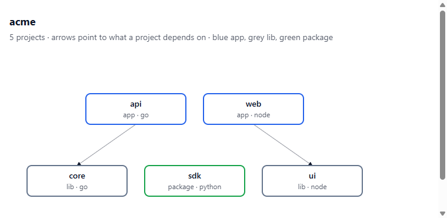
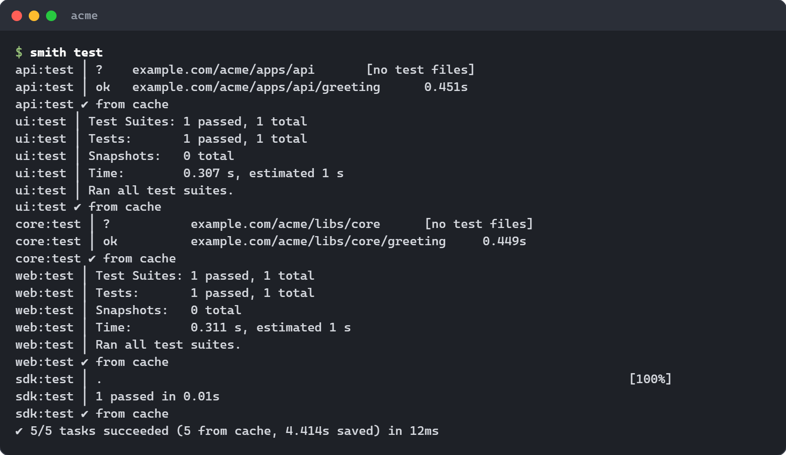
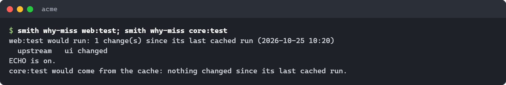
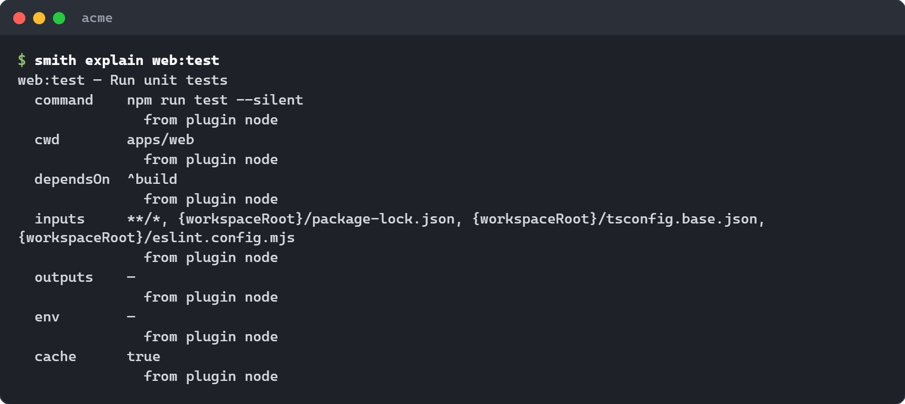
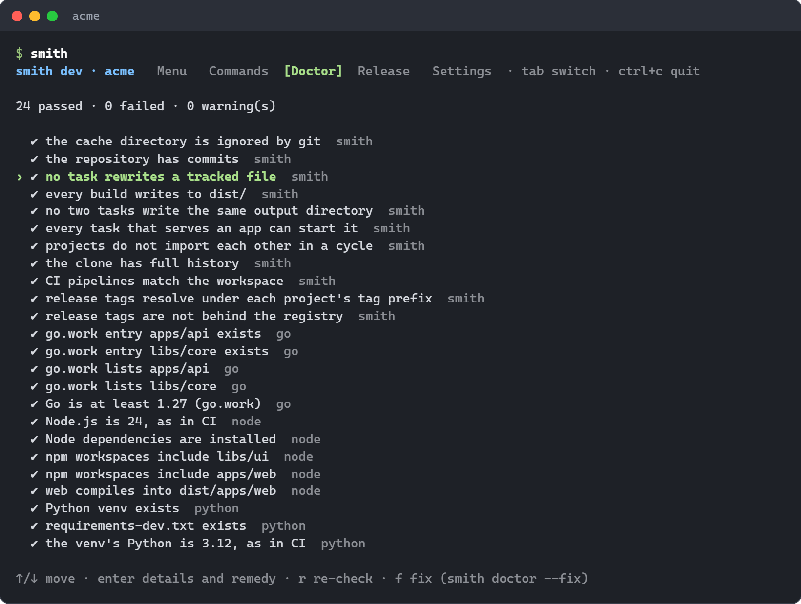
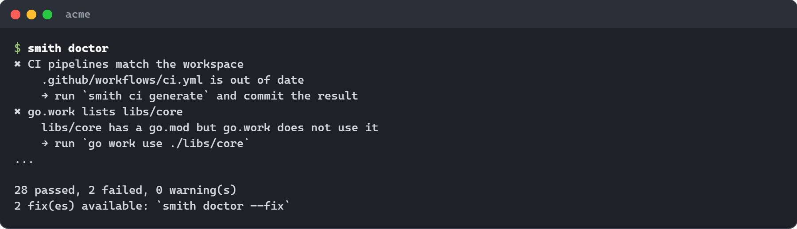
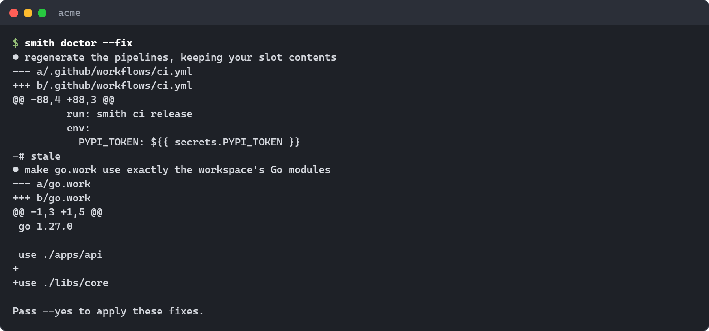
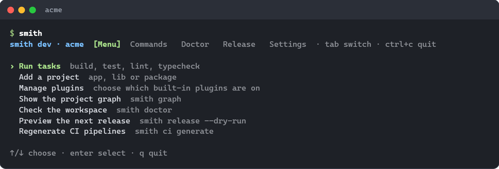
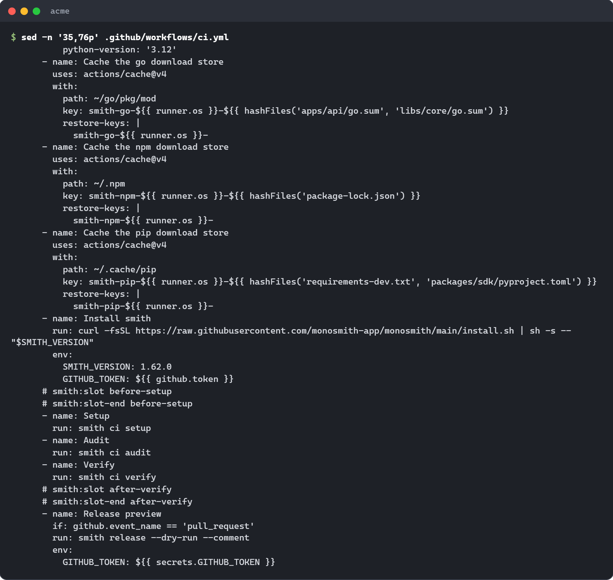
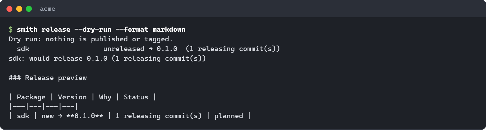

# Getting started

This is a hands-on tour. In about twenty minutes you will install `smith`,
make a workspace with projects in two languages, run tasks and watch the cache
answer, see what a change affects, check the workspace's health, open the
interactive shell, look at the CI pipeline smith wrote for you, and preview a
release.

Every command below was run for real, and every output is copied from that
run. Paths and timings will differ on your machine.

**Words you will meet.** A *workspace* is your repository as smith sees it: a
folder with a `smith.toml` file at the top. A *project* is one folder inside
it that has a manifest (`package.json`, `go.mod`, `pyproject.toml`, and so on).
A *task* is a command smith runs for a project, such as `build` or `test`. The
[glossary](../reference/glossary.md) defines the rest.

## 1. Install smith

The shortest way:

```sh
curl -fsSL https://raw.githubusercontent.com/monosmith-app/monosmith/main/install.sh | sh     # Linux, macOS, Git Bash
irm https://raw.githubusercontent.com/monosmith-app/monosmith/main/install.ps1 | iex           # Windows PowerShell
```

Check it:

```sh
smith --version
```

[Installing](installing.md) lists every other channel (npm, pipx, dotnet tool,
gem, pub, a plain download, `.deb` and `.rpm`), how to upgrade and how to check
a download.

You also need **git**, and the toolchain of each language you use. smith does
not install compilers; it tells you what is missing (see
[`smith doctor`](#6-check-the-workspace) below).

| Language | You need |
|---|---|
| Node | Node 24 with npm |
| Go | Go 1.24 or newer. The workspace's `go.work` records the version (1.27.0 when this tour was run with Go 1.27), and generated CI installs that one |
| Python | Python 3.12 or newer |
| Rust | Rust, with clippy and rustfmt |
| .NET | the .NET 10 SDK |
| Ruby | Ruby 3.2 or newer, with Bundler |
| PHP | PHP 8.2 or newer, with Composer |
| C and C++ | CMake 3.25 or newer, Ninja, a C++ compiler, cppcheck |
| Dart, Flutter | Dart (Flutter carries it) |
| JVM | JDK 21 with Maven; Gradle 9 for Kotlin; the Android SDK for Android |
| Bicep | the Azure CLI with Bicep |

This tour uses Node, Go and Python.

## 2. Start a workspace

### A new one

```sh
smith new acme
cd acme
```

```text
  wrote README.md
  wrote .gitignore
  wrote .gitattributes
  wrote smith.toml
  wrote .github/workflows/ci.yml
  wrote .devcontainer/devcontainer.json
  committed

Created acme. Next:
  cd acme
  smith add app web --lang node
```

smith writes the files, runs `git init` on `main` and makes the first commit.
The `smith.toml` it wrote is mostly comments explaining each setting; the only
live lines are the workspace's name, the npm scope, the Go module prefix, the CI
provider and a default stack for Node.

Options (see [`smith new`](../reference/cli.md#smith-new)):

| Option | Default | Meaning |
|---|---|---|
| `--scope @acme` | `@<name>` | the npm scope for Node packages |
| `--module-prefix github.com/acme/acme` | from the `origin` remote, else `example.com/<name>` | the Go module path prefix |
| `--ci github,azure` | `github` | pipelines to write (`gitlab` also works, though the option's help text does not list it) |
| `--dir .` | `./<name>` | create the workspace in an existing clone |
| `--recipe <path or URL>` | none | the [recipe](../reference/recipes.md) `smith add` builds projects from |

With `--dir .`, files smith does not own are kept, and the first commit holds
only the files smith wrote, so your other changes stay uncommitted. A workspace
made in a folder below the top of an existing repository is left uncommitted;
commit it yourself.

### Or adopt an existing repository

A repository with npm workspaces, Go modules or Python projects but no
`smith.toml` can be adopted. (An Nx workspace is for
[`smith convert`](converting.md).) First ask what adopting would involve; this
changes nothing:

```sh
smith adopt
```

```text
C:\work\old would be workspace "old" (scope @old, CI github) with:
  lib                  node     package  packages/lib
  api                  go       lib      services/api

✔ nothing blocks: smith adopt --init makes it a workspace
```

Then take the steps:

```sh
smith adopt --tags --init
```

```text
  wrote .gitignore
  wrote .gitattributes
  wrote smith.toml
  wrote README.md
  wrote .github/workflows/ci.yml
  wrote .devcontainer/devcontainer.json
  committed: chore: adopt smith
✔ adopted: smith doctor checks the workspace, smith run build builds it
```

When something blocks, the report lists each blocker and warning with the step
that clears it, and `smith adopt` exits non-zero. Blockers include a folder that
is not a git repository, one that is already a smith workspace, and an Nx
workspace (that is `smith convert`'s). Warnings include a root `package.json`
with runtime dependencies (in smith each project declares what it uses) and a
pipeline of yours at a path smith's uses, which `--init` keeps as
`<file>.pre-smith`. When a project's existing release tags are named differently
from the way smith names them (`<project>@<version>`, for example `sdk@0.1.0`;
`<dir>/v<version>` for a Go package), its next release would start from scratch; `--tags` creates the missing tags
locally, on the same commits, and pushing them is yours. Both steps need a clean
git tree. `--init` takes the workspace name from the directory, the npm scope
from the root `package.json` and the CI providers from the ones the repository
already uses, and adds `.smith/` to your `.gitignore`.

## 3. Add projects

A project has a **kind**, which tells smith what to do with it at release time:

| Kind | Lives in | What release does |
|---|---|---|
| `app` | `apps/<name>` | never published; your pipeline deploys it |
| `lib` | `libs/<name>` | never published; other projects import it |
| `package` | `packages/<name>` | published to its registry when it has releasable commits |

Add one of each, in two or three languages:

```sh
smith add app web --lang node
smith add lib core --lang go
smith add package sdk --lang python
smith add lib ui --lang node
smith add app api --lang go
```

Each command installs what the project needs (the first Node project runs
`npm install`, the first Python project makes a `.venv`) and ends by telling you
how to import it and what to try. For the Go library:

```text
Adding lib core (go) in libs/core
go: creating new go.mod: module example.com/acme/libs/core
Wrote 9 file(s):
  .devcontainer/devcontainer.json
  .github/workflows/ci.yml
  go.work
  libs/core/doc.go
  libs/core/go.mod
  libs/core/greeting/doc.go
  libs/core/greeting/greet_use_case.go
  libs/core/greeting/greet_use_case_test.go
  libs/core/greeting/greeting_contract.go
Import it from another Go project as example.com/acme/libs/core/<slice>.
Try: smith test -p core
```

Notice that adding a project also rewrote the CI pipeline and the dev container,
so they always match what is in the repository.

Every project starts with one worked example (`greeting`) laid out as a
*vertical slice*: a folder for one outcome, with files named for the role they
play (`greet.use-case.ts`, `greet_use_case.go`). It passes lint, type-check,
test and build straight away. The [conventions](../reference/conventions.md)
page explains the layout and how to turn the check on or off.

`--lang` picks the language: `node`, `go`, `python`, `rust`, `dotnet`, `ruby`,
`php`, `cpp`, `dart`, `jvm` or `bicep`. When the workspace has only one
language, it is the default. `--stack` picks the set of plugins the project is
built with instead (`smith add app web --stack react`); `smith stacks` lists
them, and [stacks](../reference/stacks.md) explains them. If your team keeps a
[recipe](../reference/recipes.md), `smith add` asks the recipe's questions
instead; `--choice language=python` answers one without asking, which is how
scripts add projects.

List what smith sees:

```sh
smith projects
```

```text
api                  app      go      apps/api
core                 lib      go      libs/core
sdk                  package  python  packages/sdk
ui                   lib      node    libs/ui
web                  app      node    apps/web
```

To take a project out again, `smith remove web --dry-run` shows what would
change, and `smith remove web` asks before deleting. It removes the folder, the
traces the language plugin owns elsewhere (the `go.work` entry, the lockfile
entry), the project's tables in `smith.toml` and its CI. A project another one
imports is refused unless you pass `--force`.

### Use one project from another

Just import it. There is no manifest to edit. Make `web` use `ui`, and `api`
use `core`:

```ts
// apps/web/src/main.ts
import { greet } from '@acme/ui'
```

```go
// apps/api/main.go
import "example.com/acme/libs/core/greeting"
```

npm workspaces, `go.work` and the workspace's Python venv (editable installs)
make every project importable by every other. smith reads the imports to learn
the dependency graph:

```sh
smith graph
```

```text
api  app · go · apps/api
  └─ core
core  lib · go · libs/core
sdk  package · python · packages/sdk
ui  lib · node · libs/ui
web  app · node · apps/web
  └─ ui
```



*`smith graph --format html -o graph.html` writes a page you can share. Arrows
point at what a project depends on; blue is an app, grey a lib, green a
package.*

The other formats are `--format tui` (browse: what a project uses, what uses
it), `json` and `dot`. `--focus web` keeps web and everything connected to it,
`--affected` keeps what a change touches, and `--diff v1.4.0` shows how the
graph changed since a revision. Projects that import each other in a cycle
cannot be ordered: `smith graph` warns with the path (`ui → core → ui`).

## 4. Run tasks and see the cache

```sh
smith build              # every project, in dependency order
smith test               # every project
smith test -p web        # web and what it depends on
smith run lint typecheck test   # several tasks
smith dev web api        # start several apps together; Ctrl+C stops them all
```

Run `smith test` the first time:

```text
api:test ▶ go test ./...
core:test ▶ go test ./...
sdk:test ▶ {workspaceRoot}/.venv/Scripts/python.exe -m pytest -q -p no:cacheprovider
web:test ▶ npm run test --silent
ui:test ▶ npm run test --silent
...
✔ 5/5 tasks succeeded (0 from cache) in 1.409s
```

Each line starts with `project:task`. `▶` shows the command smith started,
`│` is a line the task printed, and `✔` marks success with how long it took.
Tasks run in parallel, in dependency order; a task whose dependency failed is
skipped.

Run it again without changing anything:



*Every task ends `✔ from cache`: smith replayed the stored output and log
instead of running anything. Look at the last line: five tasks, 12 ms, and the
time it saved.*

The cache fingerprints each task (its command, the content of its input files,
the sources of the projects it depends on, the versions of smith, its plugins
and your compiler). The same fingerprint means the same result. Now change a
file in `ui`, and ask why `web:test` would run again, before running it:

```sh
smith why-miss web:test
smith why-miss core:test
```



*`why-miss` names the reason a task is not a cache hit, without running
anything. Here the change to `ui` reaches `web`, which imports it, and leaves
`core` alone.*

If a task misses when you expect a hit, `smith why-miss` is the first thing to
run. [Tasks, cache and affected](../reference/tasks-and-cache.md) covers the
cache key, the remote cache that shares results between machines, and how to
override a task in `smith.toml`. `smith explain web:test` shows how a task
resolved and which plugin or setting each value came from:



*Every value of a task, with where it came from. When you override a setting in
`smith.toml`, that line says so.*

### Only what changed

```sh
smith affected
smith test --affected
```

```text
changes since main
ui
web
```

`smith affected` lists the projects that own a changed file (since the merge
base with `main`, plus what you have not committed) and every project that
depends on them. `--affected` on `smith run`, `smith build` and the like runs
tasks only on those. When smith cannot tell (no base branch, a shallow clone, a
changed `smith.toml` or lockfile) it treats everything as affected: too wide
costs minutes, too narrow reports green for code nothing checked.

For a deployment platform that rebuilds on a push, `smith affected --paths`
prints, for each app, the directories that can change it:

```text
api	apps/api libs/core
web	apps/web libs/ui
```

## 5. Add dependencies

Each project owns its dependencies, so you name the project:

```sh
smith install -w web zod                    # npm install zod --workspace apps/web
smith install -w sdk -D pytest-cov          # the Python dev extra, into .venv
smith install -w api github.com/pkg/errors  # go get, in apps/api
smith uninstall -w web zod
```

`-w` takes a project name or directory and can be repeated. `-D` adds a
development dependency. A bare `smith install` installs everything a fresh clone
needs. `smith install` and `smith uninstall` cover Node, Python, Go, Dart, PHP
and Ruby; for the others use their own tool (`cargo add`, `dotnet add package`)
in the project's folder.

When projects declare the same dependency at different versions, `smith sync`
makes them agree, and `smith sync --check` only reports (use it in CI).
`smith up` lists every dependency with a newer release, grouped as patch, minor
and major:

```sh
smith up            # pick in the terminal (patch and minor start selected)
smith up zod jest   # exactly these, no prompt
smith up --yes      # everything
smith up --check    # report only (the default without a terminal)
```

Each chosen declaration keeps its operator (`^`, `~`, `>=`) and moves to the
latest version, then the workspace is installed again.

## 6. Check the workspace

```sh
smith doctor
```

A healthy workspace prints one line per check:



*The doctor tab of the shell lists every check, with the plugin that owns it on
the right. (`smith doctor` on the command line prints the same list as text.)
The header says `smith dev` because the screenshot was made from a development
build.*

When a check fails, the line says what is wrong and the remedy:



*Failed checks come first, each with a `→` line naming the fix. Here the CI
pipeline is out of date and `go.work` is missing a module.*

`smith doctor --fix` shows each fix it can make as a unified diff, then asks
before applying; with `--yes` it applies without asking, and without a terminal
it only shows:



*Only safe fixes are applied: ones that restore what smith or a plugin owns
without losing anything of yours. A fix that could lose something is shown,
never applied.*

The [troubleshooting guide](troubleshooting.md) lists the checks and what to do
about each.

## 7. The interactive shell

Run `smith` with no arguments, in a terminal:



*The Menu tab asks one question at a time. Everything it does ends as a smith
command printed before it runs, so you can type the same line in a script.*

The shell has a menu bar, the workspace navigator, the main view with tabs, an
inspector for what is selected and a status bar, and it works with the mouse
too. The tabs are also on `Alt+1` to `Alt+8` and in the View menu:

- **Projects** (`Alt+1`): every project with its language, kind, stack or
  recipe and tasks, how many projects it needs (↑) and how many use it (↓), and
  a mark on the ones the current changes affect. Enter or `Ctrl+R` runs the
  selected task; the inspector lists what the project depends on and what
  depends on it, and shows its graph (`smith graph --focus <project>`).
- **Run** (`Alt+2`): the task graph of the command running, each task's state,
  its log, failures first.
- **Doctor** (`Alt+3`): every check, problems first. Enter shows the detail and
  remedy, `r` checks again, `Ctrl+X` applies the safe fixes (`smith doctor --fix`, after you confirm).
- **Release** (`Alt+4`): what the next release would do or why it is blocked.
  `F2` previews it and `F3` releases.
- **Plugins** (`Alt+7`): the built-in and installed plugins, the roles each
  fills, and the projects that use it. `e` turns a built-in language plugin on
  or off (`smith plugin enable|disable <name>`).
- **Deps** (`Alt+8`): the dependencies with a newer release, patch before minor
  before major, with the projects that declare them, and what the one-version
  policy says. `Space` marks a row and `a` marks all; `u` or Enter updates the
  marked ones, or the row under the cursor (`smith deps up <packages>`), and
  `v` brings dependencies that projects declare at different versions to one
  (`smith deps up --align`).
- **Settings** (`Alt+5`): the settings of `smith.toml` with their values and
  what they do. Enter edits one and `u` returns it to its default; a value the
  schema rejects is refused on the spot. The change is made by `smith config
  set`, which keeps the file's comments.
- **Guide** (`Alt+6`): the common tasks, one question at a time.

The keys are the same in every tab: the arrows, `PgUp`, `PgDn`, `Home` and
`End` move, Enter acts on the row, `r` loads the view again, `Tab` moves
between the panes, `Esc` goes back, `Ctrl+P` opens the command palette with
every smith command, and `?` (or `F1`) lists the keys of the tab you are in and
the shortcuts of the menus. Everything fits 80 columns; below that the
navigator becomes a tab and the tab labels lose their padding.

Nothing the shell does happens on its own. Every action ends as a smith
command line, printed in the status bar and the Run tab before it runs; one
that changes the workspace, installs or publishes first shows the line in a
confirmation you answer with `y` or `n`.

![The Settings tab: workspace.name "acme", ci.devcontainer true, ci.providers ["github"], and the others "(default)"](../assets/tui-settings.png)

*Settings you have not set show `(default)`; the line under the list explains
the highlighted one.*

Every tab but Guide appears only inside a workspace. When stdin or
stdout is not a terminal, or `CI` is set, `smith` prints its help instead.

## 8. CI

`smith new` and every `smith add` wrote `.github/workflows/ci.yml`. You never
edit it to add a language or a project; `smith ci generate` rewrites it from
what is in the repository (`smith ci generate --check` only reports drift, and
`smith doctor` fails on it).



*Setup steps for exactly the languages in the workspace, a download-cache step
for each package manager, then one `smith ci <phase>` call per phase. The
`smith:slot` comment pairs are where your own steps go; they survive
regeneration.*

The pipeline only calls `smith`, so CI runs the same commands you run
locally:

| Phase | Does |
|---|---|
| `smith ci setup` | installs every dependency the plugins need |
| `smith ci audit` | checks dependencies for known vulnerabilities |
| `smith ci verify` | lint, typecheck, test and build; only affected projects on a pull request |
| `smith ci pack` | collects what each project packages into `dist/drop` |
| `smith ci release` | versions, publishes and tags every package with releasable commits |

`smith ci check` lists what to set up by hand: the repository secrets and each
private registry's permissions:

```text
To set up by hand before the pipelines run:
  - GitHub: add the repository secrets PYPI_TOKEN (Settings → Secrets and variables → Actions)
```

[CI pipelines](../reference/ci.md) covers Azure Pipelines and GitLab CI, your
own steps, the remote cache and the package download caches.

## 9. A first release

Commit with [Conventional Commits](https://www.conventionalcommits.org):
`feat` bumps the minor version, `fix` the patch, and a breaking change the
major. Then ask what a release would do:

```sh
git commit -m "feat(sdk): add retries"
smith release --dry-run
```



*A preview that changes nothing. The table at the bottom is what the pull
request comment shows (`smith release --dry-run --comment`).*

Only packages release. Libs are released inside the packages that use them, and
apps release only if you give them a release section. The real release runs
from the release branch (`main`) in CI as `smith ci release`; running
`smith release` on your machine asks for confirmation first. A failed release
resumes when you run it again. [Releasing](../reference/releasing.md) covers
registries, tags, binaries and container images.

## 10. Upgrade smith

After installing a newer smith, run it once in the workspace:

```sh
smith upgrade             # migrate smith.toml, regenerate the pipelines, update recipe projects
smith upgrade --dry-run   # show the plan and the change to smith.toml; change nothing
smith upgrade --check     # the same, and fail when something would change (CI)
```

`smith.toml` is migrated to the current schema with its comments and layout
kept. Files smith owns (the pipelines start with "Generated by smith") are
regenerated with your slot contents kept. Files smith wrote once, like
`README.md`, and your own files are never touched.

## Where next

| I want to | Read |
|---|---|
| look up a command or a flag | [CLI reference](../reference/cli.md) |
| change a setting | [Configuration](../reference/configuration.md) |
| understand a word | [Glossary](../reference/glossary.md) |
| fix a problem | [Troubleshooting](troubleshooting.md), [FAQ](faq.md) |
| write a plugin for a language smith lacks | [Writing a plugin](writing-a-plugin.md) |
| know how smith works inside | [Architecture](../design/architecture.md), [plugin system](../design/plugin-system.md), [execution and cache](../design/execution-and-cache.md) |
