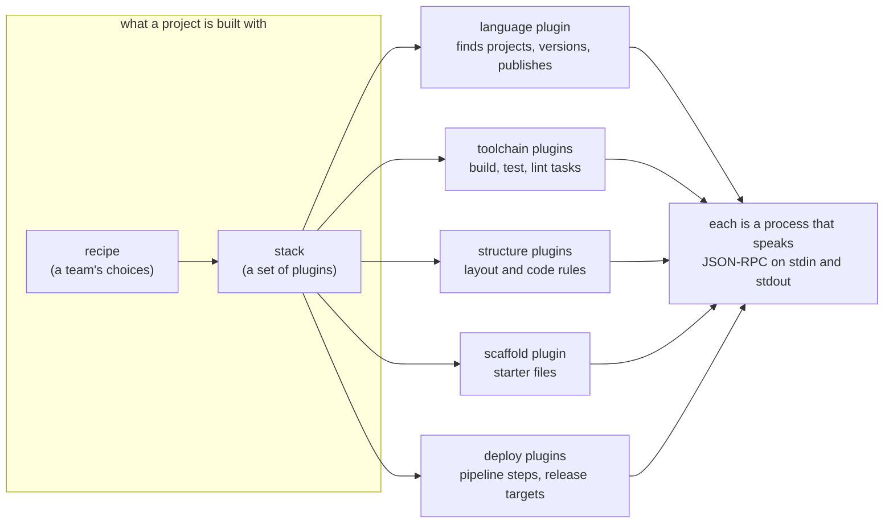

# Plugins: using and creating them

Everything in smith that depends on a language, a tool or a registry is a plugin: finding a
project, the tasks it runs, scaffolding, writing a version, publishing, what CI must install,
what `smith doctor` checks. smith's core knows none of it. This section is the home of all plugin
documentation: what the built-in plugins do for your projects, how to switch, configure and
check plugins, and a complete guide for writing a plugin of each kind.

Two readers, two sections:

| You want to | Go to |
|---|---|
| know what a plugin is, how plugins combine, and how to install, enable or configure one | [Using plugins](using/README.md) |
| see exactly what the `node`, `go`, `docker` or any other built-in plugin does | [The built-in plugin catalogue](using/catalogue/README.md) |
| fix a plugin that does not start or does not answer | [Troubleshooting plugins](using/troubleshooting-plugins.md) |
| write a plugin of your own | [Creating plugins](creating/README.md) and the [quickstart](creating/quickstart.md) |
| look up a protocol method or a message field | [The plugin protocol cheat sheet](creating/protocol-cheat-sheet.md) |

## The pieces in one picture



## What is in this section

```text
docs/plugins/
  README.md                       this page
  using/
    README.md                     index of the using pages
    what-is-a-plugin.md           roles, built-in and external, discovery, how plugins combine
    managing-plugins.md           smith plugin ..., [plugins] in smith.toml, per-plugin settings
    troubleshooting-plugins.md    the real messages and what they mean
    catalogue/                    one page per built-in plugin (24)
  creating/
    README.md                     index of the creating pages
    quickstart.md                 a first plugin in ten minutes
    protocol-cheat-sheet.md       every method and message, generated from the protocol package
    language-plugin.md            one complete guide per plugin type ...
    toolchain-plugin.md
    structure-plugin.md
    scaffold-plugin.md
    deploy-plugin.md
    recipe-and-stack.md           the choice of plugins, written as data
    plugin-sdks.md                Go with the SDK, Node.js and Python by hand
    testing-a-plugin.md
    packaging-a-plugin.md
```

The examples the guides build are real, compiled and run programs in
[`docs/examples/plugins`](../examples/plugins/README.md).

## Related reading

- [Plugins (reference)](../reference/plugins.md): the built-in plugins in one table, and the
  protocol rules.
- [The plugin system](../architecture/plugin-system.md) and
  [the plugin protocol](../architecture/plugin-protocol.md): why plugins are processes and how the
  host drives them.
- [Stacks](../reference/stacks.md), [conventions](../reference/conventions.md) and
  [recipes](../reference/recipes.md): how plugins are chosen for a project.
- [`smith plugin`](../manual/plugin.md): the command.
