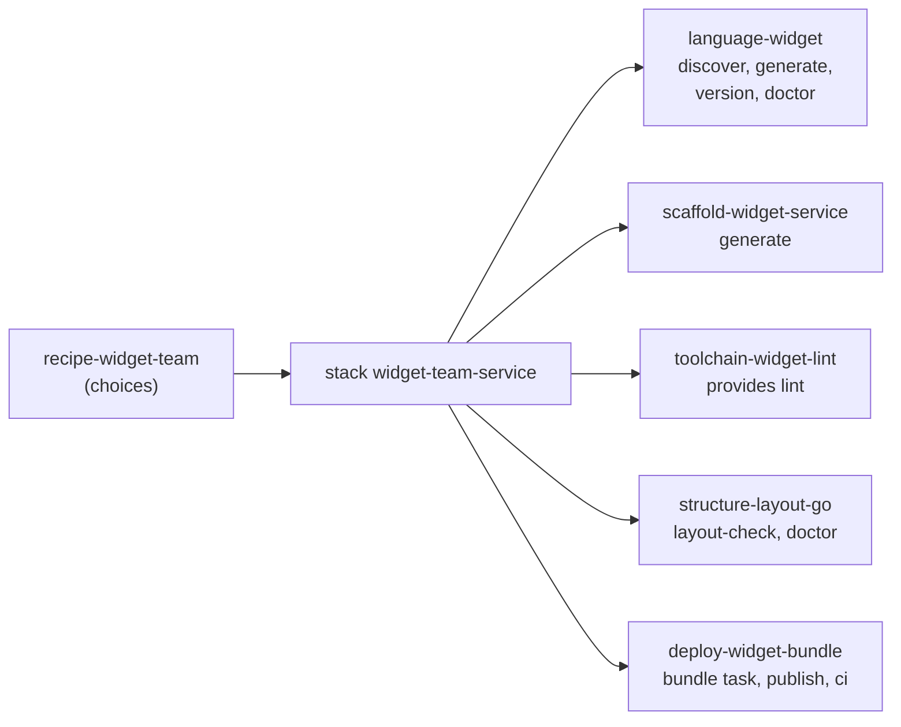

# Creating plugins

These pages are for the person who writes a plugin: what each kind of plugin must implement, a
complete worked example of each, and how to test, package and distribute the result. Every example
is a real program in [`docs/examples/plugins`](../../examples/plugins/README.md): it compiles (or
runs), its tests pass, `smith plugin check` accepts it, and the output pasted in the guides was
produced by running it.

Start with the [quickstart](quickstart.md), then read the guide for the kind of plugin you are
writing.

## Pick the guide

| You want smith to | Write a | Guide | Example |
|---|---|---|---|
| understand a new project type: find it, build its graph, version and publish it | language plugin | [Creating a language plugin](language-plugin.md) | [`language-widget`](../../examples/plugins/language-widget) |
| run a tool for projects of a language smith already knows (a linter, a test runner) | toolchain plugin | [Creating a toolchain plugin](toolchain-plugin.md) | [`toolchain-widget-lint`](../../examples/plugins/toolchain-widget-lint) |
| check or enforce your team's rules on layout and code | structure plugin | [Creating a structure plugin](structure-plugin.md) | [`structure-layout-go`](../../examples/plugins/structure-layout-go) |
| write the starter files of a new project your way | scaffold plugin | [Creating a scaffold plugin](scaffold-plugin.md) | [`scaffold-widget-service`](../../examples/plugins/scaffold-widget-service) |
| ship an app somewhere: pipeline steps, credentials, a release target | deploy plugin | [Creating a deploy plugin](deploy-plugin.md) | [`deploy-widget-bundle`](../../examples/plugins/deploy-widget-bundle) |
| let a team choose and configure plugins per project, with no code | recipe and stack | [Creating a recipe and a stack](recipe-and-stack.md) | [`recipe-widget-team`](../../examples/plugins/recipe-widget-team) |

A **recipe** is not a plugin: it is data that chooses and configures plugins. If a recipe can say
what you want, you do not need to write code.

## The pages

| Page | Read it when |
|---|---|
| [Writing a plugin: quickstart](quickstart.md) | you want a working plugin in ten minutes |
| [The plugin protocol cheat sheet](protocol-cheat-sheet.md) | you need a method, a message or a field, in a table |
| [Creating a language plugin](language-plugin.md) | |
| [Creating a toolchain plugin](toolchain-plugin.md) | |
| [Creating a structure plugin](structure-plugin.md) | |
| [Creating a scaffold plugin](scaffold-plugin.md) | |
| [Creating a deploy plugin](deploy-plugin.md) | |
| [Creating a recipe and a stack](recipe-and-stack.md) | you want your team's choice of plugins as a file |
| [Writing a plugin in Go, Node.js or Python](plugin-sdks.md) | you choose a language: what the Go SDK gives you, and what you write yourself in Node.js and Python |
| [Testing a plugin](testing-a-plugin.md) | `smith plugin check`, unit tests, and a workspace test |
| [Packaging and distributing a plugin](packaging-a-plugin.md) | naming, `plugin.json`, binaries per platform, versions |

## The example family

The guides share one made-up project type so you can see the five kinds of plugin work together.
A **widget** is a directory with a `widget.json`; the plugins below teach smith about it, one level
each:

Each plugin is a Go program on the SDK; the structure plugin is also written without an SDK in
[Node.js](../../examples/plugins/structure-layout-node) and
[Python](../../examples/plugins/structure-layout-python), so the same behaviour can be compared
across all three. There is a Go SDK only: no other language has one.

## See also

- [Using plugins](../using/README.md)
- [The plugin system](../../architecture/plugin-system.md) and
  [the plugin protocol](../../architecture/plugin-protocol.md): the design
- [Plugins (reference)](../../reference/plugins.md)
