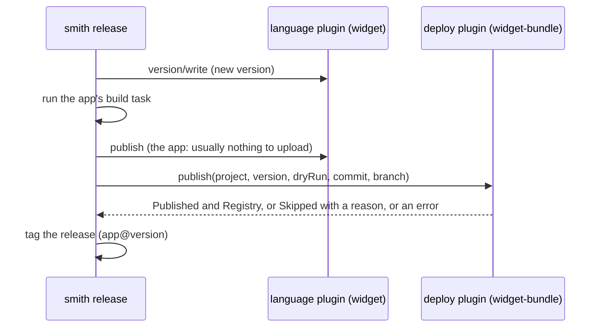

# Creating a deploy plugin

A deploy plugin ships an app: it adds the tasks that package it, publishes or deploys it when the
app is released, and tells the generated pipeline which credentials and permissions that needs.
This guide builds `widget-bundle`, which bundles a widget app and deploys the bundle to a folder
when the app is released. The built-in [`docker`](../using/catalogue/docker.md) plugin (images) and
[`vscode`](../using/catalogue/vscode.md) plugin (extensions) are deploy plugins.

## When to write one

Write a deploy plugin when an app has a release target smith does not know: a cloud service, an
artifact store, a package format. Libraries and packages are published by their *language* plugin
(`publish`); a deploy plugin is for **apps**, and it publishes *in addition* to the language
plugin, which has already published or tagged the app.

## What smith asks of it

| Method | Required | Purpose |
|---|---|---|
| `initialize` | yes | `kind: "convention"`, `roles: ["deploy"]`, `languages` |
| `contribute` | yes, in practice | a task for each app it serves. **Contributing to an app is what makes the plugin its deployer**: an app with no deployer and no `[projects.<name>.release]` section is not released |
| `publish` | to deploy on release | deploy one app at one version |
| `ci` | for the pipeline | credentials, permissions, extra steps, toolchains |
| `doctor` | optional | check the plugin's settings and the machine |
| `generate` | optional | write a new app's deployment files (`docker` writes a `Dockerfile`) |

### The release, from the deploy plugin's side



Facts worth knowing, each of which the example depends on:

- smith runs the app's `build` before it calls `publish`, but **not the tasks the deploy plugin
  added**. If you need a bundle, make it inside `publish` from the build output (the example does);
  the `bundle` task exists for people and for CI verification.
- `publish` is called once per deployer, in order, with `Commit` (the full hash) and `Branch` (the
  release branch) in addition to `Project`, `Version` and `DryRun`.
- A result with `Published: true` is reported as `<plugin> published <version> to <registry>`; a
  `Skipped` reason is reported as `<plugin>: <reason>`; an error stops the release with
  `deploying with <plugin>: <message>`, and re-running resumes where it stopped.
- `Images` (a list of `{reference, tags, digest}`) is for plugins that push container images;
  smith prints them and keeps them in the release report.

## The example

[`docs/examples/plugins/deploy-widget-bundle`](../../examples/plugins/deploy-widget-bundle):

```text
deploy-widget-bundle/
  go.mod
  main.go            serve.Main for smith; the `bundle` command for the task
  plugin.go          Describe, Contribute, Publish, CI, Doctor
  plugin_test.go
  plugin.json
```

### Step 1: describe it

```go
func (b *bundle) Describe(p protocol.InitializeParams) (protocol.InitializeResult, error) {
	b.root = p.WorkspaceRoot
	return protocol.InitializeResult{
		Plugin:    protocol.Peer{Name: pluginName, Version: "0.1.0"},
		Kind:      protocol.KindConvention,
		Roles:     []protocol.Role{protocol.RoleDeploy},
		Languages: []string{"widget"},
	}, nil
}
```

### Step 2: a task per app (`contribute`)

```go
for _, project := range p.Projects {
	if project.Kind != protocol.ProjectApp {
		continue // a lib is not deployed
	}
	out.Projects[project.Name] = protocol.Contribution{Tasks: map[string]protocol.Task{
		"bundle": {
			Command:     []string{exe, "bundle", protocol.BuildDirFromProject(project.Root), protocol.BuildDirFromProject(project.Root) + "-bundle"},
			Inputs:      []string{"widget.json"},
			Outputs:     []string{protocol.BuildDirFromProject(project.Root) + "-bundle"},
			DependsOn:   []string{"build"},
			Cache:       true,
			Description: "bundle the app's build for deployment to " + targetOf(project),
		},
	}}
}
```

Skip the projects you do not serve: an empty contribution does not mark the plugin as a deployer, and
a non-empty one for a library would. Output goes to `dist/` like every build (`dist/apps/shop-bundle`).

```text
$ smith explain shop:bundle
shop:bundle — bundle the app's build for deployment to dist/deploy
  command    <examples>\deploy-widget-bundle\smith-plugin-widget-bundle.exe bundle ../../dist/apps/shop ../../dist/apps/shop-bundle
  cwd        apps/shop
  dependsOn  build (this project's build, first)
  inputs     widget.json
  outputs    ../../dist/apps/shop-bundle
  env        —
  cache      true

Every value above comes from convention widget-bundle, except where marked.
```

### Step 3: settings

```go
// [projects.shop.settings.widget-bundle]
// target = "dist/deploy"
func targetOf(p protocol.Project) string {
	if t, _ := p.Settings[pluginName]["target"].(string); t != "" {
		return t
	}
	return defaultTarget
}
```

An external plugin is configured per project, in `[projects.<name>.settings.<plugin>]`.
`[conventions.<name>]` accepts only `languages`, `exclude` and the docker keys:
`[conventions.widget-bundle] target = ...` is rejected with `unknown field`.

### Step 4: deploy (`publish`)

```go
func (b *bundle) Publish(p protocol.PublishParams) (protocol.PublishResult, error) {
	target := targetOf(p.Project)
	dest := path.Join(target, fmt.Sprintf("%s-%s.txt", p.Project.Name, p.Version))
	if exists(dest) {
		return protocol.PublishResult{Skipped: dest + " is already deployed", Registry: target}, nil
	}
	if p.DryRun {
		return protocol.PublishResult{Skipped: "dry run: would deploy to " + dest, Registry: target}, nil
	}
	built, err := os.ReadFile(buildOutput) // dist/<root>/widget.txt, written by the release's build
	if err != nil {
		return protocol.PublishResult{}, fmt.Errorf("no build output at %s: run smith run build -p %s first", ..., p.Project.Name)
	}
	// write dest from bundleOf(built) ...
	return protocol.PublishResult{Published: true, Registry: target}, nil
}
```

| Rule | Why |
|---|---|
| **idempotent**: skip what is already deployed, with a reason | a release that failed halfway is re-run; the part that worked must not fail the second time |
| **honour `DryRun`**: change nothing and say what you would do | `smith release --dry-run` calls you |
| **errors name the remedy** | the message is shown to the user as the reason the release stopped |
| **use `p.Version`** | smith has already computed it; the build you deploy was made with it |
| set `Registry` to a human name of where it went | it appears in the report |

```text
$ smith release --dry-run
Dry run: nothing is published or tagged.
  api                  unreleased → 0.1.0  (1 releasing commit(s))
  shop                 unreleased → 0.1.0  (1 releasing commit(s))
api: widget-bundle: dry run: would deploy to dist/deploy/api-0.1.0.txt
shop: widget-bundle: dry run: would deploy to dist/deploy/shop-0.1.0.txt

$ smith release --no-push --yes
  api                  unreleased → 0.1.0  (1 releasing commit(s))
  shop                 unreleased → 0.1.0  (1 releasing commit(s))
api: building 0.1.0
api:build ▶ <examples>\language-widget\smith-plugin-widget.exe build ../../dist/apps/api
api:build │ wrote ../../dist/apps/api/widget.txt
api:build ✔ 13ms
api: widget-bundle published 0.1.0 to dist/deploy
api: tagged api@0.1.0
shop: building 0.1.0
...
shop: widget-bundle published 0.1.0 to dist/deploy
shop: tagged shop@0.1.0

  api                  new → 0.1.0  released
  shop                 new → 0.1.0  released
$ cat dist/deploy/*
bundle of api 0.1.0
bundle of shop 0.1.0
```

(`--no-push` keeps the tags local.) The first version of the example read `dist/<root>-bundle`, the
output of the `bundle` task, and the release stopped with `deploying with widget-bundle: no
bundle at ...`: the release had not run that task. Reading the build output, which the release does
produce, fixed it. This is the most common deploy-plugin mistake.

### Step 5: CI (`ci`)

```go
func (b *bundle) CI(p protocol.CIParams) (protocol.CIResult, error) {
	var res protocol.CIResult
	for _, project := range p.Projects {
		if project.Kind == protocol.ProjectApp {
			res.Credentials = []protocol.Credential{{
				Env:         "WIDGET_DEPLOY_TOKEN",
				Description: "token of the widget deploy target (this example's deploy ignores it)",
				Required:    false,
			}}
			break
		}
	}
	return res, nil
}
```

`CIParams.Projects` are the projects the plugin serves. `CIResult` is the plugin's contribution to
every generated pipeline:

| Field | Becomes |
|---|---|
| `Credentials` | environment variables `smith ci release` needs (`Env`, `Description`, `Required`). `Setup: true` also gives it to `smith ci setup`; `Tasks: true` to every step that runs tasks |
| `Permissions` | GitHub Actions token permissions beyond the defaults (`packages: write` for `ghcr.io`) |
| `Toolchains` | a runtime to install, as provider-native steps (`GitHub`, `Azure`) or an `Install` command, plus a dev container feature |
| `Setup`, `Audit`, `PostRelease` | commands run in `smith ci setup`, `smith ci audit`, and at the end of every `smith ci release` |
| `Stores` | package-manager caches, keyed on lockfiles |

```text
$ smith ci generate
wrote .github/workflows/ci.yml
$ sed -n 46,50p .github/workflows/ci.yml
      - name: Release
        if: github.event_name == 'push' && github.ref_name == 'main'
        run: smith ci release
        env:
          WIDGET_DEPLOY_TOKEN: ${{ secrets.WIDGET_DEPLOY_TOKEN }}
```

### Step 6: `doctor`

```text
$ smith doctor
✖ shop deploys inside the workspace
    the deploy target ../elsewhere is outside the workspace
    → set target in [projects.shop.settings.widget-bundle] in smith.toml to a workspace-relative folder
```

## Run and check it

```text
$ smith plugin check ./smith-plugin-widget-bundle
widget-bundle 0.1.0
  ✔ names itself
  ✔ has a known kind
  ✔ plays a known role: deploy
  ✔ a deploy plugin does something
  ✔ contribute answers with no projects
  ✔ ci answers with no projects
  ✔ doctor answers with no projects
  ✔ shuts down when asked
```

`plugin_test.go` also runs the conformance suite and checks that only apps get a bundle task, that
`publish` is idempotent, that a dry run writes nothing, that a missing build output produces the
remedy message, and that `doctor` rejects a target outside the workspace.

## Declare it

```toml
[plugins.external.widget-bundle]
command = ["/path/to/smith-plugin-widget-bundle"]

[conventions.widget-bundle]          # every widget app; or name it in a stack's deploy list

[projects.shop.settings.widget-bundle]
target = "dist/deploy"
```

## Common mistakes

| You see | Cause and remedy |
|---|---|
| `deploying with widget-bundle: no bundle at ...` | `publish` read the output of a task the release does not run. Read the build output, or produce the artifact inside `publish` |
| the app is never released | the plugin did not contribute to it, so it has no deployer. Contribute a task to every app it serves |
| a library gets released as an app | `contribute` returned a contribution for a library. Skip projects that are not yours |
| the second release run fails | `publish` is not idempotent. Return `Skipped` with a reason for what exists |
| `--dry-run` deploys | `DryRun` is ignored |
| the secret is missing in CI | the credential is not in `CIResult.Credentials` (regenerate with `smith ci generate`), or the repository secret is not set |
| `✖ a deploy plugin does something` | none of `contribute`, `generate`, `ci`, `doctor` is implemented |
| `unknown field` for a `[conventions.<name>]` key | per-project settings: `[projects.<name>.settings.<plugin>]` |

## See also

- [The docker plugin](../using/catalogue/docker.md): registries, tags, credentials and a Dockerfile scaffold in one deploy plugin
- [Releasing](../../reference/releasing.md), [CI pipelines](../../reference/ci.md)
- [Creating a structure plugin](structure-plugin.md), [the cheat sheet](protocol-cheat-sheet.md#publishparams)
