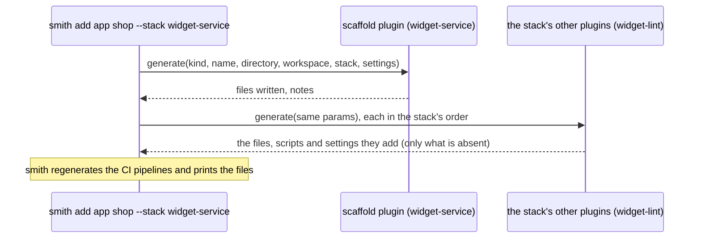

# Creating a scaffold plugin

A scaffold plugin writes the starter files of a new project, your team's way: the layout, the
manifest, a first test, the config files. `smith add app shop --stack widget-service` asks it to
generate the project in place of the language plugin. This guide builds `widget-service`, a scaffold
for widget services that takes its port from a recipe's settings.

## When to write one

Write a scaffold plugin when new projects should start from something other than the language
plugin's default starter, and the starter is more than a recipe can express: files from templates,
values from settings, a layout. A scaffold does not find or run projects; the language plugin does.
If you only need to *choose* among existing scaffolds per project, that is a
[recipe](recipe-and-stack.md).

## What smith asks of it

| Method | Required | Purpose |
|---|---|---|
| `initialize` | yes | `kind: "convention"`, `roles: ["scaffold"]`, `languages`, `requires` the language plugin, and the stacks it publishes |
| `generate` | yes | write the new project's files |

A scaffold must implement `generate` (`a scaffold generates projects`). A project has at most one
scaffold; if a stack names none, the language plugin generates.

### What happens when a project is created



Because the scaffold takes the language plugin's place, it must write the **manifest** too, and
**record `params.stack` in it**, so that `discover` reports the stack back. The other plugins of the
stack then add their parts to what the scaffold wrote.

## The example

[`docs/examples/plugins/scaffold-widget-service`](../../examples/plugins/scaffold-widget-service):

```text
scaffold-widget-service/
  go.mod
  main.go            serve.Main(&scaffold{})
  scaffold.go        Describe, Generate, the templates
  scaffold_test.go
  plugin.json
```

### Step 1: describe it and publish the stack

```go
func (s *scaffold) Describe(p protocol.InitializeParams) (protocol.InitializeResult, error) {
	s.root = p.WorkspaceRoot
	return protocol.InitializeResult{
		Plugin:    protocol.Peer{Name: "widget-service", Version: "0.1.0"},
		Kind:      protocol.KindConvention,
		Roles:     []protocol.Role{protocol.RoleScaffold},
		Languages: []string{"widget"},
		Requires:  []protocol.PluginRef{protocol.RequiresLanguage("widget")},
		Stacks: []protocol.Stack{{
			Name:        "widget-service",
			Description: "a widget service: an app with a port and a handler",
			Language:    "widget",
			Scaffold:    "widget-service",
			Toolchain:   []string{"widget-lint"},
		}},
	}, nil
}
```

The stack gives people a name to use (`--stack widget-service`) and lists the toolchain plugins that
come with it. smith checks the stack against the plugins that are loaded, so `widget-lint` must be
declared in `smith.toml` too.

### Step 2: templates

```go
var templates = map[string]string{
	"[[.Dir]]/widget.json": `{
  "name": "[[.Name]]",
  "version": "0.0.0",
  "kind": "app",
  "description": "The [[.Name]] service of the [[.Workspace]] workspace.",
  "license": "MIT",
  "stack": "[[.Stack]]"
}
`,
	"[[.Dir]]/service.json": `{
  "port": [[.Port]],
  "handler": "src/handler.txt"
}
`,
	"[[.Dir]]/src/handler.txt": "hello from [[.Name]]\n",
	"[[.Dir]]/README.md":       "# [[.Name]]\n\nA widget service on port [[.Port]].\n",
}
```

The SDK's `templating.Write(root, files, data)` renders each template with `[[ ]]` delimiters (so
`{{ }}` in your output stays as it is), including the target paths, creates directories, returns the
written paths in sorted order, and **writes nothing if any target already exists**
(`file already exists`). `missingkey=error` makes a typo in a template an error, not an empty string.
The TypeScript SDK has the same in `writeTemplates(root, files, data)` (the subset of `text/template`
that templates use: fields, `if`, `with`, `range`, `eq ne lt le gt ge not and or len index print printf`,
trim markers) and `scaffoldProject`, which fills the data from the `generate` params. The Python SDK has
the same as `write_templates(root, files, data)` and `scaffold_project(workspace_root, params, files)`, and the C# SDK
as `Templates.Write(root, files, data)` and `Scaffold.Project(workspaceRoot, params, files)`.

### Step 3: `generate`, with settings

```go
func (s *scaffold) Generate(p protocol.GenerateParams) (protocol.GenerateResult, error) {
	if p.Kind != protocol.ProjectApp {
		return protocol.GenerateResult{}, fmt.Errorf("a widget service is an app: smith add app %s --stack %s", p.Name, stackName)
	}
	port, err := portOf(p.Settings)
	if err != nil {
		return protocol.GenerateResult{}, err
	}
	files, err := templating.Write(s.root, templates, map[string]any{
		"Dir": p.Directory, "Name": p.Name, "Stack": p.Stack, "Port": port,
		"Workspace": p.Workspace.Name,
	})
	if err != nil {
		return protocol.GenerateResult{}, err
	}
	return protocol.GenerateResult{Files: files, Notes: []string{fmt.Sprintf("%s listens on port %d: edit %s/service.json", p.Name, port, p.Directory)}}, nil
}
```

| `GenerateParams` | Use |
|---|---|
| `Kind`, `Name` | the project to create; refuse a kind you do not support with a message that says what to run |
| `Directory` | workspace-relative, forward slashes; it does not exist yet |
| `Workspace` | `Name`, the npm `Scope` and the Go `ModulePrefix` of the workspace, for templates |
| `Stack` | **write it into the manifest** |
| `Convention` | true when asked as a workspace convention, not as one of the stack's plugins |
| `Settings` | this plugin's own table from the recipe the project is created from (`settings.widget-service`); `nil` when there are none. Numbers arrive as `float64` |

The result lists every file, workspace-relative; `Notes` are printed after generation. When a project is created from a recipe and creating it fails,
smith puts `smith.toml` back as it was.

## Run and check it

```text
$ smith plugin check ./smith-plugin-widget-service
widget-service 0.1.0
  ✔ names itself
  ✔ has a known kind
  ✔ plays a known role: scaffold
  ✔ a scaffold generates projects
  ✔ requires language plugin widget: a known reference
  ✔ stack widget-service is complete
  ✔ declares a concurrency the protocol defines
  ✔ shuts down when asked
```

**`--generate` and an app-only scaffold.** `smith plugin check --generate` asks every generating
plugin for an app, a lib and a package, and each must succeed. A scaffold that supports only apps
fails the other two, by design of the service:

```text
$ smith plugin check ./smith-plugin-widget-service --generate
...
  ✔ generates an app
  ✖ generates a lib
      a widget service is an app: smith add app clib --stack widget-service
  ✖ generates a package
      a widget service is an app: smith add app cpackage --stack widget-service
smith: the plugin does not conform
```

Run `smith plugin check` without `--generate` for such a plugin, and cover `generate` in a unit
test, as the example does. (The built-in `go-smith-plugin` scaffold is app-only too.)

## Use it in a workspace

```toml
[plugins.external.widget-service]
command = ["/path/to/smith-plugin-widget-service"]
```

```text
$ smith add app api --stack widget-service
Adding app api (stack widget-service) in apps/api
Adding widget-lint
Wrote 5 file(s):
  apps/api/README.md
  apps/api/WIDGET-LINT.md
  apps/api/service.json
  apps/api/src/handler.txt
  apps/api/widget.json
api listens on port 8080: edit apps/api/service.json
Try: smith test -p api
$ cat apps/api/widget.json
{
  "name": "api",
  "version": "0.0.0",
  "kind": "app",
  "description": "The api service of the wd workspace.",
  "license": "MIT",
  "stack": "widget-service"
}
$ smith add lib nope --stack widget-service
Adding lib nope (stack widget-service) in libs/nope
smith: a widget service is an app: smith add app nope --stack widget-service
```

`WIDGET-LINT.md` is the toolchain's `generate` at work. With a recipe, the same scaffold gets its
settings: `[when.kind.service.settings.widget-service] port = 9000` makes `smith add app billing
--choice kind=service` print `billing listens on port 9000`; see
[Creating a recipe and a stack](recipe-and-stack.md).

## Test it

`scaffold_test.go` checks that the files are written with the recipe's port, that the manifest
records the stack (the `discover` of the language plugin relies on it), that a lib is refused with
the message above, and that a port of the wrong type is refused naming the setting:

```text
$ GOWORK=off go test ./...
ok  	example.com/smith-plugin-widget-service	0.489s
```

## Common mistakes

| You see | Cause and remedy |
|---|---|
| `✖ a scaffold generates projects` | the plugin lists `scaffold` in `Roles` but implements no `Generate` |
| the project is created but `smith projects` does not show its stack | the manifest does not record `p.Stack` |
| `file already exists` | `templating.Write` found a target; the scaffold never overwrites. Check whether the language plugin or another plugin wrote it first |
| `<a> and <b> are both chosen as the scaffold; keep one` (from the code) | a stack or recipe names two scaffolds |
| `scaffold x cannot generate projects` (from the code) | a stack names as scaffold a plugin without the `generate` capability |
| `<plugin> applies to [widget], not to node projects` | the stack's language is not in the scaffold's `Languages` |
| a setting is ignored | settings arrive only when the project is created from a recipe whose `settings.<plugin>` names this plugin; check the plugin name |
| `Adding x` is missing for a plugin in the stack | that plugin has no `generate` |

## See also

- [Creating a language plugin](language-plugin.md): a language plugin is its own default scaffold
- [Creating a recipe and a stack](recipe-and-stack.md)
- [The go-smith-plugin scaffold](../using/catalogue/go-smith-plugin.md), [vite](../using/catalogue/vite.md): built-in scaffolds
- [The plugin protocol cheat sheet](protocol-cheat-sheet.md#generateparams), [The TypeScript SDK](typescript-sdk.md) (`scaffoldProject`), [The Python SDK](python-sdk.md#reference) (`scaffold_project`), [The C# SDK](csharp-sdk.md#reference) (`Scaffold.Project`)
