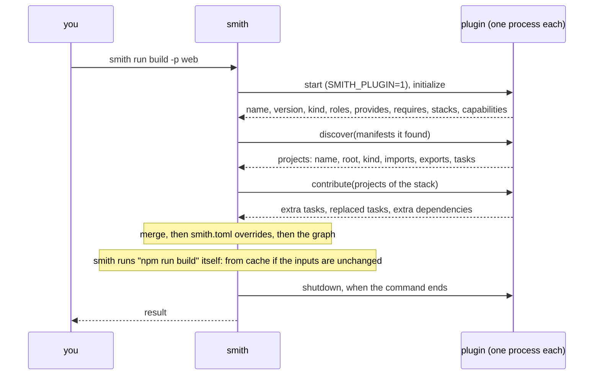
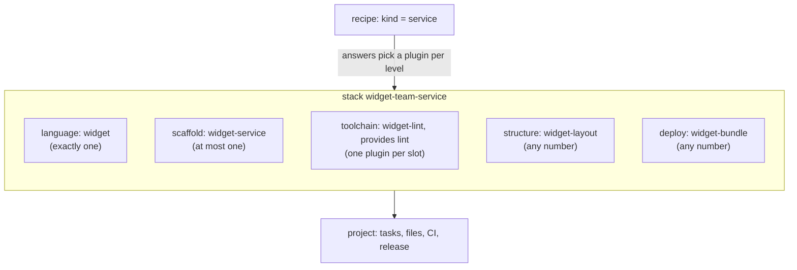

# What a plugin is and how plugins combine

smith's core knows no language. It owns the graph, the cache, the task runner, affected, release
and the generated pipelines, and it asks plugins for everything that depends on a technology. A
plugin is a program that answers questions: "which projects are in these manifests?", "what does
`npm test` look like for this one?", "write the starter files of a new library", "what must CI
install?". This page explains the parts of that model you meet when you use smith. The wire
format is in [the plugin protocol](../../architecture/plugin-protocol.md) and, for authors,
[the cheat sheet](../creating/protocol-cheat-sheet.md).

## A plugin is a process

A plugin is any executable that speaks JSON-RPC 2.0 on its standard input and output. smith starts
the plugins a workspace uses when a command begins, asks them questions, and stops them when the
command ends. The built-in plugins are not special: they ship inside the `smith` binary but run
as child processes (`smith plugin serve <name>`) and speak the same protocol an external plugin does.

A plugin does not run your tasks. It describes them: a task is an argv array with inputs and
outputs, and smith itself runs it, hashes it and caches it.

`initialize` has 30 seconds to answer. Other calls have timeouts too (a minute for `discover`,
`contribute`, `ci` and `doctor`; twenty minutes for `generate`; thirty for `publish`), and a plugin
that does not answer in time is killed (one that can be cancelled is asked to stop first). A plugin is called one
request at a time unless it says it can take more. See [Troubleshooting plugins](troubleshooting-plugins.md).

## The five roles

A plugin declares the roles it can play when it starts. A **role** is a level in a project's
make-up; a project is built from one plugin at some levels and any number at others.

| Role | What it does | A project has | Typical methods |
|---|---|---|---|
| `language` | finds projects from manifests, turns imports into graph edges, writes versions, publishes | exactly one | `discover`, `version/write`, `publish` |
| `toolchain` | decides how a project builds, tests and lints | any number, but one per **slot** (a task name it provides) | `contribute`, `generate` |
| `scaffold` | writes the starter files of a new project | at most one | `generate` |
| `structure` | checks layout and code rules | any number | `contribute`, `doctor` |
| `deploy` | adds pipeline steps and deploy targets | any number | `contribute`, `publish`, `ci` |

The list is `protocol.Roles` in `packages/plugin-sdk/protocol/plugin_role_enum.go`, in the order
`language`, `toolchain`, `scaffold`, `structure`, `deploy`. A plugin that declares no roles gets a
default: a `language` plugin is language, toolchain and scaffold (every built-in language plugin
works on its own and writes its own starter files), any other plugin is `structure`.

A plugin has a **kind** besides its roles: `language` (it understands a language and names the
manifest files that make a directory a project) or `convention` (it adds to projects another
plugin discovered). Toolchains, structure rules, scaffolds and deploy targets are all of kind
`convention`.

### What a plugin can contribute

The roles say where a plugin fits. What it actually does is the set of methods it implements, which
it advertises as **capabilities** in the handshake; smith never calls a method that was not
advertised. Beyond the five roles, the protocol (version 1) has these kinds of contribution:

| Contribution | Method | Capability |
|---|---|---|
| projects, with their tasks, imports and exports | `discover` | `discover` |
| tasks added to, or replaced in, projects another plugin discovered | `contribute` | `contribute` |
| the files of a new project | `generate` | `generate` |
| the release version written into a manifest | `version/write` | `version` |
| publishing a project, or deploying an app | `publish` | `publish` |
| what the registry has of a project | `published` | `published` |
| what a pipeline needs: toolchain setup, caches, audit steps, credentials | `ci` | `ci` |
| health checks, with fixes | `doctor` | `doctor` |
| clean-up after a project is removed | `remove` | `remove` |
| adding and removing packages | `dependencies/install`, `dependencies/uninstall` | `dependencies` |
| listing and rewriting declared dependency specs | `dependencies/declared`, `dependencies/rewrite` | `declarations` |
| newest releases of dependencies and pinned tools | `dependencies/latest` | `latest` |
| ready-made stacks | in the `initialize` answer | always |

The field-level detail of each is in [the cheat sheet](../creating/protocol-cheat-sheet.md).

## Built-in and external plugins

| | Built-in | External |
|---|---|---|
| where it lives | inside the `smith` binary | any executable you provide |
| how it is started | `smith plugin serve <name>` (a child of smith) | its `command` from `smith.toml`, or its `plugin.json` on the search path |
| how many | 12 language plugins and 12 add-ons | as many as you declare |
| switch | `[plugins] enabled` (the language plugins) | declare or remove `[plugins.external.<name>]` |
| trust | none needed: it is the smith binary | you trust it before smith starts it: `smith plugin trust <name>` |
| environment | the whole environment smith runs in | a minimal one, plus the variables it declares and you grant |

The **15 language plugins** are `applescript`, `bicep`, `cpp`, `dart`, `dotnet`, `go`, `jvm`, `lua`, `node`, `php`,
`python`, `recipe`, `ruby`, `rust` and `vba`. They load unless `[plugins] enabled` names fewer.

The **12 add-ons** are the built-in toolchain, structure, scaffold and deploy plugins: `angular`,
`astro`, `docker`, `eslint`, `go-smith-plugin`, `jest`, `playwright`, `typescript`,
`vertical-slices`, `vite`, `vitest` and `vscode`. They are always loaded, so the stacks they
publish are always available, but they act only on projects whose stack names them, or as a
convention you configure with `[conventions.<name>]`. They cannot be enabled or disabled with
`smith plugin`.

Every one has a page in the [catalogue](catalogue/README.md).

An external plugin with the name of a built-in plugin **replaces** it.

An external plugin is a program that runs with your privileges, so smith starts it only after you
have trusted it, and hands it only the environment it needs. Which plugins the workspace needs is what
`smith.toml` declares under `[plugins.external]`; a plugin that is merely installed on the search path
is never started and needs no trust. What smith protects against, and what it does not, is on
[Plugin security](plugin-security.md).

### How smith finds a plugin

For every name it must start, smith resolves a command in this order (`LaunchCommand` in
`apps/smith/pluginhost/find_plugins_use_case.go`):

1. the `command` of `[plugins.external.<name>]` in `smith.toml`;
2. a built-in plugin of that name, unless `smith.toml` has a `[plugins.external.<name>]` entry
   (then the entry replaces it, and without a `command` the plugin must be installed);
3. an installed plugin: a directory `<name>` with a `plugin.json`, found in the first of these
   places that has it:
   1. the workspace's `.smith/plugins`;
   2. each directory of `SMITH_PLUGIN_PATH` (separated like `PATH`: `;` on Windows, `:` elsewhere);
   3. `$SMITH_HOME/plugins`, where `SMITH_HOME` defaults to `~/.smith`.

None of this depends on how smith itself was installed. How to install a plugin into one of these
directories is in [Installing, enabling and configuring plugins](managing-plugins.md).

## Stacks and recipes

A **stack** is a named set of plugins a project is built with: one language plugin, and the
toolchain, structure, scaffold and deploy plugins on top. Each project records its own stack, so
one monorepo can hold a React app built with Vite next to an Azure Function built another way.
Plugins publish ready-made stacks (`node-jest`, `react`, `docs-site`, `vscode-extension`, ...) and
`smith.toml` declares more under `[stacks.<name>]`. `smith stacks` lists them. A project with no
stack is built by its language plugin alone. See [Stacks](../../reference/stacks.md).

A **recipe** is a team's choice of plugins and settings, written as a TOML file with no code. It
asks a few questions and the answers decide which plugin fills each level of a new project. When
`smith add` creates a project from a recipe, the plugins the recipe picked become a stack. See
[Recipes](../../reference/recipes.md) and [Creating a recipe and a stack](../creating/recipe-and-stack.md).

### How a project's tasks are built

1. The language plugin discovers the project and its tasks.
2. The stack's toolchain, structure and deploy plugins contribute, in the stack's order. Each adds
   tasks the project lacks, may **replace** one it has, and may make an existing task depend on one
   of its own.
3. Conventions apply to every project of their languages (`[conventions.<name>]`).
4. `[tasks.<task>]` and `[projects.<name>.tasks.<task>]` overrides in `smith.toml` apply last.

`smith explain <project>:<task>` shows which plugin each field came from, for example
`from plugin widget-layout (stack widget-strict)`.

## How plugins combine and conflict

Each plugin declares, in its handshake, what it needs and what it cannot share a project with.

| Field | Meaning | Example |
|---|---|---|
| `roles` | the levels it can be chosen for | `["toolchain"]` |
| `languages` | the language plugins (by name or `--lang` value) it applies to | `["node"]` |
| `provides` | the slots it fills: task names, one plugin per slot | `["test"]` |
| `requires` | plugins that must also be in the project | `[{"level": "language", "name": "node"}]` |
| `conflicts` | plugins that must not be in the same project | `[{"name": "karma"}]` |

A reference (`requires` and `conflicts` entries) sets at least one of `level`, `name` and `slot`,
and every field it sets must match. For a language plugin, `name` also matches any of its
`--lang` values.

smith checks a project's plugins in one place, whatever chose them (a stack or a recipe). It checks
that there is one language plugin and at most one scaffold; that every plugin plays the level it
is chosen for and applies to the language; that each slot has one plugin; that every requirement
is met and no two plugins conflict. The errors name both sides:

| Rule | Message |
|---|---|
| two plugins fill one slot | `jest and vitest both provide the test task; keep one` |
| a plugin does not apply to the language | `jest applies to [node], not to widget projects` |
| a plugin is listed at a level it does not play | `eslint is listed as structure, but it plays [toolchain]` |
| a plugin is not loaded | `plugin "nope" is not loaded` |
| two scaffolds, or two languages | `<a> and <b> are both chosen as the scaffold; keep one` |
| a plugin is listed twice at one level | `<name> is listed twice as <level>` |
| a requirement is not met | `<name> requires a <reference>, and none is chosen` |
| a conflict | `<a> conflicts with <b> (<reference>); keep one` |

The first three were produced by real runs, and are on the
[troubleshooting page](troubleshooting-plugins.md#stacks-and-conventions); the last four are
the code's messages (`apps/smith/pluginhost/stack_validator.go`).

A stack declared in `smith.toml` that fails these checks is an error as soon as smith loads it. A
stack a plugin publishes is kept with its problem, which is reported when a project uses it.

## See also

- [The built-in plugin catalogue](catalogue/README.md)
- [Plugins (reference)](../../reference/plugins.md): the built-in plugins in one table
- [The plugin system](../../architecture/plugin-system.md): lifecycle and failure modes
- [The plugin protocol](../../architecture/plugin-protocol.md)
