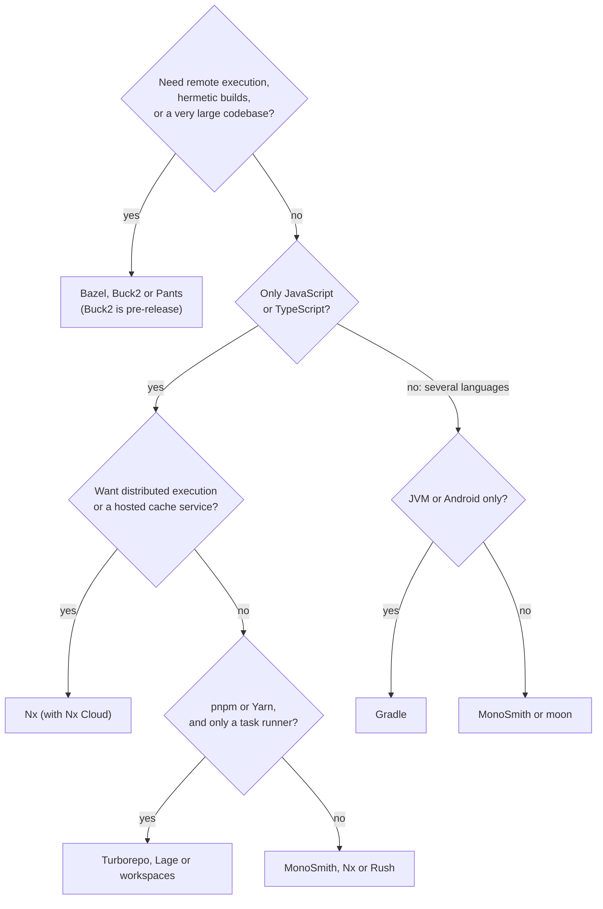

# Choosing a monorepo tool

A decision guide. It starts from your situation, not from the tool, and it says
plainly where something other than MonoSmith (`smith`) is the better choice. The
facts behind it are in [Monorepo tools compared](README.md) and the page on each
tool. The author is the smith project: weigh it accordingly.

## Start here

The chart is a starting point. Read the cases below before you rely on it.

## Choose MonoSmith if...

- Your repository has **two or more of** Node, Python, Go, Rust, .NET, Ruby, PHP,
  C or C++, Dart, the JVM or Bicep, and you want one command, one cache and one
  pipeline for them. A new project in any of them arrives passing lint, tests and
  build, with CI, a dev container and a release target wired
  ([Languages and environments](languages-and-environments.md)).
- You do **not want to write BUILD files or per-language rules**, and you want the
  dependency graph read from `package.json`, `go.mod`, `Cargo.toml`, your
  imports and your shared schemas, with a blast-radius query and a graph diff
  ([The dependency graph](dependency-graph.md)).
- You want to **extend the tool in a language your team already writes**: a plugin
  is any program that speaks JSON-RPC, 24 ship in the binary, SDKs exist for Go and
  TypeScript, and a recipe sets a team standard with no code
  ([Plugins and flexibility](plugins-and-flexibility.md)).
- You **publish packages** to npm, PyPI, crates.io, NuGet, RubyGems, pub.dev, a
  Maven repository or as Go module tags, and want the release derived from
  conventional commits and resumable after a failure.
- You want the **CI pipeline generated** for GitHub Actions, Azure Pipelines or
  GitLab CI and kept in step, with `doctor` failing on drift.
- You are on **Nx or Turborepo and want out**, and your projects are Node, Go or
  Python: `smith convert --dry-run` shows the cost before you commit.
- You want a **single static binary** with no runtime, native on Windows.
- You want **every new project to start in the same shape** (recipes, stacks,
  the `vertical-slices` convention).
- You want **no hosted service** in your build: the remote cache is a bucket or a
  server you run.

## Choose something else if...

| Your situation | Look at | Why |
|---|---|---|
| You need **remote execution** or **hermetic, sandboxed** builds | [Bazel](bazel.md), [Pants](pants.md), [Buck2](buck2.md) (and [Please](please.md), where remote execution is experimental) | smith runs tasks on one machine and shares only results |
| Your codebase is **very large** and needs a build system that models it exactly | [Bazel](bazel.md) | Bazel documents builds with 100k+ source files; smith's unit is the project |
| The repository is **JavaScript or TypeScript only** and you want the largest plugin ecosystem, **distributed task execution** or JetBrains editor support | [Nx](nx.md) | smith has none of these; its editor support is VS Code |
| You are **JavaScript only, on pnpm or Yarn**, and want a small cached script runner | [Turborepo](turborepo.md) or [Lage](lage.md); pnpm 12 documents an experimental task cache of its own ([workspaces](workspaces.md)) | smith's Node plugin runs npm; moving would change your package manager |
| You depend on **Turborepo's environment-variable cache keys** | [Turborepo](turborepo.md) | smith's cache hashes a task's declared `env` table; its reference documents nothing like `globalEnv` or wildcards, and convert reports `env` and `globalEnv` as not supported |
| You want the tool to **install and pin the Node, Bun or Deno version** | [moon](moon.md) | smith does not install compilers; it pins and checks versions and reports what is missing |
| You want a **registry of ready-made third-party plugins**, or plugins in a **sandbox** | [Nx](nx.md) (a plugin registry), [Gradle](gradle.md) (the Plugin Portal), [moon](moon.md) (WASM plugins with a sandboxed file system) | smith has no registry yet, and a trusted plugin runs with your privileges ([plugins page](plugins-and-flexibility.md)) |
| You need a **file-level graph**, or **rules on who may depend on whom** | [Bazel](bazel.md), [Pants](pants.md), [Buck2](buck2.md); [Nx](nx.md) or [moon](moon.md) for boundary rules | smith's graph is per project, and dependency rules are open ([graph page](dependency-graph.md)) |
| Your repository is **one ecosystem with a first-class native tool** and you want its depth | [Gradle](gradle.md) for the JVM, [Cargo](cargo.md) for Rust, [Nx](nx.md) for JavaScript | each is as ready-made as smith inside its own ecosystem ([languages page](languages-and-environments.md)) |
| You use **Bun or Deno** | [moon](moon.md) | smith has no Bun or Deno plugin |
| You publish only **npm packages** and want just versioning | [Lerna](lerna.md) or [Rush](rush.md) | smaller scope; Lerna can derive versions from conventional commits, and Rush has a change-file workflow |
| The repository is **JVM or Android only** | [Gradle](gradle.md) | keep Gradle; smith would only wrap it |
| The repository is **Rust only** | [Cargo workspaces](cargo.md) | Cargo already provides the workspace, the lockfile and inherited dependencies |
| You have **a few packages and a single language** and builds are short | [workspaces](workspaces.md) | a cache, generator and release tool are costs you may not need yet |
| You need a **vendor with a track record** and a support contract | an established tool | smith's repository history starts on 2026-10-15, 17 days before 2026-11-01 and its support is GitHub issues |

## Questions to ask whichever tool you pick

1. **What happens when it cannot tell what changed?** smith runs everything. Ask the
   same of any tool: too wide costs minutes, too narrow reports green for unchecked
   code.
2. **Who runs the cache, and what does it cost?** A hosted cache is convenient; a
   bucket you run keeps the data in your account. Neither is free of effort.
3. **Can you leave?** Check that the tool's files are few and its output is the
   language's own (`package.json`, `go.mod`, `Cargo.toml`). smith's design keeps
   manifests as the source of truth and builds into `dist/`.
4. **Can you see why?** smith has `explain` and `why-miss`. Ask what the tool offers
   when a task re-runs and you do not know why.
5. **Try it on a branch.** `smith adopt --dry-run` and `smith convert --dry-run`
   change nothing, so the evaluation costs a report, not a migration. Other tools
   offer their own onboarding; for Nx it is `nx init`.

## Read next

- [FAQ for evaluators](../faq-for-evaluators.md): cost, lock-in, licence, security,
  support, roadmap.
- [Migration stories](../migration-stories.md).
