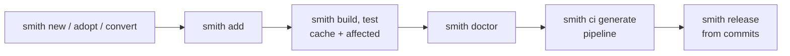

# MonoSmith in five minutes

A tour of what `smith` does, in commands you can run. The commands and the
output shown here were run on 2026-10-25 with smith 1.62.0 in a scratch
directory, on Windows with Go installed. The twenty-minute version, with Node and
Python, is [Getting started](../getting-started/first-workspace.md).



## What to look for

Three things in this tour are worth your attention, because the other tools in the
[comparison](comparison/README.md) make you build them yourself.

- **Step 3: a project that works on day one**, in any of eleven languages, with CI, a dev container and
  a release target already wired. See [Languages and environments](comparison/languages-and-environments.md).
- **The graph in steps 3 and 5**: one graph across languages, with `smith graph --blast-radius` and
  `--diff`. See [The dependency graph](comparison/dependency-graph.md).
- **Step 10: plugins in any language**, with SDKs, a conformance check and a trust gate. See
  [Plugins and flexibility](comparison/plugins-and-flexibility.md).

## 1. Install

```sh
curl -fsSL https://raw.githubusercontent.com/monosmith-app/monosmith/main/install.sh | sh     # Linux, macOS, Git Bash
irm https://raw.githubusercontent.com/monosmith-app/monosmith/main/install.ps1 | iex           # Windows PowerShell
npm install --global monosmith                                                                 # or pipx, dotnet tool, gem, dart pub
smith --version
```

The binary is static; you also need git and the toolchain of each language you
use. smith does not install compilers, and `smith doctor` tells you what is
missing. See [Installing](../getting-started/installing.md).

## 2. Start a workspace: new, adopt or convert

| You have | Run | What happens |
|---|---|---|
| nothing | `smith new acme` | writes `smith.toml`, the CI pipeline, a dev container, runs `git init` and commits |
| a repository with npm workspaces, Go modules or Python projects | `smith adopt --dry-run`, then `smith adopt --init` | the dry run lists the projects smith would see and what blocks; `--init` writes `smith.toml` and the pipelines and commits |
| an Nx or Turborepo workspace, or one made by mnci | `smith convert --dry-run`, then `smith convert` | see [Migration stories](migration-stories.md) |

## 3. Add projects

```sh
cd acme
smith add lib core --lang go            # internal, never published
smith add app api --lang go             # deployed, never published
smith add package sdk --lang python     # published on release
smith add app web --stack react         # a stack: the plugins a project is built with
```

A project has one of three **kinds**, which decides what release does with it:
`app` is deployed, `lib` is imported by others, `package` is published. Each new
project comes with one worked example that already passes lint, type-check, test
and build, and adding it regenerates the CI pipeline.

To use one project from another you import it; there is no manifest to edit.
smith reads the imports to learn the graph (`smith graph`, or
`smith graph --format tui` to browse it). Ask the graph what a change reaches with
`smith graph --blast-radius <project or file>`, and what a branch did to it with
`smith graph --diff main`. Shared schemas (OpenAPI, protobuf, GraphQL, AsyncAPI) link
projects of different languages. See [The dependency graph](comparison/dependency-graph.md).

## 4. Build with a cache

```sh
smith build
smith build
```

```text
core:build ✔ 298ms
api:build ✔ 908ms
✔ 2/2 tasks succeeded (0 from cache) in 980ms

core:build ✔ from cache
api:build ✔ from cache
✔ 2/2 tasks succeeded (2 from cache, 1.206s saved) in 5ms
```

The second run replays the stored output and log. The key behind each result is
a SHA-256 over the command, the content of the input files, the sources of the
projects it depends on, the OS, the versions of smith and its plugins, and the
version of the compiler or runtime. Change a file and ask why a task would run
again:

```sh
smith why-miss api:build
```

To share results between machines, point `[cache] remote` in `smith.toml` at an
HTTP server, S3 or Azure Blob and share the signing key as `SMITH_CACHE_KEY`.
See [The remote cache](../reference/tasks-and-cache.md#remote-cache).

## 5. Run only what changed

```sh
smith affected            # the projects a change since main can reach
smith test --affected     # run tasks on those only
```

`smith affected` includes uncommitted files and every project that depends on a
changed one. In a fresh workspace where the files smith itself just wrote have
changed, everything is affected. That is deliberate: when smith cannot be sure,
it runs more, not less.

## 6. Check the workspace

```sh
smith doctor
```

```text
✔ release tags are not behind the registry
✔ every production dependency has one version across the workspace
✔ go.work lists each project (2 projects)
✔ Go is at least 1.27 (go.work)

19 passed, 0 failed, 0 warning(s)
```

A failing check prints a `→` line with the remedy. `smith doctor --fix` shows each
fix as a diff and applies the safe ones (those that restore what smith or a plugin
owns) after you confirm.

## 7. CI is generated

```sh
smith ci generate          # rewrite the pipelines from what is in the repository
smith ci generate --check  # report drift only; doctor fails on it too
```

The pipeline for GitHub Actions, Azure Pipelines or GitLab CI installs exactly the
toolchains the workspace uses, then calls `smith ci setup`, `audit`, `verify`,
`pack` and `release`. On a pull request `verify` runs only affected projects.
Put your own steps between the `smith:slot` comments and regeneration keeps them.
See [CI pipelines](../reference/ci.md).

## 8. Release from commits

```sh
git commit -m "feat(sdk): add retries"
smith release --dry-run
```

`feat` is a minor bump, `fix` and `perf` a patch, a breaking change a major.
The dry run follows the same code path as the real release and changes nothing;
in a workspace with no releasable commit it says so:

```text
Dry run: nothing is published or tagged.
Nothing to release: no package has a feat: or fix: commit since its last release
```

Packages release in dependency order; tags are `<project>@<version>`. See
[Releasing](../reference/releasing.md).

## 9. The terminal interface and the editor

`smith` with no arguments, in a terminal, opens a shell with tabs for Home,
Projects, Run, Doctor, Deps and Release, driven by keyboard or mouse. It never
acts by itself: every action ends as a smith command line, printed before it
runs. `smith graph --format tui` browses the dependency graph.

The repository also holds a VS Code extension (`apps/vscode`) that shows the
projects, what the changes affect, task results in the Problems panel, health and
the release preview, using the smith your team installed. The Visual Studio
Marketplace lists it (MonoSmith 0.2.0, last updated 2026-10-24, checked through the
Marketplace API on 2026-10-25); Open VSX had no entry on that date. For AI assistants, `smith mcp` serves the workspace over the
Model Context Protocol. See [Editors](../guides/editors.md).

## 10. Plugins, stacks and recipes

- A **plugin** is a program that speaks JSON-RPC over stdin and stdout. The 24 built-in
  plugins (eleven language plugins and one for recipes, and twelve add-ons for toolchains,
  scaffolds, structure rules and deploy targets) ship inside the binary; `smith plugin list`
  shows them. You can write a plugin in any language (SDKs exist for Go and TypeScript) and
  check it with `smith plugin check`. A plugin a repository names does not start until you
  trust it (`smith plugin trust`), and in CI only when its SHA-256 is pinned.
- A **stack** is the set of plugins one project is built with. `smith stacks` lists
  them (React, Vue, Svelte, Angular, an Astro docs site, a VS Code extension,
  Kotlin, Android, Flutter, a smith plugin in Go, and more).
- A **recipe** is a TOML file recording a team's choice of plugins and settings,
  with questions asked when someone runs `smith add`. You do not need one.

See [Plugins](../reference/plugins.md), [Stacks](../reference/stacks.md) and
[Recipes](../reference/recipes.md).

## What to read next

- [The case for MonoSmith](why-monosmith.md), for who it is and is not for.
- [Migration stories](migration-stories.md), if you have Nx or Turborepo today.
- [Monorepo tools compared](comparison/README.md).
