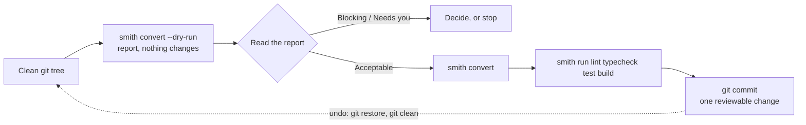

# Migration stories: moving to MonoSmith

`smith convert` turns an Nx workspace, a Turborepo workspace or a workspace made
by mnci (the Nx-based predecessor of smith) into a smith workspace in place.
This page walks through the three cases as scenarios: what you run, what changes,
what is reported to you and what stays your job.

These are descriptions of the tool's documented behaviour, taken from
[Converting](../guides/converting.md) and `smith convert --help` (smith 1.62.0).
They are not customer case studies. No claim is made here about how long a real
conversion takes, or how many projects convert cleanly; that depends on the
workspace, and the report tells you before anything changes.

## What every conversion has in common



- **A clean git tree is required** (or `--allow-dirty`), so the conversion is one
  change you can review and undo.
- **`--dry-run` always comes first.** It prints the report and changes nothing.
  `--json` prints the plan as data.
- **Every finding has a severity:** Blocking (stops the conversion), Needs you
  (convert could not do it and says what to do instead), Not supported yet,
  Behaves differently, and Converted or Dropped.
- **`--strict` refuses to convert** while anything needs you or is unsupported.
- **Projects keep their directories and sources.** What changes is how they are
  described and run.
- **Only Node, Go and Python projects are mapped.** A Dart, .NET, Rust, JVM, PHP,
  Ruby, C++ or Bicep project is reported as "Not supported yet" even though smith
  has a plugin for its language. It keeps its files; bringing it under smith is by
  hand for now.

## Story 1: an Nx workspace

**Starting point.** An Nx workspace, for example one with a few dozen Node
packages, a Go service and a Python library, released with `nx release`.

```sh
npm ci                     # Nx must be installed: it describes the projects
smith convert --dry-run    # the report
smith convert              # applies it
smith ci setup             # toolchains, the Python venv
smith run lint typecheck test build
git add -A && git commit -m "chore: convert to smith"
```

**How it reads the workspace.** Convert asks the workspace's own Nx for its
project graph (`nx graph --file`), so targets that Nx plugins infer
(`@nx/js/typescript`, `@nx/eslint`, `@nx/jest`, `@nx/vite` and others) arrive
fully resolved. It does not re-implement Nx's inference. It is tested with Nx 23;
with another major the report says so.

**What changes.**

| In Nx | In smith |
|---|---|
| a project | a project named after its directory; its language comes from its manifest |
| `projectType: application` | kind `app` |
| a project `nx release` publishes | kind `package`; anything else is a `lib` |
| `nx:run-commands` targets | tasks in `smith.toml` (command, cwd, inputs, outputs, `dependsOn`, cache carried over), or `package.json` scripts for a Node target |
| `@nx/esbuild`, `@nx/js:tsc`, `@nx/jest`, `@nx/vite`, `@nx/eslint` executors | the command each stands for, as a script |
| `{projectName}@{version}` tags and `release.changelog...createRelease: "github"` | the same tags (a `tag_prefix` when a name differs) and `[release] github_releases = true`, so the next release continues from the last tag |
| an Azure Pipelines definition | replaced by the generated one; the agent pool and variable groups are carried over, your own steps are not (they are shown in `git diff`, to put between the `smith:slot` markers) |
| root scripts calling `nx run-many`, `nx affected`, `nx graph` | the `smith` command that does the same |

It then removes `nx.json`, `.nx/`, `project.json` files of converted projects, the
`nx` fields in `package.json` and the `nx`, `@nx/*` and `@nx-go/*` dependencies,
runs `npm install` and checks that `npm ci` accepts the lockfile.

**What is reported, not hidden.** A command that only a shell can run (`&&`,
pipes, `$VAR`) becomes a script in a Node project and is reported elsewhere.
A dependency on a target smith cannot name (a pattern or tag) is reported. ESLint
rules that read the Nx project graph (module boundaries) are removed because they
depend on Nx, and every package's `deps-check` task does the dependency check
instead.

## Story 2: a Turborepo workspace on pnpm

**Starting point.** A Turborepo 2 workspace with `turbo.json`, `pnpm-workspace.yaml`
and `workspace:*` dependencies.

```sh
smith convert --dry-run    # read from the files alone; nothing needs installing first
smith convert              # applies it, then runs npm install
smith i                    # from now on, instead of pnpm install
smith run build test
```

**The decision to know about.** smith's Node plugin runs npm. Convert does not add
pnpm or Yarn: it turns the workspace into the npm workspace `smith i` installs.

| From | To |
|---|---|
| `pnpm-workspace.yaml` packages | the root `package.json` `"workspaces"` list; the YAML file is removed |
| `workspace:*`, `workspace:^`, `workspace:~` | `*`, `^<the package's version>`, `~<the package's version>` |
| `catalog:` ranges | the range from `pnpm-workspace.yaml`'s catalog |
| `pnpm.overrides`, yarn `resolutions` | `overrides`, for a plain package name |
| `dependsOn: ["^build"]`, `outputs`, `inputs`, `cache: false` | `depends_on`, `outputs`, `inputs` and `cache = false` in `smith.toml` |
| root and package scripts calling `turbo run`, `pnpm` or `yarn` | the `smith` or `npm` command that does the same (`turbo run build --filter=web` becomes `smith run build -p web --bail`) |
| `turbo.json`, `.turbo/`, `turbo` and `@turbo/*` | removed |

**What you must review.**

- **Resolved versions are not carried over.** The pnpm and Yarn lockfiles are
  removed and `npm install` resolves every range again, so a dependency can move
  inside its range. The documentation says to review the diff.
- **Not supported:** `env` and `globalEnv` (Turborepo keys its cache on those
  values; smith's task cache does not, so set `cache = false` on the task or list
  the values in its `env` table), `interactive` and `with`, and `remoteCache`
  (smith shares its cache through `[cache] remote`).
- **Behaves differently:** `persistent: true` tasks are left uncached;
  `smith dev` starts several apps together.
- **Needs you:** a build whose outputs are inside the package (smith builds to
  `dist/<project dir>` and `smith doctor` fails otherwise), `//#task` root tasks,
  `--filter` by graph or path, workflows and Dockerfiles that call `pnpm`, `yarn`
  or `turbo`, and `.changeset/`.

If your team cannot move off pnpm or Yarn, this migration is not for you; see
[Who it is not for](why-monosmith.md#who-it-is-not-for).

## Story 3: a workspace made by mnci

**Starting point.** A workspace made by mnci 4.x, with Nx underneath and an `mnci`
block in `nx.json`.

Convert follows the Nx path above and adds:

- the workspace name, scope and CI providers from the `mnci` block of `nx.json`
- Go libraries (`type:go-lib`) as packages, keeping their `<dir>/vX.Y.Z` tags
- releasable Go apps (`release:go`) as apps with `[projects.<name>.release]`; the
  release builds their per-platform zips under the same names
- the targets mnci generated for Nx release (`package-all`, `build-all`,
  `nx-release-publish`) removed, because smith does that itself
- pipeline slots kept (`after-install` becomes `before-setup`, `before-release`
  becomes `after-verify`); steps in a slot with no equivalent are reported
- `package` targets kept as `package` tasks, which `smith ci pack` runs into
  `dist/drop`

**One behaviour change is announced in the report:** before smith 1.0, a `feat:`
released a minor version where the old mnci released a patch.

## Going further: `--level full`

A plain `smith convert` is conservative: it keeps what works and lists the rest
under "things to check". With `--level full`, smith becomes the only tool. It works
out which old files and `devDependencies` nothing uses any more (the shared ESLint
config, a Rollup or SWC build nothing calls, the test runner you did not choose,
Nx and mnci leftovers) and deletes them after asking, one group at a time, with
each group shown as diffs first.

```sh
smith convert --level full --dry-run     # the whole plan, as diffs; nothing changes
smith convert --level full               # in a terminal: asks, then converts
```

A file or package is removed only when nothing that stays imports or runs it, and
when smith cannot be sure it keeps. Afterwards the workspace is built, tested and
linted and `smith doctor` runs, and the step that fails is named. The full level
is for Node workspaces only so far, and needs a clean git tree because
`git restore --staged --worktree . && git clean -fd` is the way back.

## From other tools

There is no automated import from Bazel, Pants, Lerna, Rush, moon, Gradle or any
other tool. A repository with npm workspaces, Go modules or Python projects can be
adopted: `smith adopt --dry-run` reports the projects smith would see, the
blockers and the step that clears each, and `smith adopt --init` takes the steps.
For the tool-by-tool picture, see the
[comparison pages](comparison/README.md#how-to-move-between-tools).
