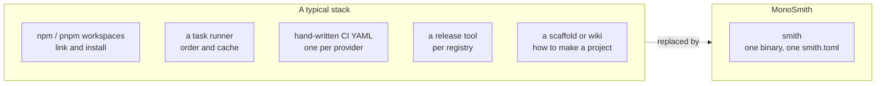

# The case for MonoSmith

**One tool runs a monorepo that holds eleven languages. A new project in any of them lints, tests
and builds on its first run. One dependency graph, read from the files you already have, orders the
work and shows what a change reaches. Plugins in any language extend the tool.** CI, a dev container
and releases come from the same model, so they cannot drift from it.

A monorepo is easy to start and expensive to keep. This page lists what goes
wrong in a repository that holds several languages and several teams, what
MonoSmith (`smith`) does about each problem, and who it is not for. Each claim
links to the page that backs it.

## Three things that set smith apart, with the proof

| | What you get | What the others make you do | Proof |
|---|---|---|---|
| **Ready-made environments for eleven languages** | `smith add lib engine --lang rust` writes a crate that already passes Clippy, tests and build, adds the Cargo workspace, regenerates CI with the Rust toolchain and its cache, and updates the dev container. The same for Node, Python, Go, .NET, Ruby, PHP, C and C++, Dart, the JVM and Bicep | write BUILD files and rule sets (Bazel, Buck2, Please), generate them for existing code (Pants), install a plugin per ecosystem (Nx), or keep the other languages mostly outside the tool (Turborepo, Lerna, Rush, Lage) | [Languages and environments](comparison/languages-and-environments.md): 14 of 14 tests and 10 of 10 builds passing across eleven languages in one scratch workspace |
| **One dependency graph for every language** | a graph of projects from `package.json`, `go.mod`, `Cargo.toml`, `*.csproj` and the imports in your sources, plus shared schemas; `smith graph --blast-radius <file>` and `--diff main` | declare every dependency in a build file (Bazel, Buck2, Please), see only the JavaScript packages (Turborepo, Lerna, Rush), or install a plugin per language (Nx) | [The dependency graph](comparison/dependency-graph.md): a change to a Go-owned OpenAPI file reaches a Python package, a Node app and a .NET library, found with no BUILD file |
| **Plugins and flexibility, in any language** | a plugin is any program that speaks JSON-RPC on stdin and stdout; 24 ship in the binary and use the same protocol; SDKs for Go and TypeScript; `smith plugin check`; stacks and recipes for team standards with no code; a trust gate and SHA-256 pins for plugins a repository names | write rules in Starlark (Bazel, Buck2), an npm package (Nx, Rush), Python (Pants), a JVM plugin (Gradle), or WASM (moon) | [Plugins and flexibility](comparison/plugins-and-flexibility.md): a 102-line Python plugin with no SDK passes the conformance check |

## The problem: one repository, five tools

A repository with a TypeScript front end, a Go service and a Python library
usually ends up with a separate tool for each job.



Each tool has its own configuration, its own idea of what a project is, and its
own way to go stale. The cost shows up as slow CI, a pipeline nobody dares to
touch, a release that publishes to two registries and fails on the third, and
a new project that is made differently every time.

## What smith does about each problem

| Problem | What smith does | Where it is documented |
|---|---|---|
| **Every language has its own tool**, and none of them know about the others | One command, `smith`, for Node, Python, Go, Rust, .NET, Ruby, PHP, C and C++, Dart and Flutter, the JVM (Java, Kotlin, Android) and Bicep. Each language is a plugin; a language smith lacks is a plugin you write, in any language | [Plugins](../reference/plugins.md), [Writing a plugin](../guides/writing-a-plugin.md) |
| **Configuration to write before anything works** | Projects, their tasks and their dependencies come from the manifests (`package.json`, `go.mod`, `Cargo.toml`, `*.csproj`, ...) and from what the sources import. `smith.toml` names the workspace; every other setting has a default | [FAQ](../guides/faq.md#what-do-i-have-to-write-to-make-smith-work), [Configuration](../reference/configuration.md) |
| **CI re-runs everything on every change** | `--affected` runs only the projects a change can reach. When smith cannot be sure (no base branch, a shallow clone, a changed lockfile or `smith.toml`) it runs everything, on the grounds that too wide costs minutes and too narrow reports green for unchecked code | [Tasks, cache and affected](../reference/tasks-and-cache.md#affected) |
| **The same work is done on every laptop and every CI run** | A task whose inputs did not change replays its output and log from a content-addressed cache. The cache can be shared through an HTTP server, S3 or Azure Blob; every object is signed with HMAC-SHA256 and a failed check is a miss, so a remote cache can slow a run but not make it wrong | [The cache](../reference/tasks-and-cache.md#cache) |
| **Nobody knows why a task re-ran** | `smith why-miss api:build` names the changed files, command, environment variable names, upstream projects and tool versions behind a miss, without running anything | [The cache](../reference/tasks-and-cache.md#cache) |
| **CI pipelines drift from the repository** | The pipeline is generated for GitHub Actions, Azure Pipelines or GitLab CI from the plugins in use. Each step calls `smith ci <phase>`, so CI runs what you run locally. `smith doctor` fails when the committed pipeline is out of date. Your own steps survive regeneration between `smith:slot` markers | [CI pipelines](../reference/ci.md) |
| **Releases are manual and different per registry** | Versions come from conventional commits (`feat` minor, `fix` patch, breaking major). Packages release in dependency order to npm, PyPI, crates.io, NuGet, RubyGems, pub.dev, a Maven repository or as Go module tags. A failed release resumes when run again, because a version a registry already has is skipped. `smith release --dry-run` shows the plan | [Releasing](../reference/releasing.md) |
| **Supply-chain questions from security reviews** | Every app released to GitHub Releases gets a CycloneDX SBOM and SHA-256 checksums; on GitHub Actions the generated workflow attests the release files with SLSA build provenance. This is partial: only npm and Go apps get an SBOM today, and Azure Pipelines and GitLab CI produce no provenance | [Releasing: SBOM and build provenance](../reference/releasing.md#sbom-and-build-provenance) |
| **Dependency versions drift between projects** | `smith sync` makes projects declare a shared dependency at the same version (`--check` reports for CI); `smith up` lists newer releases; `smith doctor` checks the one-version policy | [Getting started, dependencies](../getting-started/first-workspace.md#5-add-dependencies) |
| **New projects are made differently each time** | `smith add` scaffolds a project that passes lint, type-check, test and build at once. A recipe records a team's choice of plugins and asks the questions when someone adds a project. The `vertical-slices` convention checks that code is laid out by what it does, in each language's own naming style | [Recipes](../reference/recipes.md), [Conventions](../reference/conventions.md) |
| **Setup breaks and nobody can say what is wrong** | `smith doctor` checks the workspace; each failing check names its remedy. `smith doctor --fix` shows the fix as a diff and applies the safe ones | [Getting started, doctor](../getting-started/first-workspace.md#6-check-the-workspace) |
| **Editors and assistants need a stable interface** | `--json` output for the main commands, a JSON Schema for `smith.toml` (`smith schema`), `smith serve` (JSON-RPC over stdio) for editor plugins, `smith mcp` for AI assistants, a terminal interface (`smith` with no arguments) and a VS Code extension in the repository | [Editors](../guides/editors.md) |

## Four things that set smith apart

1. **One tool for the whole chain.** Build, test, CI, release and health check
   share one model of the workspace. Adding or removing a project regenerates the
   pipeline, and `doctor` notices when it is out of date.
2. **Language-neutral by construction.** smith's core knows no language. Built-in
   plugins are separate processes that speak a versioned JSON-RPC protocol, the
   same one an external plugin uses, so the languages beyond JavaScript are not an
   afterthought ([Plugin system](../architecture/plugin-system.md)).
3. **Low-friction start.** `smith adopt --dry-run` reports what bringing an
   existing repository under smith involves and changes nothing.
   `smith convert --dry-run` does the same for an Nx or Turborepo workspace.
4. **Nothing hidden.** The terminal interface prints the smith command behind
   every action before it runs. `smith explain` shows where each task setting
   came from. Output goes to `dist/` and `smith doctor` fails a task that writes
   elsewhere.

## Who it is for

- A team with **more than one language** in one repository (for example a
  TypeScript front end, a Go or Python service, a shared library) that wants one
  command, one cache and one pipeline.
- A team that **publishes packages** to one or more registries and wants the
  release derived from commits, not run by hand.
- A team **leaving Nx or Turborepo** that wants a tool which converts the
  workspace and reports what it could not map ([Migration stories](migration-stories.md)).
- A platform or developer-experience owner who wants **every new project to
  start in the same shape** (recipes, conventions).
- Teams that want a **single static binary** with no runtime to install first.
  smith is written in Go and ships for Linux, macOS and Windows on x64 and arm64.

## Who it is not for

Say these before you spend a day evaluating.

- **You need remote execution or hermetic builds.** smith runs tasks on one
  machine and shares results only
  ([Execution and cache](../architecture/execution-and-cache.md)). Bazel, Buck2 and
  Pants support remote execution (Please offers it as an experimental feature); see the
  [comparison](comparison/README.md).
- **You need a sandbox.** smith trusts a task's declared inputs and does not run it
  in a sandbox, which is what lets it run `npm`, `dotnet` and `cargo` unmodified.
  The design notes state the price: wrong `inputs` give wrong cache hits.
- **Your repository is large enough to need a build graph at the level of
  individual source files.** smith's unit is the project, not the file.
- **You rely on pnpm or Yarn.** The Node plugin runs npm. Converting a
  Turborepo workspace turns pnpm or Yarn workspaces into npm workspaces and does
  not carry the resolved versions across ([Migration stories](migration-stories.md)).
- **You rely on Turborepo's environment-variable cache keys.** smith's cache key
  covers a task's declared `env` table, not the variables a `turbo.json` lists in
  `env` or `globalEnv`; convert reports those as not supported.
- **You need the vendor support and track record of an established product.**
  smith is ten days of git history old at the time of writing and has one main
  contributor. See the [evaluator FAQ](faq-for-evaluators.md).
- **Your language is not covered** and you do not want to write a plugin. The
  eleven languages are built in; anything else is a plugin you write or find.
  There is no plugin registry yet ([Decisions, open questions](../architecture/decisions/README.md)).

## Try it without committing

Nothing in the first two steps changes your repository.

```sh
smith adopt --dry-run     # a repository with no monorepo tool: what adopting involves
smith convert --dry-run   # an Nx or Turborepo workspace: the full conversion report
```

Continue with [MonoSmith in five minutes](how-it-works-in-five-minutes.md).
